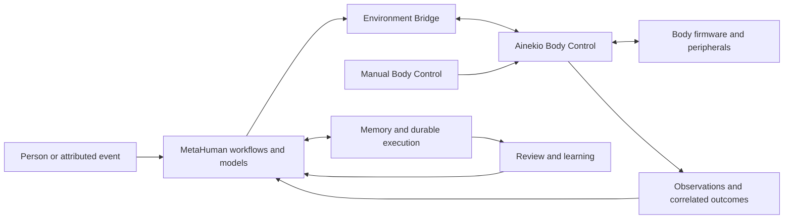

# Ainekio robot design core

This is the shared starting point for work on the physical robot, the Ainekio
repository, and MetaHuman. It explains the companion as a whole and directs a
task to its existing owners. Read this overview, then only the detail relevant
to the task. This document is a product and engineering reference, not a runtime
prompt or an instruction to operate the robot.

## Purpose

**Ainekio is a quadruped companion, friend, familiar and assistant who can see,
hear, process experience, respond and learn.** Its identity and relationships
persist across interactions. It should converse, perceive, move and express
itself, explore, play, pursue goals, remember experiences and improve through
reviewed learning.

The owner's acceptance criterion is: “When I say the robot isn't functioning it
means I turn it on and it doesn't act like a companion.” Successful individual
nodes, model calls, services or firmware commands support that outcome; they do
not establish it.

The active development scope is **V2: twelve servos, ESP32-P4 and PCA9685 servo
output**. V1 work is paused; its separate eight-servo ESP32-S3 implementation
is retained. The selected body's identity, advertised capabilities and installed
calibration determine what can actually be requested. A session name or an old hardware inventory is
insufficient evidence. See [Ainekio's model boundaries](../../../Ainekio/docs/ROBOT_MODELS.md).

## Design priorities

- Models interpret requests and evidence, select relevant context, choose behavior
  and assess outcomes. Code exposes capabilities, executes selections and preserves
  accurate attribution and results.
- Model-backed functions use visible, editable node workflows. Model roles describe
  inference responsibilities; concrete deployments and adapters are configuration.
- Speech, sensing, movement and independent work can overlap where the body and
  providers support it. Requested ordering and actual data dependencies remain
  meaningful; a reply about an action needs that action's evidence.
- **Full Auto continuously chooses and carries out meaningful self-directed
  activity while enabled.** It can muse, reason, pursue tasks, trigger agents,
  move, or run the Sleep workflow. Doing nothing, returning no operation,
  repeatedly assessing without activity, and waiting for an external event to
  resume are not valid Full Auto behavior. The model chooses the activity;
  selected work progresses independently of subsequent assessments. See the
  [Full Auto contract](COMPANION_BEHAVIOR.md#full-auto-continuity--owner-contract).
- Conversation can be valuable without creating a physical task or a durable goal.
- Persona, recent buffers, persistent memories and learned parameters have distinct
  roles. Relevant selected context retains speaker, source, time and uncertainty;
  imagined material does not become an observed event.
- Each responsibility has one implementation owner. Repairs correct that owner and
  affected consumers, including removal of superseded paths. Repository instructions
  govern changes to prompts, contracts, runtime restrictions and physical behavior.
- Responsiveness and useful learning require measured outcomes. Local Body Control,
  Q6A and remote compute placement depend on actual capacity and latency. The owner
  can inspect and steer the system through its existing interfaces and diagnostics.

## Reading the design without changing its meaning

| Question | Authority |
| --- | --- |
| What should the companion do? | This core and the linked capability contracts |
| Which component owns that function? | The software architecture and Maintained Surface |
| What is selected or running now? | The actual graph, model-role settings, service state and connected body's advertised capabilities |
| What has been demonstrated? | Qualification evidence identifying its date, source/build, model, body and observed result |

An old model assignment, successful deployment or failed experiment does not
change the intended design or establish the present installation state. Repair
work states the expected observable behavior, traces the existing owner and
handoffs, and reports what was actually demonstrated. It does not infer a new
product design from whichever implementation happens to exist.

Full Auto's meaningful activity requirement and its approved assessment cadence
are separate concerns. The [autonomy contract](COMPANION_BEHAVIOR.md#full-auto-continuity--owner-contract)
records both and the unresolved resource-use question. Repeated inference or
feed messages alone do not prove that the companion is acting or progressing.

## System map

For the software wiring, start with [Robot software architecture](SYSTEM_ARCHITECTURE.md):
process/host diagram, interfaces, command and observation paths, source owners,
state lifetimes and implemented versus intended distribution. The diagram below
summarizes the product's information flow.

This shows information flow, not a fixed schedule or host arrangement. An
interaction or autonomous experience should reach the appropriate output, remain
available with its attribution, and inform later decisions or reviewed learning.
Connection switching alone does not migrate a durable goal between installations.

| Responsibility | Implementation owner and authoritative detail |
| --- | --- |
| Physical body, dimensions, hardware, wiring and body connections | Ainekio [V1 specifications](../../../Ainekio/docs/v1-8servo/SPECIFICATIONS.md) and [V2 specifications](../../../Ainekio/docs/v2-12servo/SPECIFICATIONS.md), linked to their firmware, geometry and calibration owners |
| Selected robot, body transport, advertised capabilities, semantic translation and manual control | Ainekio [Body Control gateway](../../../Ainekio/Master/gateway/README.md) and [protocol](../../../Ainekio/Slave/software/protocol/README.md) |
| Transport between Body Control and MetaHuman | MetaHuman [Environment Bridge](../../brain/agents/environment-bridge/); it carries observations, actions and results |
| Work admission, durable execution, cancellation, storage, model transport and result delivery | Core owners in [Maintained Surface](../technical/MAINTAINED_SURFACE.md#critical-runtime-ownership-boundaries) |
| Context selection, planning, conversation, autonomy and review | [Cognitive graphs](../../etc/cognitive-graphs/README.md), registered nodes and [model roles](../../packages/core/src/model-roles.ts) |
| Finite agents, triggers and service registration | [Agent Catalog](../../packages/core/src/agent-catalog-definitions.ts) and the configured lifecycle owners |
| Identity, memory and learning | Existing Core persistence/training owners and Brain workers; [behavior](COMPANION_BEHAVIOR.md) and [learning contract](MODELS_AND_LEARNING.md) explain their distinct purposes |

## Find the affected capability

| Work concerns | Read next | Evidence to follow across owners |
| --- | --- | --- |
| Listening, speech, movement, camera, recognition, tracking, display or body events | [Body capabilities](BODY_CAPABILITIES.md) | Actual advertised capability → selected request → body result or observation → its MetaHuman consumer |
| Conversation, memory, persona or inner activity | [Companion behavior](COMPANION_BEHAVIOR.md#memory-persona-and-inner-dialogue) | Attributed input → selected context → delivered output → saved record → later retrieval and use |
| Modes, wake/sleep, goals, desires or self-directed activity | [Companion behavior](COMPANION_BEHAVIOR.md) | Trigger or intention → existing lifecycle owner → selected work → outcomes → subsequent decision |
| Agent responsibilities, deployment, queue/execution distinctions or operator interfaces | [System architecture](SYSTEM_ARCHITECTURE.md) | Entrypoint → responsible owner → handoff → result/status projection |
| Model categories, providers, curation, training or learned personality | [Models and learning](MODELS_AND_LEARNING.md) | Original input/output and attributed outcome → review → dataset → evaluated artifact → authorized activation → behavior |
| Testing an integrated function or reporting progress | [Qualification](QUALIFICATION.md) | Intended observable result → existing test entry points → explicit software/model/physical evidence |

These detail pages retain the existing companion contracts. They are not lists
of currently running services. Use executable catalogs, graph registrations,
advertised capabilities and configuration for changing inventories rather than
copying them into another document.

## Working on the robot

The core and capability contracts define intended behavior. The architecture maps
that behavior to implementation owners; source shows what is implemented; tests
and observations show what has been demonstrated. These are different kinds of
evidence. A defect in code does not redefine the design, and a design statement
does not prove that a capability works.

Use [Ainekio's authority map](../../../Ainekio/docs/README.md) for body/protocol
specifications and approved amendments. The selected model's specifications own
installed hardware facts. Local agent instructions establish permissions; the
shared [repair method](../technical/REFACTOR_BLUEPRINT.md) applies
across the repositories and remains readable without private agent files.

For each change:

1. Read this core and the architecture, then the affected capability contract.
   State the expected behavior, existing owner and why the repair belongs there.
2. Trace the input, identities, state transitions and result through its consumers,
   including the other repository when an interface crosses it. Identify an
   interacting capability that must continue working.
3. Repair that owner and its consumers. Remove the superseded path and update the
   contract where it lives. A proposed new responsibility needs an explicit design
   decision; a second implementation of an existing responsibility is duplication.
4. Run the relevant owner and handoff checks from [qualification](QUALIFICATION.md),
   then review the complete change for preserved behavior and actual removals.
   Report any boundary that remains unverified.

[Maintenance walkthroughs](QUALIFICATION.md#maintenance-walkthroughs) apply this
method to movement, speech concurrency, reconnect and retained state. They provide
starting paths and executable checks, not a fixed inventory of every function.

## Keeping the reference coherent

This core changes when the robot's intent or major responsibility boundaries
change. It does not accumulate repair reports, hardware tables, deployments,
benchmarks or model assignments. Those facts belong to the linked owner or dated
evidence. Read only the affected details after the common orientation.

A capability contract explains its purpose, owning implementation, input/output
semantics, failure and state lifecycle, and verification path. Significant design
choices retain their reason beside that contract. New functions extend the
appropriate contract; they do not create a competing Bible or owner catalog.

When publishing a reference change, review the core and every changed linked
contract together. New local detail pages must be included in that review; a
local file is not evidence that another checkout has it. Private diagnostic
history remains local and is not a prerequisite for reading the current design.

When a fact changes, replace its authoritative statement and update dependent
references in the same change. Preserve superseded decisions in version history
or dated evidence. Resolve a genuine intent conflict with the owner; identify the
affected behavior precisely and continue independent work. Empty placeholders,
duplicate inventories and contradictory amendments are not completed maintenance.

## Qualification and history

Implementation, passing software tests, live model decisions, deployed services
and physical results are different evidence. A command receipt is not proof that
the companion achieved the user's objective. [Qualification](QUALIFICATION.md)
maps representative whole-companion scenarios to existing checks and states the
remaining boundaries. This documentation consolidation does not qualify any new
runtime or physical behavior.

The October reference and troubleshooting history is retained locally under
`docs/robot/history/2026-10-26-robot-reference.md`. It preserves the complete pre-consolidation Bible, including original decisions,
measurements, earlier inventories and the diary. It is dated evidence, not the
current entry point or standing authorization. Search it for a specific decision
or incident; routine robot work does not require loading it.

Private incident histories and installation-specific evidence are excluded from
the published reference. The core and linked capability contracts contain the
maintained design; consulting private history is optional background research.
