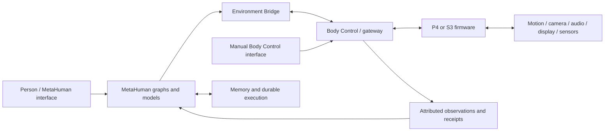

# Ainekio Robot Bible

Version 0.4 — system purpose, features, architecture, and qualification reference. Cross-repository comparison: 2026-10-14. Agent responsibilities and model-category definitions updated: 2026-10-15.

**Ainekio is a robot familiar: a persistent conversational companion with a physical body.** MetaHuman OS supplies identity, memory, model-backed cognition, tools, learning, and high-level agency. The Ainekio repository supplies the bodies, firmware, motion models, sensing, media, and Body Control gateway through which that companion interacts with the physical world.

**Active development and qualification scope: V2, the twelve-servo ESP32-P4 robot.** V1 remains a distinct supported eight-servo ESP32-S3 body. The selected connected body's advertised model and capabilities determine which operations are available; a session name alone does not establish hardware identity.

## How to use this reference

Sections 1–12 describe intended use and inspected system structure. Section 13 summarizes qualification and documentation gaps. The troubleshooting diary is retained at the bottom in section 14. Its dated observations, approvals, service states, and measurements describe those particular rounds, not the system's present live state.

This is a product and engineering reference, **not an injected runtime prompt**. Editing it does not change model instructions, configuration, permissions, firmware, or actions. Repository authority remains with [MetaHuman AGENTS.md](../../AGENTS.md), [Maintained Surface](../technical/MAINTAINED_SURFACE.md), and the [Ainekio documentation owners](../../../Ainekio/docs/README.md). Detailed executable contracts remain with their existing owners.

Evidence terms:

- **Owner intent:** the desired function or experience; implementation may be incomplete.
- **Source/configuration:** present in inspected code or settings; not proof of deployed or physical behavior.
- **Historical measurement:** a recorded test under its original conditions.
- **Live verification:** observed in running software at the stated time.
- **Physical verification:** observed on the selected physical robot at the stated time.
- **Open:** incomplete, conflicting, or not yet demonstrated.

The 2026-10-14 comparison used both working trees, including local edits. It did not restart services, run models, flash hardware, or test physical behavior. The retained diary contains earlier live tests; those were not repeated for this documentation revision. This local working reference includes installation-specific diagnostic history; publication would require a separate private-data review.

Contents:

1. [Companion purpose and design priorities](#1-companion-purpose-and-design-priorities)
2. [MetaHuman OS](#2-metahuman-os)
3. [Bodies and hardware](#3-bodies-and-hardware)
4. [Responsibilities and deployment](#4-responsibilities-and-deployment)
5. [Modes and lifecycle](#5-modes-and-lifecycle)
6. [Physical and interactive abilities](#6-physical-and-interactive-abilities)
7. [Memory, persona, and inner dialogue](#7-memory-persona-and-inner-dialogue)
8. [Goals, desires, and autonomy](#8-goals-desires-and-autonomy)
9. [Workflows and interaction examples](#9-workflows-and-interaction-examples)
10. [Models and learning](#10-models-and-learning)
11. [Interfaces and operator controls](#11-interfaces-and-operator-controls)
12. [Functional inventory](#12-functional-inventory)
13. [Qualification and repository reconciliation](#13-qualification-and-repository-reconciliation)
14. [Troubleshooting diary and improvement record](#14-troubleshooting-diary-and-improvement-record)

## 1. Companion purpose and design priorities

Ainekio is intended to converse, perceive its surroundings, recognize familiar context, move and express itself, explore, play, reason, pursue goals, remember interactions, and improve through reviewed experience. The relationship is that of a familiar or companion with continuity of identity, rather than a succession of isolated command responses. Its persona describes its identity and personality; the model interprets the situation and chooses what to do through available capabilities.

**Primary owner acceptance criterion:** “When I say the robot isn't functioning it means I turn it on and it doesn't act like a companion.” Successful individual nodes, services, tests, or firmware commands do not by themselves establish this experience.

In Full autonomy, the intended companion can choose activities without a new human instruction, carry them through, and let results, memory, and inner activity inform later decisions. Variety is an outcome of informed model choices, not a prescribed rotation, mandatory activity quota, or random command generator. Ordinary conversation remains valuable without creating a physical task or persistent goal.

The architecture supports both local interaction and distributed processing. Responsiveness matters: useful physical action should not wait on unrelated conversation or background learning. At the same time, a response describing what happened needs the actual relevant results. The intended design preserves these real dependencies while allowing independent work to overlap.

### Owner-confirmed design priorities

1. Accurate, fast, understandable interaction; a simple movement should not wait for unrelated long-form reasoning or speech.
2. LLMs interpret requests, select relevant context, decide behavior and pursue goals. Code exposes real capabilities, executes choices, preserves evidence, and reports outcomes.
3. Visible, editable node workflows for model-backed functions, including prompts, model-category selection, connections, and results. The status widget assigns concrete models and adapters to those categories.
4. Relevant context rather than indiscriminate full history/persona loading. Persona can contribute selected identity, personality, values, or goals when useful.
5. Speech, sensing, motion, and other independent work can overlap where hardware and protocol support it. Requested ordering remains meaningful.
6. Clean foundational code, one owner per responsibility, complete repairs, and removal of directly superseded paths. No hacks, duplicate managers, concealed failures, or accumulating legacy wiring.
7. No new arbitrary restrictions, blocking waits, keyword-based behavioral overrides, silent truncation, or fallback behaviors without explicit owner authorization. Existing contracts are investigated, not silently deleted.
8. Configurable placement across local body control, Q6A, and faster remote compute. Measured latency and capacity determine placement; near-immediate response is a goal, not a measured guarantee.
9. Learning from recorded decisions and outcomes, with curation, correction, separate evaluation, and traceable deployment.
10. The owner can inspect and steer the system, including diagnostic agents in a conventional desktop terminal.

Repository authorization and code ownership remain defined by [AGENTS.md](../../AGENTS.md) and [Maintained Surface](../technical/MAINTAINED_SURFACE.md).

## 2. MetaHuman OS

MetaHuman OS is a local-first application and cognitive runtime for a persistent AI identity. Here, “OS” describes the coordinating software suite; it is not the ESP32 firmware or a replacement for the host's Linux operating system. The same suite also supports personal-assistant and digital-counterpart uses outside robotics, including external environments connected through adapters.

Its main functions are:

| System | What it contributes |
| --- | --- |
| Persona and profiles | Persistent identity, background, personality, values and goals, with profile-owned settings and records |
| Conversation | User input, selected context, model-generated responses, text delivery, and optional speech |
| Cognitive graphs | Visible, editable compositions of context retrieval, model calls, actions, results, and persistence |
| Agents and triggers | Admission of configured finite cognitive work from modes, schedules, events, or explicit requests |
| Memory | Attributed recent buffers, persistent experience records, indexing, and retrieval |
| Inner activity | Reflections, dreams, daydreams, curiosity, mood review, and associative thought |
| Agency | Desires, planning, execution, outcome review, and ongoing goals |
| Environment integration | An adapter contract for observations, capabilities, selected actions, and outcomes |
| Models and tools | Configurable roles and providers, delegated computer work, and diagnostics |
| Learning | Evidence capture, curation, dataset construction, training, evaluation, and model activation |

The Site and CLI are interfaces over Core. Core owns domain behavior, graph execution, durable state, model/provider routing, and work coordination. Brain contains agents, services, and training workers using those owners. Graph JSON connects registered nodes; it is the editable composition, not an independent implementation of each subsystem.

The Work Coordinator records and admits work; durable graph execution preserves progress and correlated results across asynchronous handoffs. A queued job finishing may mean it handed work to a continuing execution. Likewise, a spoken acknowledgment is not proof that a requested action occurred. Queue, execution, model, bridge, and physical outcomes are distinct evidence.

**Owner-approved graph-editing behavior:** admitted work retains the graph it started with, including a child graph once that child is entered. New work and children not yet entered use the edited template. Existing node, schema and executable-version compatibility checks remain in force; editing a prompt is distinct from upgrading running code. The saved-graph repair is implemented and passes storage, retry and recovery tests; activation evidence is recorded in the latest diary entry. Older child records with no graph snapshot retain their existing exact-definition requirement; their missing graph is not invented or silently migrated.

References: [MetaHuman overview](../../README.md), [architecture](../technical/ARCHITECTURE.md), [current runtime ownership](../technical/MAINTAINED_SURFACE.md).

## 3. Bodies and hardware

| Item | Current reference | Evidence and limitations |
| --- | --- | --- |
| Body | Twelve-servo quadruped, three joints per leg: shoulder, carrier, crank | V2 geometry/model source; loaded tracking and calibration require physical checks |
| Controller | ESP32-P4-WIFI6 board with ESP32-C6 wireless support | Hardware record; recorded P4 revision 1.3, 32 MiB flash and 32 MiB PSRAM |
| Servo output | PCA9685, body channels 0–11 | Native P4 firmware owner; driver capacity is not robot joint count |
| Servos | Owner-recorded MG90 designation | Exact installed variant, actual travel, directions and load performance need current evidence |
| Camera | OV5647 source integration | Installed readiness, image quality, capture freshness and concurrent throughput need live testing |
| Audio | ES8311 source integration, microphone/audio pipeline | End-to-end listening and physical playback are separate tests |
| Face display | Current firmware documentation specifies SSD1306 128×64 OLED; ST7789 LCD remains selectable | Verify deployed build and attached display; do not infer from a purchased kit |
| Persistent device state | Per-device calibration, identity and configuration | Saved calibration takes precedence over assumptions from generic defaults |
| Power and sensors | Power telemetry plus LSM6DS3 IMU acquisition, attitude estimation and V2 balance integration exist in source | Monitor readiness determines whether voltage is meaningful; calibration, installed configuration and effective balance need physical evidence |

Current motion-model source records a 40/24/38/24 mm four-bar linkage and 55 mm distal link. These are geometry inputs, not measured physical pose accuracy. Joint order, channel mapping, travel, pulse conversion and horn assembly must use the model/calibration owners. Geometric zero, Home, Stand, Sit and Rest are different concepts.

**Important discrepancy:** older V2 overview text describes disabled/unimplemented movement and older pulse references, while current model and firmware source describes later integrations and changed geometry. This reference records the conflict rather than selecting an old value as a current installed fact. Do not use it as a wiring or calibration recipe.

Sources: [V2 hardware overview](../../../Ainekio/docs/v2-12servo/README.md), [P4 firmware](../../../Ainekio/Slave/firmware/esp32p4-wifi6/README.md), [V2 motion model](../../../Ainekio/Slave/software/models/v2-12servo/README.md), [servo assembly](../../../Ainekio/Slave/software/models/v2-12servo/SERVO_ASSEMBLY.md), [resource budget](../../../Ainekio/docs/v2-12servo/RESOURCE_BUDGET.md).

V1 uses eight servos with direct MCPWM outputs on ESP32-S3; V2 uses twelve modeled joints and PCA9685 output on ESP32-P4 with C6 wireless support. They share Body Control and the Environment adapter while retaining different calibration, motion, and joint contracts. V1 simulation or an eight-joint Freestyle plan does not qualify V2 execution. The [model boundary reference](../../../Ainekio/docs/ROBOT_MODELS.md) describes that separation, although its V2 implementation-status paragraphs lag current source.

The Ainekio repository also contains CAD/printable body assets, model geometry and motion-authoring tools, native software tests, a protocol body emulator, and a Sesame visual simulator. These support development without dispatching physical actions. Their modeled results do not establish loaded servo tracking, traction, balance, or real-world distances. See the [emulator reference](../../../Ainekio/Emulator/README.md) and model-specific hardware directories.

## 4. Responsibilities and deployment

| Layer | Responsibility | Existing reference/owner |
| --- | --- | --- |
| Body firmware | Physical execution, gait/gesture timing, peripheral capture/playback, device state and receipts | Ainekio P4 firmware and portable core |
| Gateway / Body Control | Selected robot, connection and command correlation, capability advertisement, manual interface | Ainekio `Master/gateway/` |
| Environment Bridge | Connect MetaHuman to the external environment contract; carry actions, observations and outcomes | MetaHuman `brain/agents/environment-bridge/` |
| Core runtime | Admission, durable task state, execution, cancellation, storage and provider transport | Core owners in Maintained Surface |
| Cognitive graphs | Editable composition of routing, context, task selection, conversation, autonomy and review | `etc/cognitive-graphs/` |
| Models | Interpretation, planning, expression and review through selected model roles | Core model registry/router |
| Memory and training | Persist evidence, curate examples, fit/evaluate adapters, record activation | Existing Core memory/training owners and Brain workers |
| Interfaces | Conversation, workflow editor, status, memory, model controls and diagnostic visibility | Site and supported clients |

The gateway-selected body and its advertised capabilities determine available actions. A V1 command name does not establish V2 semantics. V2 left/right may be ongoing gait turns; the advertised contract must establish finite versus continuous behavior.

### Companion architecture — owner-confirmed intended design

**Owner intent, clarified 2026-10-14:** these parts form one companion. They are not independent utilities whose successful launches establish that the robot works. This section specifies intended behavior; the complete integrated loop remains unqualified.

| Part | Intended responsibility |
| --- | --- |
| Agents and triggers | Initiate the appropriate work from user requests, events, schedules, or the selected operating mode. Agents trigger functions; model-backed interpretation and execution belong in visible node workflows. |
| Node workflows | Compose the LLM tasks and execution: routing, selected context, planning, expression, actions, review, and persistence. They expose the actual inputs, model choices, outputs and connections so the behavior can be understood and repaired. |
| Conversation interface | Accept the person's input and deliver the robot's conversational responses. Work initiated by agents can also return an appropriate conversational response through this interface without requiring another user message. |
| Inner dialogue | Represent non-conversational inner thoughts and internal cognitive activity. Preserve this as attributed internal content, distinct from speech addressed to the person and from observed events. |
| Rolling buffer memory | Retain recent conversation, inner dialogue and relevant activity through the existing attributed buffer system, giving the companion continuity across successive operations. Separate persisted buffer channels may support this shared role; this does not require copying everything into every model call. |
| Persistent memory | Save responses and relevant experiences beyond the rolling buffer, and retrieve useful records for subsequent conversation and decisions. Saving a record, indexing it, retrieving it and actually using it are separate functions to verify. |
| Learning cycle | Use saved records and outcome evidence to curate training examples and corrections, train the appropriate models/adapters, evaluate changes and activate qualified improvements through the existing owners. The intended result is a companion that improves over time. Recording an output does not establish that the output is correct or that learning occurred. |

The intended information flow is: **user input or an agent trigger → node workflow with relevant context → response, inner activity or execution → attributed buffer and persistent records → later retrieval and reviewed learning → improved subsequent behavior**. Independent work can overlap; this diagram is a description of information flow, not a new serialized execution requirement.

The buffer provides recent continuity; retrieval supplies relevant longer-term evidence; trained parameters provide learned behavior. These roles complement one another. Persona, memories and inner dialogue are supplied where relevant, without treating generated thoughts as physical observations or loading the entire history indiscriminately.

Architectural acceptance requires following information across these boundaries: an interaction or autonomous experience must reach the correct output, remain available with its attribution, inform an appropriate later operation, and be eligible for the intended reviewed learning path. Sleep, daydreaming, desires and personality development must be evaluated for their contribution to this same companion loop. A node completing, a record being written, or a training process exiting successfully is only component evidence.

### Agent and service reference

An **agent** initiates or coordinates a particular function. A **node workflow** composes its model calls, context, execution and persistence. A **model category** identifies the responsibility of an individual inference call; it is neither an agent nor a fixed model. A **service** maintains a connection or process needed by those functions. Shared names do not merge these responsibilities: selecting the Psychotherapist model category does not give a Desire workflow permission to edit persona.

The table records intended functions and inspected source ownership. It does not assert that each function is enabled, continuously running, or behaviorally qualified. [Agent Catalog definitions](../../packages/core/src/agent-catalog-definitions.ts) identify installed agents and default triggers; profile settings and the existing [Trigger Manager](../../packages/core/src/queue/trigger-manager.ts), [Active Operator](../../brain/agents/active-operator/index.ts) and [Sleep Workflow](../../packages/core/src/queue/sleep-workflow.ts) determine actual admission. Work Coordinator retains execution identity and results. Use [the graph inventory](../../etc/cognitive-graphs/README.md) for current graph registrations rather than inferring a graph filename from an agent's display name.

| Agent or service | Function and expected result | Activation or responsibility boundary |
| --- | --- | --- |
| Active Operator | Persistent agent coordinating mode-appropriate robot work and its progress. | Reactive makes it dormant; Semi requests operations updated to 100%; Full requests the highest returned activation, even below 100%. Its existing internal service ID remains `robot-operator`; Work Coordinator and Environment Mode retain execution ownership. |
| Robot Autonomy Controller | Assess operation activation from persona, experience, current circumstances and recorded activity. | Editable Active Operator assessment workflow for Semi and Full; selected intentions enter the shared Environment graph with autonomous attribution. |
| Observer, Movement and Reflection activities | Develop observation-led, embodied or memory-inspired intentions, respectively. | Existing `boredom-observer`, `boredom-movement` and `boredom-reflection` agents/workflows; model-selected activation or explicit invocation. An intention is not a completed action. |
| Body Event Trigger | Interpret an actual body event and its measurements with the current state and task. | Event-driven workflow, including eligible physical events in Reactive mode; sensor evidence does not prescribe a response. |
| Robot Goal Review | Assess the current execution objective against returned evidence and retain or update its state. | Existing objective/result path; command completion and whole-goal success remain distinct. Agency reviews its own plans. |
| Robot Status | Project selected-robot telemetry, execution and relevant context into a situational snapshot. | Status owner and graph; a projection is not the authority for execution or proof of unmeasured conditions. |
| Desire Agent | Generate, nurture, plan, execute and review specific desired outcomes in Agency. | Public `desire-agent` controller, with existing finite workers such as Desire Planner. It reads persona context but never promotes desires into persona goals. See section 8. |
| Psychotherapist (`psychoanalyzer`) | Analyze attributed conversations and other memories, propose persona changes, and apply validated updates through Persona Learning. | Manual or Sleep review; sole autonomous persona-writing agent. Evidence about Greg does not become Ainekio's identity. |
| Curator | Review saved conversational/memory records and prepare attributed material for personalization training. | Manual or Sleep stage. Curation is distinct from fitting and deployment; originating cognitive mode determines whose replies are learned. |
| Environment Training Curator | Review saved Intent, Task and Freestyle decisions with separately attributed outcomes; propose corrections. | Manual review graph and decision banks; proposals require the existing review process before use as training data. |
| Environment Training Trainer | Fit reviewed Intent and Task adapters separately, compare against the current artifacts, export qualified candidates and delegate activation to the existing owners. | Manual worker; evaluation, service lifecycle and model-registry ownership remain separate. Recording Freestyle examples does not establish a qualified V2 Freestyle model. |
| Organizer | Enrich saved memories with tags, entities and metadata. | Manual or Sleep graph; Core Memory owns scanning and persistence. It does not itself train models. |
| Audio Organizer / Inbox Ingestor | Convert completed transcripts or inbox files into episodic memories. | Audio organization is explicitly requested; inbox ingestion follows its configured trigger. Neither is the live speech-recognition service. |
| Dreamer | Generate memory-derived dream narratives and save them as dreams. | Sleep or manual work; imaginative content remains distinct from observed events. |
| Daydreamer | Generate and save brief internal daydreams. | Configured idle activity; preserves internal/imagined attribution. |
| Mind Wandering (`reflector`) | Reflect on selected memory and persona context and save the resulting inner activity. | Configured inactivity or explicit invocation; its graph may admit a subsequent Train of Thought. |
| Inner Curiosity | Generate a private question, investigate related memories and save its internal question/answer. | Existing finite graph; may admit Train of Thought after persistence. |
| Curiosity / Curiosity Researcher | Pose conversational curiosity questions; investigate pending questions using local memory and retain grounded findings. | Separate user-facing inactivity and research triggers. Generated questions are not evidence that their assumptions are true. |
| Train of Thought | Extend a supplied thought or memory seed through associated memories and save one reasoning chain. | Explicit or parent-agent admission; no independent hidden scheduler. |
| Mood | Review attributed conversation or inner activity and select an enabled persona facet. | Persisted buffer-event admission and Mood Review graph; selecting a facet is not rewriting persona. |
| Sleep Workflow | Coordinate Organizer, Curator, eligible personalization training, Desire, Dreamer, Psychotherapist and indexing. | Existing sleep lifecycle and enabled settings; distinct from body power states and from continuously running awake work. |
| Environment Bridge (Local / Remote) | Transport advertised capabilities, observations, selected actions and correlated receipts between MetaHuman and Body Control. | One shared connection owner behind the configured local/remote entrypoints; transport does not select behavior. |
| Terminal / Big Brother | Maintain conventional terminal sessions for delegated computer work or diagnostics, and return task results through the configured workflow. | Explicit tool/diagnostic handoff; Big Brother is also a separately assignable model provider. See section 10. |
| Profile Sync / Maintenance | Synchronize profile data through its existing owner; perform installation housekeeping such as stale-lock and audit-log maintenance. | Distinct configured finite-work/service responsibilities; neither is companion motivation or a learning loop. |

Other supporting owners include memory indexing/retrieval, personalization training, speech recognition and synthesis, and durable execution. They are not additional autonomous decision agents merely because an agent uses them. The [Maintained Surface](../technical/MAINTAINED_SURFACE.md#critical-runtime-ownership-boundaries) specifies their executable boundaries.

For future repair work, start with the affected function in this table, its detailed section below, the canonical agent/graph registration, and its maintained owner. Record whether the evidence concerns source, activated software, model decisions or physical results. The improvement-loop lead evaluates the complete companion behavior and delegates scoped coding work to repair agents; those development agents are separate from the installed runtime agents above.

### Distribution across the body, Body Control, Q6A, and remote hosts

The intended deployment has a wireless body, an offboard Q6A available for nearby processing, and more capable remote compute for expensive work. P4 retains local physical execution and peripheral control; model tokens do not drive each servo frame. Body Control owns the shared body connection and manual interface. MetaHuman owns high-level cognition and durable task execution in the controlling installation.

The owner's distributed direction allows Q6A and remote hosts to run MetaHuman, with placement determined by latency, capacity and installed capabilities. Speech/perception/lightweight work can be located nearby; heavier reasoning, memory services and training can be remote. This is a deployment direction, not a claim that an integrated Q6A installation or WAN failover is qualified.

Current Ainekio source implements configured gateway connection switching and portable pairing. **Switching a robot connection is not durable goal migration between MetaHuman installations.** General cross-installation control grants, replicated state, and continuation handoff remain design work in the distributed reference. Body Control can also operate manually without MetaHuman. No mandatory Q6A intermediary or simultaneous independent motion writers are implied.

This diagram shows responsibility and data flow, not fixed host placement or a serialized schedule. [Body Control integration](../../../Ainekio/docs/BODY_CONTROL_INTEGRATION.md) and [distributed foundation](../../../Ainekio/docs/DISTRIBUTED_ROBOT_FOUNDATION.md) contain the detailed deployment proposals and their qualification boundaries.

## 5. Modes and lifecycle

Three separate controls describe different aspects of operation:

| Control | Choices / function | Distinction |
| --- | --- | --- |
| MetaHuman cognitive mode | Dual Consciousness, Agent, Emulation, Environment | Selects the kind of cognitive operation and its associated policies/graphs |
| Robot autonomy mode | Reactive, Semi, Full | Selects how new embodied work is initiated and continued |
| Lifecycle | MetaHuman Sleep Workflow; body Idle/Doze/sleep states | Cognitive maintenance and physical power/peripheral states are separate |

[The cognitive-mode source](../../packages/core/src/cognitive-mode.ts) defines Dual for deep identity/memory-oriented operation, Agent for command/task assistance, Emulation for use of an existing persona with read-only defaults, and Environment for embodied interaction. These descriptions are mode definitions, not a fresh qualification of every mode. Environment Mode is the robot workflow discussed throughout this reference.

The cognitive mode also determines whose conversational replies personalization should learn. The owner-confirmed distinction between Dual Consciousness and Environment Mode is recorded under [Conversational training by cognitive mode](#conversational-training-by-cognitive-mode).

### Robot autonomy modes — owner-defined behavior

These are the robot's three autonomy modes within the embodied system. Body power states and the Sleep Workflow are separate features; they must not be conflated with this mode selection.

| Mode | Intended function | End-to-end acceptance |
| --- | --- | --- |
| Reactive | Respond to human commands/requests and physical body events, including boot/wake, tipping and rapid movement. It does not independently choose unrelated new activities. | A request or configured physical event reaches the correct interpretation and capabilities and produces an appropriate action or answer, with continuity and accurate outcomes. |
| Semi-autonomous | Active Operator assesses operation activation and requests each returned update at 100%. | Recent activity, context and current work influence model-selected levels. There are no independent idle timers for migrated operations. |
| Fully autonomous | Make high-level decisions about what it wants to do, pursue and fulfill goals, review desires, and choose subsequent activities from experience and the current situation. | The robot behaves like a companion without the owner continually assigning its next step. It integrates perception, identity, personality, memory, goals, desires and available capabilities; acts on its choices; evaluates what happened; and meaningfully changes course when appropriate. Repeated no-op decisions, repeated commands without progress, or repeated fault commentary do not meet this requirement. |

The LLM owns high-level choices. Implementing Full autonomy means making the decision, execution, evidence, memory and review paths work together. It does not mean adding a fixed task rotation, keyword behaviors, mandatory activity quotas or an imposed personality. Existing code and current settings are evidence of implementation, not authority to redefine these intended modes.

**Owner clarification, 2026-10-14:** Reactive mode includes both human requests and physical events. Configured body-event interpretation remains eligible in Reactive; recording a sensor event does not prescribe a particular speech or movement response. This clarification resolves the earlier ambiguity between command-driven Reactive operation and the independently admitted Body Event Trigger graph. It does not authorize arbitrary event suppression or additional unsolicited activity selection.

### Sleep, wake, and maintenance

MetaHuman's existing [Sleep Workflow](../../packages/core/src/queue/sleep-workflow.ts) sequences Organizer → Curator → eligible personalization training → Desire Agent → Dreamer → persona review → memory-index refresh. Enabled settings and stage results determine what actually runs. User activity ends the remaining sleep chain through its existing lifecycle owner; awake automation and robot operator scheduling are coordinated with it.

Its purpose is to organize experience, support reviewed learning and persona development, and produce internal material for later cognition. A session labelled completed may contain failed or skipped stages; the diary records an example. This lifecycle is separate from putting the body into a low-power state. A body boot/wake event also does not mean that a MetaHuman sleep session occurred.

## 6. Physical and interactive abilities

### Motion and posture

Capability code includes posture requests (Stand, Sit, Neutral, Rest), gestures (Wave, Bow, Nod, Pushup, Point, Dance and others), and locomotion. V2 has distinct Walk/Run/Crawl/Crab implementations and ongoing steering. Additional declared assets include Lie Down, Crouch and experimental Upright. This is a source inventory, not an assertion that every command is currently advertised, installed, mechanically usable, or equivalent across bodies.

For every motion test, record the selected body's actual advertised command, requested parameters, intended endpoint, physical behavior and terminal receipt. Use [semantic translation](../../../Ainekio/Master/gateway/environment_adapter/translation.py) and actual advertised capabilities; do not copy a global catalog into a second runtime list.

The V2 body owns continuous gait execution, finite gesture trajectories, steering, and per-device calibrated output. Speed, stride/rate, direction, and finite gait-cycle count are distinct controls; their ranges and effects come from the selected body's current advertised contract. Commanded joint pose is not measured shaft position, and modeled planted feet are not measured ground contact. General obstacle avoidance, cliff detection, reliable recovery from a fall, and autonomous navigation are not established capabilities by virtue of having a camera or IMU.

Current P4 source distinguishes **ordinary Stop** (cancel motion and hold the commanded pose with outputs enabled), **detach** (disable outputs), and **gait Finish** (complete the gait's stopping transition; requested by speed zero in the existing locomotion contract). Stop also cancels affected audio/snapshot work through the current controller. These meanings describe [controller source](../../../Ainekio/Slave/firmware/esp32p4-wifi6/main/controller.c), not proof of the firmware installed on a particular robot.

**Goal-directed locomotion — approved October 15:** MetaHuman must select a locomotion goal together with gait controls, rather than exposing bare Walk, Run, Turn, Crab or Crawl starts. The goal describes a measured distance, signed relative turn, approach relationship, ongoing follow relationship with an ending condition, or visual endpoint. Gait percentage controls express actuation, not metres per second. Finite gait-cycle counts and elapsed time are not arrival evidence. Internal/manual Body Control gait primitives remain available through their existing owner. Standing, resting and other finite gestures retain ordinary command handling.

The model selects the goal, target, tolerance and relevant visual behavior. Core Active Task owns execution and progress; the existing Bridge carries sensor evidence and the same movement's start/update/Finish receipts. Visual and follow goals reuse the existing behavior evaluator and its selected observation cadence. Sensor updates wake that active execution without another intention or task-selection call. Each result must distinguish endpoint evidence, requested Finish, acknowledged settings, and the original gait's actual terminal receipt. Neither a command receipt nor a spoken response establishes that the overall goal succeeded.

**Approved missing-measurement behavior:** if the selected goal's required measurement is unavailable before movement, report incomplete without starting. If it becomes unavailable during movement, request Finish on that same gait and retain the actual outcome for the planner. Do not substitute timed travel, a new target or an automatic restart. Camera, orientation and target measurements have independent availability; missing metric camera calibration does not by itself invalidate available IMU orientation. References, source frame, robot/session, measurement time, units and uncertainty remain attributed. The owner also approved using the existing four-second gateway control-freshness interval to expire orientation telemetry if that stream alone stops; repeatedly reading the same sample does not renew it.

**Calibration and qualification:** real calibration and physical qualification are outstanding; installed application and body support are recorded below. Metric image estimates require real camera intrinsics, a measured camera-to-body transform, and a measured reference on the ground plane. The camera-only estimator tracks that plane; it is not general depth, inertial odometry or room navigation. An image-box fraction is an explicitly image-relative relationship, not a metric distance. A selected metric target requires an explicit ground-contact point in retained image evidence; a box bottom is not silently assumed to touch the floor. Unknown metric uncertainty remains unknown. P4 commanded gait geometry is not measured displacement. The earlier side-crab primitive could not correct sideways overshoot through forward/turn controls. The approved signed lateral control now extends the same P4 movement owner, protocol and Core controller; its installation is verified below, while physical correction accuracy remains untested.

The current 0.8B Task adapter failed all six locomotion cases in the initial eight-case no-dispatch replay, while retaining the finite-bow and discussion controls. The existing 9B Planner selected valid measured goals for four explicit distance/turn cases, but fabricated visual target evidence in another case. The owner authorized Task training and qualification with the new contract while preserving Intent, previous skills, held-out evidence and restored serving settings. Neither model replay nor the successful controller tests establishes that the complete robot movement feature is ready in production. The subsequent 0.8B locomotion fit was rejected during serving qualification: despite improved quoted-language handling and visual-planning delegation, it regressed previously correct finite commands, including selecting an unrequested 10-metre walk for a rest-position request. Its partial evaluation is retained as failure evidence, not an overall accuracy benchmark. It was not promoted.

The separate 2B comparison completed without physical dispatch. Its eight private current-contract replays produced two valid direct decisions, five allowed Planner handoffs and one Crab grounding failure. Some held-out direct locomotion plans omit requested speed, reverse yaw or invent missing-measurement explanations. Putting speed only in a steering component is not equivalent to preserving the gait's `speed`, because the goal controller updates those steering components. A handoff does not prove a correct downstream plan or arrival, and an action receipt does not establish visual goal success. Following that comparison, the owner selected the 2B Intent and Task adapters for production on the next normal startup. This assignment does not remove the recorded model failures or qualify physical locomotion.

**Installed support, October 15:** after explicit owner approval and confirmation that the robot was supported, V2 application `0.8.51-p4-lateral` was installed through Body Control's existing OTA path. The live robot reports the accepted `ota_1` image and negotiates `walk_lateral_v1` with the restarted gateway. Comparison of stored servo calibration before and after installation found no changes. The final MetaHuman build was activated through its application-only restart; a fresh authenticated Bridge read confirms the goal-bearing capability and position/yaw/camera evidence. This establishes installation and data delivery, not measured motion accuracy. An updated Task adapter, real camera calibration and physical goal tests remain separate acceptance work. A measured Crab goal on older firmware reports unavailable lateral control before starting; manual gait controls retain their existing owner.

Visual-only goals use independent camera availability and source expiry, without requiring YOLO or metric calibration. If actual camera evidence disappears, the approved Finish/incomplete behavior applies. A long-running visual model call does not by itself mean a still-live camera has stopped supplying evidence.

A destination does not establish a traversable route. Obstacle avoidance and drop-off handling remain separate unqualified capabilities; this change does not introduce an unapproved obstacle/edge policy. Software simulation, model replay, runtime activation, real calibration and physical movement accuracy are separate acceptance stages. See the [approved locomotion contract](../../logs/diagnostics/robot-improvement/round-004-locomotion/proposed-contract.md) for the scoped implementation and acceptance record.

### Camera, perception, recognition, and tracking

P4 shares one camera acquisition/JPEG pipeline across preview streaming and correlated still captures. Body Control displays frames and can run configured perception through its camera worker without making the robot receive loop await inference. The existing bridge supports reading the latest cached image without taking another picture. An explicit capture produces a new correlated still; a cached image retains its original identity and time. Wake-speech capture also has image correlation in firmware. These are different acquisition paths, not a requirement to take an extra photo before every text request.

Recognition can supply object/person boxes, track continuity and, when enrolled local face models are configured, a named-person estimate. Detection, tracking, a face match, and physical identity are different claims. Tracking IDs do not establish identity; a match is not liveness verification. Visual planning can select acquisition, a retained frame/region, tracking configuration, or observation through the existing task workflow. Success requires the appropriate returned evidence, not simply selecting a tracking command.

YOLOE is a supported Body Control perception backend for object detection and visual prompting; it is not itself a navigation or goal-execution owner. The existing visual workflow connects acquisition/search/selection and returned frame or track evidence to model-selected behavior. An ongoing `behavior` step has its own target, motion and `completionCriteria`. The [active-task owner](../../packages/core/src/nodes/environment/active-task.node.ts) evaluates supplied visual evidence through the existing model path, requests gait Finish when target/completion evidence establishes that step's criteria, and advances only after the correlated terminal receipt. Tracking availability, target identity, actual motion, and goal completion remain distinct facts. This path needs end-to-end qualification for the intended target and body; merely naming a goal or enabling YOLOE does not establish object following.

The intended use includes noticing the surroundings, answering visual questions, searching for things, and using perception to inform activities. Reliable visual navigation and person following require their own end-to-end qualification. See [camera source](../../../Ainekio/Slave/firmware/esp32p4-wifi6/components/ainekio_p4_media/camera.c), [Body Control perception](../../../Ainekio/Master/gateway/README.md#continuous-camera-processing), and [named-person recognition](../../../Ainekio/Master/gateway/README.md#named-people-optional-local-models).

### Listening and speaking

Body firmware supports microphone capture with Open, VAD and wake-word modes, saved gain/settings, and audio transport. MetaHuman's STT owner produces the attributed text admitted to the workflow; the robot does not need the user to type in the browser. Speaker playback and listening interact through firmware's existing capture/playback rules, so simultaneous motion and speech support does not establish unrestricted full-duplex listening.

MetaHuman's audio control selects **Off / Browser / Body Control**. Body Control then selects **Robot speaker / Body Control computer**. The latter means speakers attached to the gateway host, not MetaHuman's browser. TTS synthesis, admission, playback start and playback completion have different timings and evidence. Speech is admitted through its existing delivery owner independently of movement; audio chunks preserve order. See [speech destinations](../../../Ainekio/Master/gateway/README.md#speech-destination) and [voice/TTS ownership](../technical/MAINTAINED_SURFACE.md).

### Face expressions and processing feedback

The body display presents shared expressions used by motions and by standalone face selection. MetaHuman exposes standalone expressions from the advertised library and workflow display-feedback nodes. Feedback uses replacement and timeout/release behavior through the existing display owner, rather than a queue of obsolete faces. It does not establish that a movement happened.

The intended feedback lifecycle is listening during recording; animated thinking while sending/transcribing/reasoning and between further steps; speech or motion expression during those activities; normal face at completion; and an error/connection indication when appropriate. Firmware also has local listening and connection display behavior. These owners need integrated precedence/release qualification; the existence of nodes is not proof that every stage appears correctly. Current P4 listening feedback also includes a small shoulder cue implemented by the body owner, as documented in the [firmware reference](../../../Ainekio/Slave/firmware/esp32p4-wifi6/README.md); this is distinct from the display-only expression command.

### Body sensing, events, and balance

Current P4 source acquires IMU data, estimates attitude and publishes timestamped telemetry. V2 body code contains balance corrections and configuration. This supersedes old overview statements that telemetry/feedback are unconnected, but does not establish effective physical balancing. Calibration state, sample time, readiness, and uncertainty matter; six-axis yaw is not an absolute heading reference.

Body Control detects configured event episodes such as tilt or rapid movement and forwards measurements. Boot/wake events also enter this path. MetaHuman's **Body Event Trigger** graph interprets the event and may send an attributed intention to Environment Mode. Measurements and event names do not prescribe an emotion, greeting or recovery motion. The language and action choices belong to the model. See [body events](../../../Ainekio/Master/gateway/README.md#v2-body-events-and-imu-status), [P4 body owner](../../../Ainekio/Slave/firmware/esp32p4-wifi6/main/body.c), and [Body Event graph](../../etc/cognitive-graphs/body-event-trigger-mode.json).

### Recording, maintenance, and manual operation

Body Control includes manual motion controls, calibration, camera/recognition settings, audio settings, networking/pairing, body event settings, status and diagnostics. Firmware supports SD video recording alongside preview, clip listing/download, and rolling reuse of old completed clips. Recording video does not automatically turn every frame into a MetaHuman memory or LLM input.

The maintenance interface uploads a P4 application and separately activates it, provides update display feedback, and retrieves robot logs. C6 firmware and initial partition/bootloader preparation are separate concerns. Source and earlier controller-only tests do not qualify powered motion or every media/network workload. See [recording and OTA](../../../Ainekio/Slave/firmware/esp32p4-wifi6/RECORDING_OTA.md) and [Body Control workspace](../../../Ainekio/Master/gateway/README.md#body-control-workspace).

## 7. Memory, persona, and inner dialogue

The companion's continuity comes from several kinds of state, not from a language model automatically remembering every earlier request:

| Information | Purpose | What it is not |
| --- | --- | --- |
| Persona | Persistent identity, background, personality, values and goals; relevant facets can be selected for a call | Evidence that an imagined event physically occurred |
| Recent buffers | Attributed conversation, internal activity, system and robot events available to later context assembly | An instruction to load every item into every call |
| Persistent memory | Saved experiences and records available beyond recent buffers | Proof that a record was indexed, retrieved, or used |
| Search/index | Find relevant stored records for the selected task or conversation | A guarantee that similarity ranking answers chronological questions |
| Robot Status | Projection of selected-body condition, current task, action outcomes, and dated observations | A separate goal executor or an independent replacement for receipts |
| Durable execution | Original objective, corrections, selected work, progress, results and continuation state | A second persona or general conversational memory |
| Model weights / LoRAs | Learned behavior and tendencies following training | Live storage of the current conversation |
| Inference context / cache | Input and working state for generation, with backend-dependent reuse | The authoritative persistent memory store |

The interface can merge feeds visually while their records retain separate speaker, source, type, identity and time. An inner thought must remain distinguishable from a human statement, an assistant reply, a dream, a camera observation, and a body receipt. The originating turn time, a result's acquisition time, and the time it was received can differ.

Robot Status uses the [live projection owner](../../packages/core/src/robot-status-live.ts) to expose current execution and command evidence to the interface and workflow context. Its source now preserves motion parameters including `continuous`, `units` and `durationMs`, command work state/start time, correlated receipts, the overall objective's criteria, and a behavior step's separate criteria. A plain action has no behavior-step criteria. An omitted parameter remains omitted, and a queued or acknowledged command is not proof of physical movement or arrival. This projection admits no actions and creates no independent goal store; source checks and the motion incident below document its qualification.

Reflection, Dreamer, Daydreamer, Inner Curiosity, Train of Thought and mood review provide different internal activities. Dreams/daydreams are generated imagination; reflection examines supplied experience; curiosity can pose questions and retrieve or investigate related information; associative thought can continue from a persisted seed. They contribute to the intended inner life and can inform later decisions when the workflow selects that context. They are not all necessarily spoken, and their existence does not prove they currently influence each autonomous choice.

**Owner-confirmed dream behavior, 2026-10-14:** keep the sleep-generated surreal stories derived from remembered events, saved as dreams and recalled as dreams. The owner accepted this behavior after the controlled recall test below. Dream content remains attributed imagination rather than evidence that the described physical events occurred.

Long-term continuity requires the complete save → index → retrieve → deliver → use path. A request about the most recent dream also needs correct dream attribution and temporal selection. The diary records cases where stored dreams existed but routing or retrieval failed. These are distinct defects from absent dream generation. Persona evolution and model training are also distinct: changing a persona record does not itself retrain a model.

Optional model-selected newest/relevance ordering, explicit time ranges, and latest-sleep-cycle scope were activated on 2026-10-14 at 17:25 PDT, retaining actual cycle identity and record provenance. A controlled request with Big Brother temporarily selected for Intent retrieved the actual latest-cycle dream and delivered a faithful answer. This qualifies that selected retrieval path, not the deployed 0.8B Intent's routing or general relative-date interpretation. The existing subprocess/durable owner was subsequently repaired to preserve graph state across Dreamer retries and activated at 17:32 PDT; focused retry tests and a fresh completed Daydreamer run are recorded below. Exact current-record exclusion was activated at 18:18 PDT and subsequently verified through a real queued conversation. The current record was excluded while an older identical question remained eligible. That conversation still failed dream recall because the selected search returned questions rather than dreams.

References: [buffer owner](../../packages/core/src/conversation-buffer.ts), [memory owner](../../packages/core/src/memory.ts), [Robot Status](../../packages/core/src/robot-status.ts), [Inner Curiosity graph](../../etc/cognitive-graphs/inner-curiosity.json), [Dreamer graph](../../etc/cognitive-graphs/dreamer-mode.json), [Daydreamer graph](../../etc/cognitive-graphs/daydreamer-mode.json), [Train of Thought](../../etc/cognitive-graphs/train-of-thought.json), [persona learning](../../packages/core/src/persona-learning.ts).

## 8. Goals, desires, and autonomy

| Concept | Meaning and existing responsibility |
| --- | --- |
| Persona goal | A longer-term architectural, developmental or aspirational direction represented in persona; it guides the companion without becoming an automatically running command |
| Desire | A specific desired outcome represented in Agency, with motivation, evidence, relevance and lifecycle; it can be considered, planned, executed and reviewed |
| Robot execution objective | The current requested outcome retained by durable execution, with corrections and evidence |
| Program / action | Selected work toward that outcome; a receipt describes execution, not necessarily fulfillment |
| Robot Goal Review | Assessment of an unfinished non-Agency objective after selected work/results, before final conversation |
| Agency outcome review | Review of Agency-owned plans and steps through their own lifecycle |
| Weekly Goal Review | Separate project-progress/insight workflow; not the robot's per-objective continuation owner |

**Owner-confirmed distinction, October 15:** persona goals describe the general direction of the companion's development and aspirations. Desires describe particular outcomes the companion currently wants to achieve. Specificity and purpose distinguish them; a desire can take time to satisfy without becoming a general persona goal. A robot execution objective is the outcome of a particular admitted request or activity and remains distinct from both.

The model uses goals, attributed experience and actual operating state to decide whether a specific desire is warranted. It may create, strengthen, weaken, retain, complete or archive desires as the evidence and lifecycle justify. An empty desire list is neither inherently a success nor inherently a failure. Evaluation must check whether meaningful supported opportunities or unfinished needs were missed, whether obsolete concerns were retained, and whether claimed progress matches execution evidence. The owner clarifies intended design; the owner is not expected to choose the desired verdict for each model review.

Psychotherapist is the sole autonomous editor of persona goals through the existing persona-learning owner. Desire Agent owns specific desires through Agency and may use persona goals as context. Strong or repeatedly reinforced desires do not automatically become persona goals. A goal is not fulfilled merely because an associated desire, action or conversation ends. Cleanup of historically misplaced specific items must preserve their provenance and history and must not treat an old record as evidence of a current need. The current owner-authorized goal-list reconciliation is recorded in the evaluation diary.

Nurturing reviews every open desire, including those already being planned or executed. The model selects a relevance strength on the existing zero-to-one scale and cites attributed evidence for a change; it can reduce, increase or retain strength. Zero means archival with history retained. The existing elapsed-time decay policy remains separate. Archival requests cancellation of that desire's remaining work through Coordinator; a cancellation request is not proof that physical activity stopped, and late receipts do not reopen the desire.

The review draws on enabled saved conversation and memory sources, standing persona goals, the selected robot's actual state and capabilities, and current or explicitly linked execution records. Memory type, speaker, source and timestamps distinguish conversation, observations and imagined material. An original request, the selected program, a command receipt and evidence of the desired outcome remain different facts. Generation receives the current review's proposed relevance changes explicitly as uncommitted decisions; after persistence, duplicate comparisons use the resulting open desires. Unchanged evidence is not new reinforcement merely because the agent runs again.

In the shared Environment Mode workflow, Intent selects whether a response is needed. Task selects executable actions, sensing and behaviors; it does not compose or publish speech. The conversation context builder joins the selected results, and Persona generates the outward reply through the single conversation delivery path. The former speech program step has been removed, including exact spoken lines inserted between motion steps. This makes Persona the single speech author for that execution path rather than having Task speak and Persona repeat it. Independent controller or agent outputs retain their own documented workflow ownership.

A conversational exchange does not require inventing a goal. Existing Environment completion routing skips review when there is no unfinished owned objective. Finite action-result objectives can complete from the appropriate receipt. An unfinished objective is reviewed using returned actions and observations; review may revise its objective and completion criteria, mark it complete, retain it pending relevant input, or abandon it. Review does not start planning or actions. A reply is selected by Intent through `needsResponse`, not treated as a goal. Task and Goal Review completion bases are `action_result`, `visual_observation`, `environment_state`, and `user_input`. Goal Review returns assessment data and does not publish conversation or speech. Robot Status displays this state; the durable execution retains it.

**Objective completion and step completion are separate.** `taskDecision.completionCriteria` describes success for the overall request; it does not terminate an open-ended action. A visual behavior's own `completionCriteria` governs that behavior's Finish path. For example, an objective to obtain a view beneath a desk does not make a bare `crawl` stop beneath it, and a capture scheduled after that crawl cannot execute while the action remains unfinished. Goal Review assesses the supplied results; it cannot retrospectively supply a missing movement endpoint. This distinction belongs in capability/context delivery, execution, status and evaluation, without replacing the model's choices with scripted navigation.

For an open request such as finding a wallet, the intended system preserves the request, records searches and observations, and lets the model assess what to try next or whether the outcome is established. This is not a hardcoded wallet-search procedure. The original request and later corrections remain distinguishable from the planner's interpretation.

In Semi and Full modes, Active Operator runs the same editable activation-assessment workflow. The model receives selected persona, recent conversation, inner activity, robot outcomes/status, environment evidence, operation meanings, retained levels and recorded activity. Semi requests every returned update at 100; Full requests the highest returned activation even below 100, with returned order breaking ties. Empty updates request no work. Omitted operations retain their previous levels without being requested again. Selected work runs through independent Work Coordinator admissions, so its duration does not block subsequent assessment. The assessment itself does not author outward speech. Human messages and autonomous intentions enter separate inputs of the same Environment Mode graph. Its input join preserves the selected origin and planner metadata, and the shared Intent, context, Task, action-result, Goal Review and final-response paths execute the request. The separate Robot Autonomy Executor graph has been removed; the Autonomy Controller remains the decision owner. Active goals, observations and recorded results inform the controller or an appropriately triggered Semi Auto agent when choosing and planning work. Goal Review updates the durable goal shown by Robot Status after selected work returns; it does not trigger the next planning pass. Abandonment removes a goal from active consideration while retaining its original instruction and recorded results. Current source does not implement Full mode as a compulsory rotation of movements.

Autonomous intentions sent to Environment-style execution are displayed in Inner Dialogue and saved in long-term memory by the existing Inner Dialogue Buffer and Inner Dialogue Memory Saver nodes. The entry contains the selected instruction, stated reason and observed context, tagged `autonomy` and `autonomy-intention`. Metadata retains the originating agent, trigger source, decision time, source observation time, session, cycle and execution identities. This records the model's declared intention rather than claiming the selected motion has completed; action receipts remain separate evidence. Observer, Movement, Reflection and direct Full Auto Controller handoffs use this same output path. This adds no spoken announcement or model call.

Desire Agent is the public controller for Agency work and can be invoked manually or selected by Sleep or Robot Autonomy. Its stages handle generation, planning, execution, outcome review and check-in as needed. It operates within the Desire system: it may read persona as context, but must not create or update persona goals or other persona fields. Agency-owned steps do not acquire a second continuation owner in Robot Goal Review. How well enduring goals and fresh experience inform new desires remains an open integration issue, documented below.

Standing persona goals and fresh reinforcement evidence have different purposes. Full Autonomy needs recorded proposed, planning, aspirational and active aims, retaining their status and horizon; an aim is not automatically an active task. Desire review needs the same context even after earlier evidence has been consumed, without treating unchanged goals as new evidence or reinforcement. The approved October 15 extension adds an optional standing-goal selection to the existing Persona Formatter and shares the recorded-goal selection with Desire. Other formatter consumers retain active-only defaults. Deployment and behavioral evidence are recorded in the diary.

The **Intent Orchestrator** is the program-wide input-routing responsibility, represented by the single `orchestrator` category. Task Decisions selects concrete supported actions, Planner develops complex plans, Psychotherapist independently assesses experience and outcomes, and Persona expresses identity, conversation and self-directed intentions. These are the approved distinctions in section 10. The category consolidation preserves each mode's existing Intent assignment, including the trained Environment specialist, rather than assigning the small model to unrelated higher reasoning. Activation evidence belongs in the dated qualification record; the category name alone does not establish which artifact is serving.

**Psychotherapist owns autonomous persona changes.** The owner clarified on October 15 that this is the only agent allowed to edit persona. It analyzes saved conversational evidence and develops Ainekio's persona through the existing persona-learning and persistence owners. Greg's statements remain attributed to Greg; they do not automatically become Ainekio's traits or circumstances. Explicit manual persona editing, onboarding and restoration remain separate owner actions. The existing agent is internally identified as `psychoanalyzer` and uses the `psychotherapist` model role; its manual and Sleep triggers do not imply a continuously running service.

The old Desire nurturing path appended proposed persona goals after sufficient reinforcement. That violated the clarified ownership and has been removed. Completing an Agency desire or robot execution does not by itself change a standing persona aspiration. The owner subsequently authorized cleaning the goal list: thirteen historical specific outcomes were removed from standing persona goals, with the complete original persona retained through Identity archives. The two broad planning aims and two long-term aspirations remain unchanged. Their former source Desire IDs no longer exist in current Agency storage; this cleanup does not fabricate current needs or revive obsolete tasks. Psychotherapist's existing instruction already distinguishes identity-level aspirations from tasks or projects; its semantic quality and evidence-supported persona maintenance still need qualification.

**Desire relevance must be reviewed throughout its open lifecycle.** A triggered review reassesses all open desires against fresh attributed evidence and current lifecycle state. The model selects an exact target strength from zero to one, with a reason and supporting evidence references for changes; an unchanged assessment may have no references. This replaces the fixed positive reinforcement increment for model relevance review. Existing elapsed-time decay remains distinct. At zero, the Agency storage owner saves archived disposition and strength together, retaining history. The existing Desire outcome/Coordinator path requests cancellation of that desire's remaining work. Archived status and a cancellation request do not establish that physical work stopped; actual receipts and uncertain outcomes remain recorded. Late planning or execution results must preserve the saved archival and newer relevance assessment. Source qualification, recovery checks and activation are tracked in the diary below.

Nurturing uses the enabled sources gathered by Desire Agent: up to twenty nonblank user messages from the conversation buffer, up to fifty eligible episodic memories from the previous seven days, and enabled task, goal, curiosity, reflection and dream sources. These are existing record-selection settings, not semantic memory search. Selected content remains complete; speaker/source/mode/time attribution remains available. Standing persona goals supply context rather than fresh evidence. Previously acknowledged source fingerprints are not repeatedly consumed. A remaining issue is that one conversation event can arrive through both the buffer and episodic memory with different source identities; canonical cross-source event identity is pending owner approval and is not claimed repaired.

**Workflow nodes select model categories, and the status widget assigns models to those categories.** Desire generation and nurturing select `psychotherapist`; the owner has assigned that category to Big Brother in Agent and Environment modes. The node's Reasoning checkbox is enabled and requests high Codex reasoning for that invocation. Unchecked retains the configured Big Brother effort. This does not change the category's persona-editing authority: Desire still writes only Agency records, while Psychotherapist's separate review agent owns autonomous persona edits. Planning, execution and outcome stages retain their existing role selections unless explicitly reassigned.

References: [autonomy controller](../../etc/cognitive-graphs/robot-autonomy-controller-mode.json), [shared human/autonomy executor](../../etc/cognitive-graphs/environment-mode.json), [Active Operator](../../brain/agents/active-operator/index.ts), [Robot Goal Review](../../etc/cognitive-graphs/robot-goal-review-mode.json), [Weekly Goal Review](../../etc/cognitive-graphs/goal-review.json), [Agency owners](../../packages/core/src/agency), [remaining-objective routing](../../packages/core/src/nodes/utility/execution-context.node.ts).

## 9. Workflows and interaction examples

Updated for the 2026-10-15 source repair; runtime activation is recorded in the scratchpad. Connections and implementation, not this summary, determine actual scheduling.

1. User/event input enters the graph with originating instruction and attribution.
2. Intent Orchestrator selects needed routes and context.
3. Persona, history, memory, Robot Status, current execution, available capabilities and camera evidence feed the relevant context builders.
4. Task Decision selects an executable plan or delegation. Visual Planning and the existing plan resolver contribute when selected.
5. The existing active-task executor dispatches selected operations and records progress/outcomes.
6. Remaining-objective routing conditionally invokes Goal Review for an unfinished owned objective. Its assessment returns as data; unrelated conversation does not require review.
7. When Intent selects `needsResponse`, the final context builder combines its selected sources, returned execution/image evidence and applicable goal assessment. Graph dependencies hold the builder until selected results return; unselected branches are skipped. Persona generates the response and the single Conversation Out records and speaks it. The caller then handles newer input, selected continuation or an explicitly selected input wait.
8. Save nodes retain Intent and Task decisions for later curation. Tool delegation has its own eventual result-return path.

Core distinction: **request → selected plan → dispatched operation → operation receipt → evidence about the objective**. These are different events. Saying “done” or receiving a command completion does not by itself prove that an object was found, tracking is active, or a clearer image was obtained.

Sources: [Environment graph](../../etc/cognitive-graphs/environment-mode.json), [autonomy controller](../../etc/cognitive-graphs/robot-autonomy-controller-mode.json), [shared human/autonomy executor](../../etc/cognitive-graphs/environment-mode.json), [Goal Review](../../etc/cognitive-graphs/robot-goal-review-mode.json).

### Illustrative request paths

These examples explain intended information flow. They are not runtime prompts, forced action sequences, or claims that every case currently passes. Intent selects routes; the task/conversation models decide the actual response and actions from the supplied evidence.

| Request or trigger | Relevant path and expected evidence |
| --- | --- |
| “How are you?” | Intent may select conversation and relevant context. A generated reply is delivered to text and the selected speech output. No body action or goal review is inherently required. |
| “What do you see?” | Selected vision context supplies a dated image through cached read or selected capture. Visual interpretation and returned evidence reach conversation. A capture receipt without the image does not establish what was seen. |
| “Walk forward,” then “Please stop” | The first turn selects goal-bearing locomotion with an endpoint or continuing condition; bare gait starts are not exposed to the model. The later turn reaches the existing execution for interpretation and cancellation/control. Results distinguish endpoint evidence from gait termination. Stop, detach and Finish remain distinct. |
| “Tell me what you see, a fact about cats, and bow” | Context selection and planning cover the visual, conversational and physical parts. Independent work can overlap where supported. The response receives relevant completed results; independent specialist roles are not assumed to run simultaneously when one needs another's output. |
| “Help me find my wallet” | A selected objective persists with the request and corrections. Model-selected searches/actions produce evidence; review assesses fulfillment or the next step rather than discarding the goal at the end of one graph pass. |
| Full-auto activity | Context and available capabilities inform a controller choice. Execution or agent work returns attributed results; later decisions receive that history instead of repeatedly seeing only the original situation. |
| “What did you dream about last night?” | Routing selects memory/inner evidence as relevant; retrieval must distinguish dated dreams from older questions and physical experiences. Missing evidence is not supplied by inventing a remembered event. |

### Dependencies and concurrency

Intent context selection precedes the planning that consumes it. A description of a newly captured picture depends on the returned image. These are necessary data dependencies. Independent speech, motion, sensing and delegated computer work can overlap through their existing owners; one shared graph is not a requirement that the entire robot perform only one activity at a time. Hardware, speaker ordering, configured inference capacity and real requested ordering still affect concurrency.

Build Conversation Context assembles the selected inputs and available task results for the conversation model. It does not execute commands or magically receive evidence after a model call has already started. Correct result handoff and continuation are therefore part of the functional contract, not optional reporting details.

### Active Operator activation display and evidence

Agency → Active Operator displays the configured operation list, current activation percentages, recent assessment trends, reasons, instructions and work states. The operation selection is editable in the graph's Available Autonomy Tasks node; model selection remains a saved model role in the model widget. Assessment records remain in durable executions and are projected into the next decision; there is no separate accumulating queue history. Initial unassessed operations have level zero and no assessment date. Levels are not automatically raised or reset. Goal Review is still tied to goals and returned evidence, not an idle polling operation. Reflection, daydream and curiosity timers migrated to this owner are removed; Sleep and explicit manual invocation retain their existing owners.

The October 15 activation implementation is source/build work pending live activation and behavioral qualification. Offline model checks do not establish useful physical autonomy. Inference latency and the model's choice of levels require observation and tuning using the recorded reasons and outcomes.

## 10. Models and learning

### Roles, backends, and delegated computer work

The status widget assigns concrete models/deployments and adapters to categories for the selected profile and cognitive mode. Model-calling graph nodes select the category they need; [the shared role catalog](../../packages/core/src/model-roles.ts) and Model Registry/Router own resolution. “Model Role” is the existing UI/API name for this category. Model assignments are configurable installation state, not permanent aspects of Ainekio's personality or abilities.

**Owner-approved category definitions, 2026-10-15:** the shared catalog, widget and node selectors use these same definitions.

| Category | Internal role | Function |
| --- | --- | --- |
| Orchestrator | `orchestrator` | Interprets incoming requests and events, and selects the required workflows, tools and context. |
| Task Decisions | `environmentActionSelector` | Selects concrete supported actions and task controls for a routed request. |
| Planner | `planner` | Develops and revises plans for complex or multi-step tasks. |
| Persona | `persona` | Expresses the robot's identity, personality, conversation and self-directed intentions. |
| Autonomy | `autonomy` | Selects self-directed activities and develops autonomous intentions. |
| Psychotherapist | `psychotherapist` | Independently analyzes attributed experience, behavior and outcomes, including persona and desire review. |
| Vision | `environmentVision` | Interprets visual evidence and supports visually grounded planning. |
| Curator | `curator` | Reviews, attributes and prepares saved records for memory and training. |
| Coder | `coder` | Generates and analyzes code and technical solutions. |
| Summarizer | `summarizer` | Condenses supplied information while preserving its meaning and attribution. |
| Embedder | `embedder` | Produces vector representations for retrieval and similarity. |

The same deployment may serve several categories, and different cognitive modes may assign different deployments to one category. The canonical Orchestrator replaces the former separate `environmentIntent` setting; the registry migration preserves the existing Intent assignment for each mode, including explicit disabled assignments and inherited defaults. The Environment installation's trained small Intent and Task adapters remain distinct. Renaming a category neither retrains nor qualifies a model for new responsibilities.

Complex planning, independent review and conversational personality are not generic orchestration. Selecting Persona does not automatically load the entire persona; selected context remains a graph responsibility. Selecting Psychotherapist for Desire review does not grant the Desire Agent persona-editing authority. Image input retains the selected category and its assigned provider; the router does not silently substitute Orchestrator for an incompatible image request. The existing provider capability contract reports unsupported input.

MetaHuman has backend paths for llama.cpp, Ollama, vLLM, local-models and remote configurations. Availability depends on installed/configured services and artifacts. Small trained specialists can perform lighter tasks while a larger model handles conversation or demanding planning. The current Environment graph can select visual planning instead of the text specialist; a larger-model delegation is an additional selected planning call, not permission to act without a task result.

**Big Brother has two relevant uses:** it is a selectable provider deployment for individual roles, and its terminal/tool workflows can perform delegated computer work or diagnostics. Selecting it for Persona does not replace Intent, Task or Vision. A delegated tool submission is not its completed answer; the eventual result returns through the existing conversation/delivery path. Diagnostic terminal work is also distinct from ordinary chat. See [Big Brother](../technical/BIG_BROTHER.md), whose older routing descriptions require the reconciliation noted in section 13.

Reasoning is configurable on supported model-calling nodes and mapped through provider settings. Its effects on quality and latency require measurement for the actual model/backend. There is no permanently fastest or universally correct model encoded by this reference. Backend context capacity/cache allocation is working memory for inference, not durable conversation storage.

At the owner's request on 2026-10-15, Active Operator assessment reasoning is disabled in `robot-autonomy-controller-mode.json`. Full and Semi Auto share that node setting. Fresh assessments pick up the graph change; already admitted executions retain their saved graph. Other workflows retain their own reasoning settings.

### Learning and personalization

The intended learning loop is **original inputs and outputs + separately attributed outcomes → review/curation and corrections → training data → fitting → independent evaluation → authorized activation → observed behavior**. Saving an example, finishing training, and improving the robot are different achievements.

### Intended model specialization and learned persona

**Owner-confirmed design, 2026-10-14:** the Qwen 0.8B specialists handle Intent orchestration and Task decisions. The 9B model handles conversation and higher-level functions. When a function remains beyond the 9B model's demonstrated ability, consider task-specific LoRA training or fine-tuning using the recorded failures and reviewed examples. A larger or delegated model can help investigate a failure; that comparison does not replace the intended local model architecture or prove that training has repaired it.

**Owner-authorized comparison, 2026-10-15:** specialist size is not a permanent architectural requirement. The owner requested local Qwen3.5 2B equivalents of both existing 0.8B adapters using the retained training data, with independent evaluation of Intent and Task. Both fits, exports and serving comparisons are complete; they are registered as separate Intent and Task choices on one shared 2B base, initially qualified at BF16 precision. After reviewing the results and remaining regressions, the owner selected both adapters for Ainekio Environment production. The status widget's persisted Orchestrator and Task Decisions assignments now select those 2B adapters. Persona, Planner and other assignments remain unchanged. The established 0.8B recipes are starting settings for 2B, not evidence of development validation on that larger base. Complete examples and held-out separation were preserved.

Against the current 0.8B Q4 deployments on identical requests, automated reference agreement improved from 219 to 266 of 297 Intent evaluation cases and from 578 to 1,194 of 1,293 Task evaluation cases. Those counts are not semantic or physical success rates. Independent review found valid alternative plans and Planner handoffs, but also at least 21 previously valid Task decisions that regressed within the reviewed cases. Remaining failures include conditional branches, gesture counts/order, command identity and locomotion parameters. The 16-request latency samples had median complete-call times of approximately 175 versus 401 ms for Intent and 572 versus 1,012 ms for Task. Size, precision and training differences are combined in this comparison. Qualification restored the 2B service to its previous off state. The subsequent owner-authorized production selection updates the existing launcher to start the 2B shared service instead of the 0.8B shared service on normal startup. At the owner's request, no service was started during assignment; loading is deferred until MetaHuman is turned on. No robot action was dispatched.

**Production precision update, 2026-10-15:** the owner requested quantization after the BF16 service contributed to GPU memory exhaustion. The shared 2B service now loads a Q8_0 base with the same two trained F16 adapters. Its measured GPU allocation fell from 5,684 to 3,982 MiB. Forty matched BF16/Q8 replays preserved selected programs and task controls; 38 outputs were parsed-identical, while two changed wording. Intent reference agreement stayed 16/16 and Task 15/16 in the scored subset. Existing relative-turn and Crab failures remain. This focused check is not a full Q8 accuracy benchmark or physical qualification. The existing service and registry owners retain the deployment, with unchanged roles, context capacity and other services. The original BF16 qualification remains historical evidence; the precision update is recorded in that run's `quantization-q8/qualification-summary.md`.

Future manually triggered Environment specialist retraining uses the selected adapter's recorded base and native checkpoint stage through the existing trainer. Activation uses that base's existing shared service and preserves the paired adapter. A selectable or newly fitted artifact is not implicitly qualified for production. The private comparison report is retained under `out/environment-action-selector/training/qwen35-2b-specialists-20261015/qualification-summary.md`.

The current prompt-based persona is a bootstrap placeholder. Environment conversations should supply reviewed Ainekio replies for training a persistent persona in the conversational model's weights or LoRA. The intended result is learned identity, expression and personality: Ainekio should no longer need the full persona description injected into every conversational request to express who it is.

As enough suitable conversational data accumulates, the existing personalization pipeline should train and evaluate that persona, then the existing serving/configuration owners should activate it and retire the redundant persona-prompt dependency. This concerns the persona description; current requests, selected memories, robot status and task/tool instructions still provide information appropriate to each operation. The learned persona can continue improving through later reviewed training cycles. This entry records the intended development direction; it does not claim that a persona adapter has been trained or that persona prompts have already been removed.

Two related learning paths exist: profile personalization from reviewed memories/persona material, and Environment specialist training from recorded Intent/Task decisions and corrections. Freestyle also has decision recording; this does not establish a qualified V2 generator. Training owners preserve artifact identity and evaluation evidence; model-role assignment owns which artifact serves a request. Evaluation/regression/private diagnostic cases remain separate from fitting and checkpoint selection.

### Conversational training by cognitive mode

**Owner-confirmed intended behavior, 2026-10-14:** retain Ainekio's conversational replies as learning material. The cognitive mode in which the conversation occurred determines whose reply is the personalization target:

| Recorded cognitive mode | Reply to learn | Purpose |
| --- | --- | --- |
| Dual Consciousness | Greg's human reply | Learn the human's expression and response patterns from their own contributions. |
| Environment | Ainekio's assistant reply | Improve the robot companion's conversational responses from its reviewed interactions. |

Saved conversational records must preserve their originating cognitive mode, actual speaker/role, and the relationship between the request and its replies. Curation and dataset construction must carry this attribution forward so the trainer selects the intended author's response. The UI mode selected later, or one profile-wide target-author setting, must not reinterpret the authorship or training purpose of earlier records. Both sides remain available as attributed context; choosing a training target does not relabel who originally spoke.

The owner also approved this provenance for background-generated memories: capture the actual originating mode when the work is admitted, retain it through Sleep stages and worker retries, and save it with the result. Internal Agent-mode execution remains a separate fact. Legacy records without recorded origin stay unattributed. The source repair passes focused admission, mode-change, Sleep and retry checks and was activated at 18:50 PDT on 2026-10-14. A fresh live background-memory generation has not been run to qualify its deployed end-to-end behavior.

This decision concerns conversational personalization. Intent and Task decision records retain their separate specialist review and training path. Retaining an Ainekio reply does not certify its correctness: the existing curation/correction and independent evaluation stages still apply. Agent and Emulation mode training policies were not specified by this clarification and must not be inferred from these two mappings.

**Implementation status:** mode-aware settings, UI controls, dataset selection and Python manifest handling are implemented and source-tested. The externally activated application returned the intended Dual/human and Environment/assistant mappings through its authenticated training-data API on 2026-10-14. Twenty-nine focused TypeScript tests passed; Python tests passed eleven cases with two optional model tests skipped. A frozen mixed-mode fixture reached the real Python reader with twenty human Dual targets and forty assistant Environment targets; separate tests verify objective-specific persona context and final-target supervision. These are data-path and configuration tests, not a trained-model quality result.

The investigation also found that ordinary request/reply records were not reaching Curator as pairs: per-message node-occurrence identities were incorrectly treated as a shared turn identity. The approved repair preserves message idempotency and carries an explicit link to the original user message through asynchronous reply delivery; two real post-restart pairs have qualified that link. The owner also approved separate review acknowledgments for multiple replies to one request. That storage repair passes focused tests and was activated at 18:18 PDT. A subsequent read-only Curator graph diagnostic accepted both fresh linked pairs; no new reviews were persisted by that diagnostic. No training run or new production adapter resulted from this repair stage.

**Owner-confirmed persona-review subject:** develop Ainekio's own personality while retaining facts about Greg as separately attributed memories. Learning whose reply style to imitate for a particular cognitive mode does not relabel that person's circumstances as the companion's identity. The approved review repair supplies the existing subject identity and each record's saved cognitive mode, alongside its speaker/source. It does not introduce hardcoded names, preferred traits or example-driven behavior rules. The 9B reviewer still requires model-quality qualification after receiving that information.

Current instructions, training labels, precision, decoding constraints, backend templates and artifact conversion can all affect behavior. Comparisons must hold relevant conditions constant and inspect selected actions, not just fluent text or structurally valid JSON. Better aggregate scores do not erase meaningful new movement, silence, grounding, or continuation failures.

Sources: [specialist training](../../brain/training/environment-action-selector/README.md), [training configuration](../../packages/core/src/training-config.ts), [training dataset owner](../../packages/core/src/training-dataset.ts), [model router](../../packages/core/src/model-router.ts), [backend owner](../../packages/core/src/llm-backend.ts). Dated assignments and earlier measurements are preserved in the diary, not presented as fresh live verification.

## 11. Interfaces and operator controls

| Interface | Intended use |
| --- | --- |
| MetaHuman conversation | Text/voice interaction and delivered robot responses; Conversation, Inner and System feed controls expose different records |
| Status/model widget | Inspect and assign model roles rather than maintaining stale model IDs in individual nodes |
| Node graph editor | Inspect/edit composition, role choices, supported reasoning settings, prompts, ports and execution outputs |
| Robot Status and Queue | Inspect selected-body evidence, goals, admitted work and execution progress; distinguish active work from history |
| System feed / terminal | Observe failures and diagnostics; an absent answer must not be mistaken for success |
| Memory / Persona / Agency / Training | Inspect stored experience, identity, desires, reviewed examples, artifacts and evaluations |
| Agent Monitor / Trigger controls / Backend Settings | Configure existing agents, admissions, model services and providers |
| Body Control | Select/connect the robot, operate it manually, configure peripherals/calibration and inspect physical-device evidence |
| CLI and supported mobile interface | Other entrypoints into the same Core owners, rather than separate cognitive engines |

The bridge carries observations, capabilities and results in addition to actions. Direct Body Control operation and model-selected actions converge on the selected body's existing gateway/firmware contracts. Interface success, accepted commands and physical success remain separate. Source changes require coherent build/activation before the running system reflects them; rebuilding files under an old running server is not a verified deployment.

## 12. Functional inventory

| Function | Intended result | Initial evidence / next qualification |
| --- | --- | --- |
| User input | Preserve the current request, speaker and corrections | Graph/source present; test attribution and repeated input |
| Intent routing | Select action, response, tools and relevant context independently | Trained specialist and graph present; test decisions against real requests |
| Context assembly | Supply selected persona/history/memory/status/capabilities/observations with provenance | Graph present; inspect actual payload rather than infer from routing text |
| Conversation | Useful, coherent expression grounded in available evidence | Graph present; verify actual answer, delivery and claims |
| Task decisions | Select suitable commands, programs or larger-model delegation | Trained Task adapter deployed historically; known sequence and visual-plan failures remain |
| Physical commands | Perform the selected gesture/posture/movement on V2 | Capability source present; each motion needs current physical evaluation |
| Generated movement / Freestyle | Generate motion through the supported body contract and record results | Existing subsystem; V1 eight-joint motion-plan history does not prove V2 support |
| Visual sensing | Capture or retrieve a fresh correlated image when needed | Camera and graph paths present; test freshness and return delivery |
| Recognition and tracking | Use acquired candidates, exact frame/box provenance and attributed recognition evidence | Planning tests exist; detection accuracy and complete tracking loop need live tests |
| Goals and continuation | Retain the original objective and corrections, continue unfinished work, distinguish receipts from goal success | Active-task and Goal Review paths present; test end to end |
| Robot Status | Report selected body, current state, recent actions and goals with freshness/uncertainty | Projection owner present; stale identity/status previously reported |
| Autonomy | Select contextual activities, use available tasks/agents, review outcomes | Controller/executor/observer graphs present; independent successful autonomy not assumed |
| Speech output | Deliver generated speech through the selected speaker path without blocking independent movement | TTS and durable playback owners present; audible timing/interruptions need measurement |
| Listening | Acquire speech, transcribe, attribute and admit a request | Source paths exist; microphone, wake-word and transcription require separate testing |
| Face expression | Display selected expressions and processing feedback | Output nodes and body display integration present; test actual display and release |
| Memory | Save interactions and retrieve relevant memories without inventing recalled facts | Existing memory/router paths; retrieval quality needs testing |
| Persona | Maintain continuity of identity and relevant expression without inventing experiences | Persona nodes and learning system present; behavior is evaluated separately from persona text |
| External tools | Delegate searches/files/code/settings work and return the result to conversation | Big Brother tool handoff exists; test completion delivery independently from admission |
| Diagnostics | Investigate supplied failures with identifiable node/input evidence and a repair history | Big Brother node/terminal owner exists; submission does not mean repaired |
| Learning | Save original model input/output plus outcome evidence, curate successes/corrections, train and compare | Specialist training/save nodes and curator/trainer owners exist; no automatic assumption that saved output is correct |
| Cancellation/recovery | Apply requested changes and accurately report interrupted, failed or resumed work | Existing execution contracts; test repeats, interruption and reconnect explicitly |

## 13. Qualification and repository reconciliation

This section is the reference's consolidated status summary as of the records available on 2026-10-14. It does not assert that services, autonomy mode, selected models or the physical robot are currently running. Complete companion behavior remains unqualified even where individual paths have succeeded.

### Cross-repository comparison

| Topic | Inspected evidence | How this reference treats it |
| --- | --- | --- |
| V2 support | Ainekio root/model overview still describes early bring-up; P4 controller/body and V2 motion source implement substantially more | Preserve V1/V2 boundaries; describe current source features without claiming every motion is physically qualified |
| IMU and balance | An older P4 README section says telemetry/feedback are unconnected; controller publishes IMU and body source applies balance corrections | Source implementation exists; effective calibration and physical balancing remain separate acceptance questions |
| Firmware identity | P4 documentation includes several historical version paragraphs | Do not infer installed build from README prose; inspect the connected device for deployment claims |
| Modes | Core has four cognitive-mode IDs and a separate Reactive/Semi/Full operator owner | Separate cognitive, autonomy and lifecycle concepts |
| Model selection | The approved October 15 consolidation gives Orchestrator one input-routing responsibility; category definitions are shared by the widget and node selectors. Some older documents still describe fixed node models or general orchestration. | Use section 10 and the shared category catalog; live activation is recorded below. Older descriptions do not redefine current roles. |
| Training/backend coverage | Older MetaHuman architecture/README summaries emphasize Ollama/vLLM; current backend and specialist owners include llama.cpp and adapter GGUF paths | Include those owners and distinguish specialist training from profile personalization |
| Vision and recognition | Shared JPEG pipeline, cached bridge read, perception and named-face paths exist | Separate acquisition, freshness, recognition, tracking and goal completion |
| Distributed operation | Gateway switching/pairing exists; distributed document explicitly leaves general grants/task migration as design work | Do not advertise seamless multi-host goal continuation as implemented |
| Sleep and memory | Source has seven sleep stages; retained live tests show saved dreams can still fail retrieval or routing | Component completion does not qualify the entire learning/recall loop |

Supporting source anchors are linked in the corresponding sections. The comparison did not change those other documents, executable source, runtime prompts, model settings or physical behavior.

**October 15 update:** agent/service responsibilities are consolidated in section 4, model categories in section 10, and `AGENTS.md` directs robot work to this reference. The model-category conflict is repaired in source and verified in the running registry/workflow projections below. This does not close the separate open questions about model accuracy, useful autonomous behavior, memory recall or physical execution.

### Outstanding companion qualification

The major remaining areas include complete autonomous activity and goal pursuit; reliable memory selection and temporal dream recall; meaningful use of inner activity; recognition reaching decisions with correct provenance; motion/stop behavior on the installed body; voice latency and playback; and a complete learning cycle that improves actual behavior. Existing diagnostic records below identify narrower successes, failures and deferred work.

Standing-goal context, temporal memory/session provenance, and the Memory UI route repair were activated at 17:25 PDT; the subprocess retry repair followed at 17:32 PDT. Live evidence includes a saved sleep dream, a completed Daydreamer run, and successful latest-cycle dream recall in a controlled Big Brother Intent diagnostic. Sleep's Curator and persona-review stages still failed, and no completed learning cycle or post-repair Full-autonomy decision is qualified by those successes. Mode-aware training and conversation reply linkage have source/data-path and limited live evidence. The speaker-attribution repair is included in the externally restarted 18:06 application. The subsequent autonomy-history, selected-session count, shared-review acknowledgment, current-record exclusion and persona-subject repairs were activated together at 18:18 PDT without restarting model services. Live checks recovered ten retained controller decisions, distinguished selected-session pending work from global uncertain work, and excluded the current question while retaining older identical questions. Correct reply linkage also persisted. These data-flow successes did not resolve the contradictory autonomy decision or incorrect dream answer; the latest diary entry records those failures and Curator results. Earlier diary status statements describe their dated checkpoints, not the current implementation status.

The later queue-burst repair was activated externally at 18:28 and verified against a naturally occurring mixed-event burst: all events persisted while pending wake jobs stopped multiplying. Repetitive conversation remains open because Task invented an unrelated objective and Goal Review continued it despite receiving the real originating instruction. A separate inspection found that temporal memory definitions reached output grammar but not the model's readable prompt. The approved definitions are now present in both Intent graph prompts and their public copies. The saved-graph repair preserves admitted templates, and originating cognitive mode now survives background/Sleep work into new memories in focused tests. Deployment and remaining live-qualification limits are recorded in the latest diary entry. These source repairs do not establish improved model decisions or a completed learning cycle.

### Whole-companion functions still requiring qualification

**Recorded owner assessment, 2026-10-14:** the broader system is broken; the following features are poorly implemented, nonfunctional, or not yet demonstrated as an integrated companion. This assessment is recorded separately from the limited successful component tests. This improvement effort must cover these functions, not stop at Environment command handling.

| Feature | Intended role in the companion | Required investigation and demonstration |
| --- | --- | --- |
| High-level autonomy | Decide what it wants to do and sustain purposeful activity. | Trace complete cycles from context and motivation through selected work, outcomes, review and the next decision. Explain and repair repetition at its cause. |
| Goals and desires | Represent ongoing aims, review their relevance and progress, and use them to choose and carry out work. | Demonstrate a goal's creation/selection, execution, fulfillment or reasoned revision, and its effect on subsequent behavior. A successful agent launch or empty model result is insufficient. |
| Sleep cycle and its services | Provide the existing coordinated sleep-related lifecycle and associated background functions. | Inspect the actual Sleep Workflow, its services, entry/exit behavior and stage outcomes. Demonstrate the complete cycle and return to normal operation. Intended stage details and scheduling remain to be confirmed with the owner; do not invent them here. |
| Daydreaming and inner activity | Support the intended internal cognitive life and its relationship to personality, memory and later decisions. | Establish which agents run, what they produce, where those results persist and whether they contribute usefully to later interaction. Generated imagination must retain its attribution rather than masquerading as a physical experience. |
| Training and improvement | Learn from recorded experience and reviewed corrections, then demonstrate better behavior. | Test recording, curation, dataset construction, training, evaluation, deployment and the changed live behavior as one complete learning loop. Separately successful training scripts do not prove the companion learns appropriately. |
| Personality and personalization | Maintain and develop the intended identity and personality across interactions and activities. | Review the existing persona, personal-training and planned personalization paths; establish what is implemented versus planned, how relevant information is selected, and whether continuity appears in actual behavior. |
| Memory storage and retrieval | Remember useful experiences and retrieve relevant information for conversation, decisions and goals. | Trace saving, indexing/search, selection, attribution and actual use of retrieved memories. The successful recent-conversation-buffer test does not qualify semantic or long-term retrieval. |
| Work scheduling and useful repetition | Trigger the intended work and use returned events to continue it without multiplying wake jobs or repeating an irrelevant interaction. | Distinguish active jobs, durable workflows and history; trace producers and delivery identity. Wake coalescing now has live evidence; wrong-objective continuation still fails. |
| Integration across modes and lifecycle | Remain one coherent companion as requests, autonomous work, sleep, inner activity and learning interact. | Test transitions and shared state ownership, including unfinished goals, fresh body evidence, recognition, memory and model availability. Avoid independent subsystems that run but do not inform one another. |

These are required areas of the ongoing improvement program, not a claim that every implementation is absent. Each needs an owner-confirmed intended function, an observed end-to-end baseline, architectural diagnosis, repair, and live retest. Detailed feature specifications will be expanded in their corresponding sections as they are established.

### Open questions and specification reconciliation

- Verify selected V2 device ID, actual firmware build, installed peripherals and calibration from the current robot.
- Establish gesture endpoints and what the owner considers a satisfying motion; do not assume a command label proves quality.
- Establish acceptable response timing from owner feedback and measured stages, not an invented numeric target.
- Review stale/inconsistent V2 hardware and software overview claims against current owners and deployed evidence.
- Clarify status, goal continuity, conversational narration and autonomy expectations through the test rounds.
- Validate memory retrieval, listening, speech overlap, tracking and tool-return paths independently.
- Determine current V2 Freestyle support before treating the V1 motion-plan system as available.
- Reconcile this evolving product reference with the existing Ainekio normative specification through its documented change process when an actual behavior conflict is addressed.

Ainekio's [documentation authority](../../../Ainekio/docs/README.md) names its System Specification v1.0 and Parts Overview as normative. That specification contains V1-era hardware and safety requirements; it is not silently replaced by this reference or generalized to V2. MetaHuman's current owner instructions also prohibit introducing unapproved restrictions. Any concrete conflict affecting a repair must be surfaced with the relevant owner before that repair. No firmware policy is changed by this document.

V1 remains a separate eight-servo ESP32-S3/MCPWM body with a different joint contract. Preserving V1 compatibility does not make it the subject of these rounds.

## 14. Troubleshooting diary and improvement record

**Historical record, not live status or standing authorization.** Entries below retain the measurements, unresolved questions, approvals and repair history from the original reference. “Current”, “pending”, “enabled” and similar wording describe the point in that investigation when written. Later entries may supersede earlier status. Consult section 13 for the consolidated qualification summary and actual runtime evidence for today's service state.

The development-agent working arrangement below records the separate improvement effort. It is not robot architecture, a new runtime service, or an instruction to begin physical tests during a documentation task. Repository instructions and the owner's current request govern work.

### Improvement process and recorded working arrangement

For each round:

1. Choose an observable companion behavior or complete functional loop and define its intended result. Start from the user experience and trace down into its implementation; individual node checks support that investigation.
2. Record selected robot/model, relevant configuration, request, initial state and evidence source.
3. Exercise the real relevant path; separate model-only, simulated, live-software and physical tests.
4. Compare observed behavior with the request, including missing outputs and time spent in each stage.
5. Ask the owner in ordinary English whether this was the intended behavior and what should change.
6. Record the owner's answer as the design decision. Trace and fix the responsible owner, or improve data/model when accurate inputs are being misinterpreted.
7. Repeat the same test and a directly relevant neighboring case. Record remaining failures honestly.
8. Update the corresponding specification section and round record. A failed attempt stays visible; it is not rewritten as a success.

The lead development agent is the **orchestrator and evaluator**. It operates the tests, submits requests, triggers existing robot agents, observes execution and companion behavior, identifies architectural failures, and maintains this reference. When it finds an issue requiring code changes, it launches a separate repair agent with the observed failure, intended behavior, responsible owner, scoped files and acceptance evidence. Repair agents investigate and implement the coding changes, preserve concurrent work and report their validation and remaining limitations. The orchestrator coordinates ownership, reviews the result, arranges authorized activation and retests the actual system; a repair agent's passing tests alone do not establish that the companion works.

The owner is a passive observer who supplies corrective design feedback, not the test operator. The orchestrator keeps evaluating independent functions while repairs proceed where the work does not conflict. It does not have repair agents simultaneously change the same owner without resolving ownership. Required approvals for prompts, public contracts, physical effects and other protected changes still apply. This collaboration arrangement does not install a separate autonomous repair service inside MetaHuman OS.

#### Ongoing goal and owner-feedback record

The owner explicitly established this recursive improvement work as an ongoing goal on 2026-10-14. The target is a functioning V2 companion and an organized, evidence-backed specification accepted by the owner. It is not merely a series of successful builds or higher model benchmark scores.

For each feature, the agent asks in plain English:

- What was the robot trying to do, and what actually happened?
- Was that the behavior you intended?
- What should it do differently, including what it says and when it acts?
- After the repair: does this result meet your expectation, or what remains wrong?

Questions are grounded in observed behavior. Obvious infrastructure failures do not require the owner to restate that the system should work. The agent continues authorized diagnosis and repair; it asks when intended behavior, overlapping ownership, or a specifically protected change needs a decision.

The record for each round contains **intended function → test → evidence → question → owner answer → agreed specification → repair → retest → remaining issues**. An unanswered question stays open. The agent does not invent an owner answer or infer approval from silence. Confirmed design answers update the relevant functional section, not just the chronological notes. Retests may refine the specification further.

| Owner decision | Effect on this reference |
| --- | --- |
| Work on V2; intermediate V1 selection corrected | V2 is the active hardware scope |
| Agent sends commands and evaluates; owner observes and advises | Agent operates the full test/repair cycle |
| Big Brother is the main conversational model; 0.8B LoRAs perform Intent and Task | Model arrangement recorded separately from live availability |
| Start production 0.8B alongside evaluation | That service was restored and verified without stopping evaluation |
| Take ownership of the completion repair | Agent may finish the overlapping repair and deployment within approved boundaries |
| Delete obsolete code as issues are encountered | Direct chat submission route removed; active shared implementation retained |
| A response does not itself complete a goal; add response evidence to Goal Review | The model assesses fulfillment; delivery alone does not imply completion |
| Prioritize functional defects before conversational style | Questions and repairs follow demonstrated faults |
| Repair missing motor status, preserving overlapping work | Existing context projections retain reported output evidence without changing command behavior |

**Round status recorded before this reorganization:** top-down qualification of autonomous companion behavior. Earlier awareness and infrastructure repairs provide a baseline, not completion. Full-auto observation exposed missing decision continuity, misleading control/connection state, repeated unproductive choices and failed Desire Agent admission. Broader sleep, daydreaming, learning, personalization and long-term-memory loops remain open. The observed operator mode later changed to Semi; whether to resume Full observation is awaiting owner clarification. Physical Stand confirmation and the manual-control status correction also remain pending.

### Initial companion failure assessment — 2026-10-14

| Concern | Evidence and current status | Required outcome |
| --- | --- | --- |
| Commands rejected instead of useful physical behavior | Owner reports rejection of all commands. Live body telemetry reports output not ready, not armed, and fault 1; a fresh normal-workflow Stand test subsequently returned successful body completion; physical posture awaits owner confirmation. The cause of each rejection must be established from its selected command and body receipt. | Appropriate requests select the intended operation and execute successfully; failures retain the actual cause and never become claims of successful movement. |
| Recognition does not become usable social awareness | Owner reports difficulty establishing that the visible person is Greg. Body Control has returned an enrolled face match named `greg`, but a sampled model context marked recognition stale and omitted the person fields. Matching, freshness, frame association, and downstream use require qualification. | Available recognition reaches the model with its actual frame, time and uncertainty, and supports a natural, grounded interaction with the recognized person. |
| Autonomous repetition without progress | Owner reports repeated selection of the same command. Observed Full-auto cycles repeatedly selected no task, cited the unresolved stand request and motor fault, and sometimes repeated scene/status commentary. These are related failures, not proof that every repeated cycle dispatched the same physical command. | The robot remembers what it attempted and learned, reassesses an unsuccessful course, and selects meaningful subsequent activity through the LLM rather than remaining in an unproductive loop. |
| Misleading operational context shapes decisions | False admission failures were cited by later model decisions; a busy bridge became falsely stale; a completed calibration read was represented as active manual takeover. The first two have repairs; the manual-control status correction awaits approval. | Accurate lifecycle and control evidence allows the model to reason about what is actually possible. Historical errors and last-command provenance must not masquerade as current restrictions. |

These concerns remain major open issues until complete live companion behavior is demonstrated and accepted by the owner. Improvements to plumbing are supporting work, not completion of this acceptance criterion.

### Recorded model configuration and qualification — 2026-10-14

Configuration read on 2026-10-14: Intent and Task select separate LoRA adapters for the shared Qwen3.5 0.8B model. Task selects the refinement adapter activated in the preceding work. Intent now selects a later planner-boundary adapter. Conversation's `persona` role now selects Big Brother/Codex; the planner registry entry names Qwen3.5 9B. These are current configuration observations, not a fresh loaded-artifact or provider-call verification. Historical names containing “ollama” do not prove Ollama is serving a request.

No fixed model identity is a permanent behavioral specification. The role registry and per-node choices own configuration. Preserve exact artifact identity, base precision, prompts, decoding settings and dataset provenance in private test records when comparing models.

Learning cycle: capture original input/output and separately attributed evidence → curate correct/incorrect/uncertain outcomes → retain corrections with provenance → fit using development data → evaluate against current production on separate cases → review regressions → activate through existing owners when authorized. Evaluation, regression and private diagnostic replays stay out of fitting and checkpoint selection.

Historical Task qualification at Q4 improved typed matches from 409/549 to 429/549 and regression matches from 88/141 to 99/141. The owner accepted disclosed regressions and authorized deployment. This is neither physical success evidence nor a guarantee of subsequent graph behavior. The known glare replay still failed at Q4.

Sources: [specialist training](../../brain/training/environment-action-selector/README.md), [Big Brother](../technical/BIG_BROTHER.md), [architecture](../technical/ARCHITECTURE.md).

### Round 001 — current body and task awareness

**Current result:** one grounded answer delivered through the normal queued workflow; execution completed. The follow-up motor-status context repair is active and verified through the live Robot Status node. This round does not establish physical movement, audible quality, or owner acceptance of overall robot function.

#### Intended function and test

The agent submitted: **“Which robot body are you connected to, and what are you currently doing?”** The intended answer identifies the selected body, connectivity and current activity from attributed evidence; distinguishes commanded state, reported completion and physical observation; and does not invent activity or dispatch unrelated movement. The agent operates the test; the owner gives corrective feedback.

The current browser admission path is POST `/api/unified-queue`, with `type=user_message` and `input.kind=persona-chat`, followed by the admitted task's stream. The successful execution was `737ab9f4-0a6a-4816-ba53-57e916b8f860`, admitted on 2026-10-14 at 22:56:33.603Z. Private attempts, snapshots, streams and timing evidence remain under `logs/diagnostics/robot-improvement/round-001/`.

#### Observed answer and grounding

The answer identified the connected twelve-servo V2 body `ainekio-p4-e6ebe5`, described no active walk and commanded Stand, and explicitly declined to claim confirmed physical posture. It mentioned a prior rejected motion and stale blue-toy recognition without claiming successful tracking.

Inspection of the exact saved conversation input supports those statements: selected robot `lastTerminal.msg` reported “Motion mapping failed or pulse exceeds PWM timer capacity”; last body action recorded an earlier completed Stand; recognition was explicitly `stale`, with age 1,014 ms against its recorded 1,000 ms expiry. Later fresh snapshots do not contradict the earlier answer. A command receipt still does not prove actual pose. The logical bridge session name `ainekio-01` is distinct from the selected hardware identity and is not evidence that V1 was used.

#### Failures, causes and repair status

| Finding | Cause and owner | Repair and evidence |
| --- | --- | --- |
| First request produced no answer | Production specialist port 8081 was inactive during a separate evaluation lifecycle | Owner authorized starting the existing shared service; health and both configured adapters were verified. Evaluation was preserved. This was not evidence of a crash. |
| Retry failed after routing | Running application predated replaced build modules and five graph/schema ports; the initial stream also reported Coordinator authentication failure | Coherent build and normal launcher restart restored the request path. No authentication bypass or fallback was added. |
| Test used obsolete direct chat submission | Agent initially used `/api/persona_chat`; the current browser uses Work Coordinator | User authorized removal of direct GET/POST from router and Site adapter. Internal chat handler, DELETE history and cancellation remain. Live retired GET and same-origin POST return 404. |
| Saved-answer Goal Review rejected an evidence type | Task supported `response`, but Goal Review's completion-basis enum omitted it | Owner approved the exact enum addition. Completion still depends on model outcome plus evidence. Saved-answer restart and complete/continue/wait regression tests pass. |
| Model context omitted motor-output state | Selected-body and live Robot Status projections discarded readiness, armed state, fault code and source timestamp | Owner authorized scoped edits. Both existing projections now retain `motorOutput`; 31 focused tests, Core typecheck and production build pass. Saved live snapshot replay retains false/false/1 and timestamp, with motion capability unchanged. **Activated; live Robot Status node verified. Full conversational retest pending.** |

No requested motion was dispatched during this information test. Automatic face-expression and speech work did occur; physical expression and audio quality were not independently observed. The unrelated September system/body command was not deleted or retried.

#### Motor-state interpretation

The bridge snapshot reports `output_ready=false`, `output_armed=false`, `output_fault=1`, with zero output transfer failures and last ESP error zero. Firmware defines code 1 as `AINEKIO_PCA_FAULT_EMERGENCY`; normal disable paths can also produce it. Existing movement code can recover unarmed outputs. This does not prove an I2C failure or that the next motion will fail. The initiating cause of this disabled state remains unresolved.

`motionAvailable` advertises authenticated command capability, not instantaneous output readiness. The repair preserves both facts. Missing fields remain unknown, other robots do not supply replacement state, and no command gate, forced action, fault interpretation or prompt instruction was added.

#### Offline investigation of the rejected Stand

The gateway audit correlates manual Stand, epoch 5 sequence 8, at playback rate 3 with the reported mapping/PWM rejection on 2026-10-14. Its I²C transfer-failure count remained zero. This is a body-execution rejection, not an Intent-model misselection in the status-question test.

An isolated native build of the current Ainekio source passed its body-execution and joint-calibration tests. A separate offline probe used all twelve exact saved joint mappings from the bridge snapshot, including shoulder Home 1500 µs. The current startup-rise solver and production pulse mapper accepted 10,203 sampled front/rear rise combinations, with pulse extrema 482–2818 µs inside the body's reported timer capacity (3–19986 µs). No robot command, calibration write or firmware flash was performed.

These results do not reproduce the earlier failure or establish physical motion quality. Current body source contains concurrent changes, and the stored failure does not identify the installed firmware build or retained pose at failure. The cause may lie in a different transition or deployed implementation; neither is established. Do not change calibration or remove checks on this evidence. Further diagnosis needs the failed transition and deployed-code identity, or a coordinated reproduction through the existing command owner.

#### Measured timing

| Event | Time after admission | Evidence |
| --- | --- | --- |
| Initial queued chat job finished | 8.3 seconds | Durable asynchronous continuation; not whole-request completion |
| Conversation result returned | 13.532 seconds | Correlated work result |
| Speech rendering started | 15.330 seconds | Coordinator task lifecycle |
| First speech accepted by bridge | 20.616 seconds | Bridge receipt; Core recorded it at 20.720 seconds |
| Final speech completion recorded | 59.981 seconds | Fifth `speech_played` receipt |
| Whole execution completed | 60.287 seconds | Execution store |

Conversation work ran from 22:56:39.815Z to 22:56:47.060Z (7.245 seconds). Speech rendering started 1.873 seconds after that completion. First chunk admission followed 4.995 seconds later; this includes rendering, staging and delivery-graph work, not isolated synthesis time. Speech-render queue delay was 106 ms; first playback-command queue delay was 157 ms.

Five audio chunks total 35.800 seconds (3.900, 6.150, 5.850, 12.425 and 7.475 seconds). Every chunk reported playback completion with target `computer`. Rendering continued while earlier chunks played, so no all-chunks-before-playback barrier was demonstrated. Whole-execution duration is not silent latency. The buffer preserves the originating turn timestamp, so it cannot establish when the browser first rendered text. Audible playback remains unverified.

#### Validation and remaining work

- Completion/continuation tests: 17/17; response-evidence tests: 4/4.
- Motor-context/status tests: 31/31, including recovery, missing state, wrong-robot telemetry and no new work admission.
- Core typecheck, Site build, scoped diff checks and compiled/source runtime verification pass; 45 workflows validate.
- Separate pre-existing checks remain unresolved: security routes 11/14 (execute-graph-stream auth metadata and bridge allowlist entries), and a robot-buffer duplicate fixture fails before its chat-handler test. No assertions were weakened.
- Concurrent quoted-imperative Task training owns the GPU/service lifecycle. The approved application-only launcher option allowed activation without touching it. The live Robot Status node now returns false/false/1 and the original telemetry timestamp for the selected V2 body. Repeat the complete queued conversation when specialists return; no model inference is claimed by the status-node test.
- Owner decision: defer the unreproduced Stand failure until it recurs with fresh detailed evidence. Do not change calibration or firmware based on the old generic error. Establish physical readiness through later authorized tests.

#### Owner feedback and decisions

For everyday current-activity answers, the owner chose to let the conversational model choose the level of detail. Do not impose a fixed brief or technical response template. This preference does not change the requirement to distinguish evidence from unverified physical claims.

The owner clarified that this loop is for resolving functional robot issues, not asking about style before demonstrating a fault. The answer itself has no established factual error against its supplied evidence. The owner authorized the completion repair, obsolete route deletion, response-evidence enum addition and scoped motor-context repair. Overall behavioral acceptance and acceptable response latency remain open; silence is not acceptance.

#### Inventory follow-up recorded during Round 001

Live inventory follow-up: Body Control identifies `ainekio-p4-e6ebe5` as `v2-12servo` and reports twelve calibration entries. Its top-level eight-joint contract is consumed only by the V1 dashboard branch; V2 uses its own body calibration controls. No obsolete-code deletion is justified by that field alone. The current status snapshot exposes no firmware build identifier. Camera, microphone, speaker and display readiness are reported true; this is device telemetry, not a listening/playback quality test. The power monitor reports not ready alongside 0 V, so that value does not establish a depleted battery.

### Application lifecycle repair and Round 002 — camera capture

The owner approved application-only restart in the existing launcher. `./start.sh --restart-app` verifies the compiled runtime and replaces only the launcher-owned web child; `./start.sh --app-only` starts the web application without starting or stopping background services. Default startup and full shutdown retain their existing service behavior. Eleven launcher tests passed, covering repeated restart, abnormal server exit, failed build verification and application-only shutdown. A live restart changed the web PID and restored HTTP 200 while the same training PID continued and model-service states stayed unchanged. The old launcher shells required one explicit migration without running their full-service cleanup; that migration is not a permanent alternate launch path.

A camera probe initially failed Coordinator service-token admission. The token file had not changed; the running web process predated an in-place rebuild, allowing old startup and new lazy route modules to disagree on process-local ownership. After coherent application restart, the same configured submission owner admitted the capture. No token was changed or authentication bypassed. Future activation must keep the running application and its built modules coherent; an in-place build is not activation.

Round 002 tested capture execution directly through `prepareEnvironmentCommand` and the server-owned `submitCoordinatorWork`, without model inference or a movement command. This qualifies the capture/return path, not Intent routing. Task `task-1792020002382-d14a2b2c` was admitted at 23:20:02.382Z, started at 23:20:02.436Z and completed at 23:20:03.601Z. The correlated JPEG retained robot ID, gateway instance, epoch 2, frame counter 25, original frame timestamp and action ID. Its frame-ready timestamp was 23:20:03.549Z and Core received it at 23:20:04.150Z: command completion preceded image arrival, so a receipt alone is insufficient visual evidence. The separate latest-visual owner retained the image across later face/status observations.

Agent image inspection confirmed a decoded 1280×960 scene with a seated person and a strongly overexposed window/right side. Capture succeeded; image quality under backlighting limits visible detail. No identity inference or recognition accuracy is claimed. The owner explicitly deferred camera-quality improvements; camera settings remain unchanged. Private evidence remains under `logs/diagnostics/robot-improvement/round-002-camera/`.

#### Round 002 repeat: detailed rejection lost in the bridge

Repeat capture task `task-1792020164209-c87a72ec` was rejected by the body. Gateway epoch 2 sequence 12 reports code `busy` and message “Body is asleep; select Idle before moving”. The Environment feedback retained only “busy”: `_terminal_feedback` chose the terminal code and discarded `msg`. The owner approved the scoped reporting repair and overlapping edits. The existing handler now preserves `msg` as the feedback message and retains `code` separately in feedback data, alongside unchanged action, command, sequence, robot and epoch identity. Completion, cancellation and unknown-outcome classification remain unchanged. This does not authorize waking the body or changing Sleep policy.

All 23 action-receipt tests pass, including the captured rejection shape, durable receipt storage and identical replay. The broader adapter suite encountered five WebSocket handler-signature incompatibilities with the installed ComfyUI Python environment, outside the changed receipt handler; this is not a passing full-suite claim. Scoped diff checks pass. Speech and walk-update receipts have separate formatting paths and were not changed by this scoped command-receipt repair.

The owner approved gateway restart and verification. The existing stop/start launchers activated the repair without interrupting training PID 3970993. Fresh capture task `task-1792020397466-afe0db5b`, action `70af9799-023f-4b3c-ab4f-b17ed128ca7f`, returned `completed` / `done` at 23:26:38.636Z from the selected V2 robot, epoch 1 sequence 6. This verifies live reconnection and successful receipt delivery after activation. The body did not reject this request, so live detailed-rejection delivery remains unobserved; its evidence is the captured rejection regression test. No Sleep command or forced error was introduced for qualification.

The previous visual remained stored with its original timestamp and previous action ID after the rejected request. This was correct historical retention, not successful repeat capture. A fresh capture after gateway restart subsequently succeeded as recorded above; no commanded Sleep-to-Idle transition was tested. The user-directed Stand investigation is deferred until recurrence with fresh detailed evidence.

#### Awareness follow-up: camera freshness

The post-reconnect live Robot Status read at 23:27:42.009Z identified the selected V2 body and current gateway correctly. Motor telemetry retained false/false/1 with a source timestamp 161 ms before the read. The failed earlier objective remained explicitly failed, with no unresolved action receipts; it was not reported as a successful physical task.

The same read exposed contradictory camera evidence: `receivingFrames: false` and a 61-second frame age, alongside matching recognition frame 123 received 792 ms earlier. The live-status owner aged the camera data from the last full observation while recognition telemetry continued independently. The owner approved a scoped freshness repair, separate from deferred image-quality changes. The existing projection now selects the newer matching frame evidence and its counter, retaining normal aging and existing identity checks. It neither changes camera configuration nor admits actions or inference. All 32 focused status/context tests and Core typechecking pass. The production build passed and the approved application-only restart activated the repair; compiled/source parity and 45 workflows validated. The live read at 23:30:04.853Z now reports receiving frames, age 485 ms and frame counter 247, matching recognition frame 247 at 23:30:04.368Z despite the older full observation. Motor readiness/fault evidence remains intact. The gateway and training PIDs continued unchanged. Private before/after evidence is `round-001/post-reconnect-status.json` and `round-001/camera-status-repaired.json`. Full conversational awareness retest remains pending specialist-service restoration by the active training lifecycle.

#### Awareness follow-up: periodic motor and power telemetry

Further tracing found that both the Ainekio adapter and Core telemetry handler discarded motor readiness/fault and power-monitor readiness fields from periodic status packets. Full observations carried those fields, but IMU telemetry could refresh a shared timestamp without refreshing the values. This qualifies the earlier motor-context result: it proved values were projected, not that they stayed current between full snapshots.

The owner approved preserving `output_ready`, `output_armed`, `output_fault`, and `power_monitor_ready`, retaining timestamps and exposing live power evidence. The gateway status owner now stamps each full status receipt as `status_received_at`, shared by its snapshot and forwarded event. This is host receipt time, not a claimed sensor acquisition timestamp. Both existing telemetry filters retain these fields. Motor context uses the dedicated status timestamp; live power includes raw voltage, monitor readiness and that timestamp. An IMU-only update leaves these timestamps unchanged. No battery-driven behavior, motion restriction, inference or prompt was added.

Validation: 24 gateway/receipt tests, the targeted adapter telemetry test, 33 Core status/context tests and Core typechecking pass. Coverage includes faults, recovery, missing/wrong-body evidence, unchanged motor/power evidence on IMU-only updates, and packet receipt timestamps reaching snapshots and bridge telemetry. Production build passed and both existing launchers activated the changes. Three live Robot Status reads at 23:33:59–23:34:04Z retained the same full-observation timestamp while the dedicated motor/power timestamp advanced from 23:33:53.851Z to 23:33:59.153Z. The next IMU timestamp advanced independently to 23:34:03.683Z without changing the motor/power timestamp. All reads carried raw 0 V with monitor readiness false and motor readiness/armed false, fault 1. This proves periodic delivery and timestamp separation; it does not prove motor recovery or a valid voltage measurement. The same training PID remained active. Private evidence: `round-001/telemetry-live-0.json` through `telemetry-live-2.json`.

#### Full awareness retest with training still running

The owner clarified that conversation uses Big Brother and the shared .8B service should not unnecessarily block training. Live role resolution confirmed `persona` uses Big Brother/Codex `gpt-6-sol`; Intent and Task use their existing separate LoRAs on the shared Qwen3.5 .8B server at port 8081. No assignments or adapters changed. The training wrapper had stopped that service proactively. At the time of restoration there was 5.6 GB free VRAM; the restarted specialist used about 2.0 GB alongside the unchanged 5.5 GB training process. Health returned OK and training continued advancing. This establishes coexistence for this workload, not a guarantee for every training batch or qualification phase.

The repeated normal queued request, “Which robot body are you connected to, and what are you currently doing?”, entered as `task-1792021083989-2e5a1b5b` at 23:38:03.989Z. Execution `4ee9de14-2b21-4e31-a0e0-223fe7ceec89` delivered a conversation result at 23:38:16.358Z, approximately 12.37 seconds after admission. It identified the V2 twelve-servo body and online gateway, reported no active walk, declined to claim verified physical posture or motionlessness, and correctly described the earlier rejected stretch-and-stand objective as unfinished. The exact saved conversation input contains the repaired motor and power evidence. It did not dispatch a locomotion command for this information request.

Queue completion at about 8.35 seconds was only the asynchronous handoff; it was not answer completion. The durable execution later completed with no pending effects after 48.07 seconds from execution creation, including speech/display work. Computer speech receipts are recorded; independent audible quality remains unverified. Private request, stream, exact dispatched context, answer and receipt evidence are under `round-001/awareness-repaired-01/`. Owner feedback on the answer has been requested. The broader iterative improvement goal remains open.

#### Battery-awareness test and speech timing

The next normal queued request was “What is your battery level?”, task `task-1792021179824-0f012c58`, execution `91cdf061-05d3-495d-8a66-f582193bbde2`. Its exact conversation input included the new power-readiness evidence. Big Brother answered: “I can’t tell my battery level from the current reading. The power monitor reports 0 V, but it also says it isn’t ready, so 0 V isn’t a reliable battery measurement.” No scripted answer or prompt change was used. No locomotion command was dispatched. The conversation result arrived about 9.67 seconds after admission; the durable execution completed after 50.59 seconds from execution creation with no pending effects and two `speech_played` receipts. Audible quality remains unverified.

Timing records reveal remaining performance work: TTS rendering started at 23:39:50.621Z and completed at 23:40:19.583Z, about 28.96 seconds. The first 2.975-second audio chunk was admitted at 23:39:58.644Z, its command started at 23:40:00.410Z, and Core persisted acceptance at 23:40:18.409Z. The receipt itself carries gateway timestamp 23:40:00.886Z, so this interval cannot be described as time before gateway acceptance. The second chunk lasted 8.375 seconds. Thus 11.35 seconds of generated audio alone does not explain the total delay; rendering and the receipt persistence/delivery/admission interval both need investigation. This was during the active training/export workload, not an isolated voice benchmark, and does not establish the root cause. Private evidence, exact answer/context, final execution and individual work timestamps are in `round-001/power-awareness-01/`.

Speech timing follow-up found an existing diagnostic propagation defect in `brain/agents/environment-bridge/core.ts`: the feedback handler calculates `actionTiming` and `actionStageDurations` on `receivedFeedback`, but posts the original `feedback` to Core. Thus the saved receipts lose the already-calculated timing fields. A scoped repair and bridge-agent activation have been proposed for owner approval. This does not yet establish which stage caused the approximately 17.5-second gap between the first speech acceptance timestamp and Core event persistence.

Read-only voice follow-up: the live Kokoro `/health` response reports ONNX engine, CUDA device, requested mode `auto`, and no fallback reason. Existing logs confirm successful synthesis of the battery response as 71,400 and 201,000 samples (24 kHz; 2.975 and 8.375 seconds). CPU fallback is not supported as the explanation for this run. Existing synthesis logs lack per-request timing sufficient to isolate compute from shared-resource contention. No voice, language, device or synthesis setting was changed. The existing bridge lifecycle suite passes 10/10 with its required module-mock runner flag; it does not currently assert the missing timing fields.

Owner decision: speech latency is a longstanding limitation with repeated optimization attempts and only minor gains. Defer further speech optimization and the proposed timing-receipt repair for now; do not treat them as blockers to functional testing. The timing defect remains documented, not fixed. Continue testing whether requests select the correct action, execute through the existing owner, and produce an evidence-grounded response.

### Round 003 — photo request through Environment Mode

The agent submitted “Please take a photo.” through normal queued conversation, task `task-1792021547282-923ce509`, execution `7abc4f2f-0b3e-4209-b8c7-77c7b861750c`. The workflow failed after about 5.28 seconds at `vision-planner` with connection refused on localhost port 8080. It did not reach photo execution. This differs from the previously successful direct capture test: the failure is in the upstream configured model path.

The current Intent prompt explicitly routes camera-capture objectives to the visual planner, whose node uses role `environmentVision`. That role resolves to the offline local Qwen3.5 9B endpoint, while persona conversation resolves to Big Brother/Codex and the Intent/Task roles resolve to the healthy shared .8B server. Thus this routing follows the current instructions; it is not evidence of an Intent misclassification. The existing configured Big Brother/Codex model advertises text and image input. The owner has been asked whether to assign Environment Vision to that model through the existing settings owner, preserving prompts and both specialist assignments. No role change has yet been made. Private evidence: `round-001/photo-workflow-01/`.

#### Independent continuity test while Vision assignment is pending

The agent asked “What did I ask you immediately before I asked about your battery level?” through normal queued conversation (`task-1792021618869-61cb04d5`, execution `a09cc305-e5a8-4ff8-ba43-872989466a64`). The response correctly quoted the preceding body/current-activity question. The saved conversation input contains the ordered recent-history entries for the body question, battery question and subsequent failed photo request, so the answer is grounded in supplied history. This tests short-term conversation continuity, not semantic long-term memory retrieval. The answer arrived about 10.50 seconds after admission. The execution subsequently completed after 27.92 seconds with no pending effects. Intent selected response and conversation history, without action, memory, vision or tool use; it also selected Robot Status. This is not a long-term-memory test or owner acceptance. Private evidence: `round-001/continuity-01/`.

### Round 004 — top-down Full autonomy

Owner direction: evaluate the complete autonomous companion from the top down. The agent activates existing Full autonomy and observes the robot's own choices, execution, evidence and continuation. Low-level checks support repairs discovered through that behavior; they are not a substitute for testing higher functions. Speech optimization and the pending Vision assignment question must not block this experiment.

Full autonomy was enabled through the existing authenticated Active Operator control at 2026-10-14T23:51:28Z. The controller selected stationary person tracking from a fresh camera frame in execution `7712cde0-df67-4da5-abf8-9abd8b396b08`, explicitly choosing not to move. Its downstream visual planner failed against the offline localhost:8080 model. A display expression completed; that receipt does not demonstrate tracking acquisition or physical movement.

A separate admission defect falsely reported “Graph contract requires exactly one robot_autonomy_controller_parser node; found 0” while the durable graph was yielding for a camera read. The graph did subsequently run. Later controller decisions explicitly cited this false missing-node error as a reason to choose no task. Thus incorrect lifecycle reporting contaminated subsequent autonomous decisions, rather than being merely a cosmetic log issue. The existing trigger handler is being repaired to return the waiting execution identity without reading an unfinished decision; actual terminal errors and missing completed decisions remain errors.

Subsequent cycles described the person and then an empty chair, repeatedly mentioned the motor fault and unconfirmed stand-up request, and selected no task. This is observed model behavior, not evidence of a code-imposed movement block. The supplied status also retained an older user-context summary. Further review must distinguish that historical summary from the actual ordered conversation input before attributing repetition to stale context. Full autonomy remains enabled. No locomotion or successful tracking has been verified in this round.

Admission repair activation: the focused yielded/terminal outcome tests pass 2/2; Core typecheck and production build pass. The existing broader graph-outcome suite still fails in its pre-test robot-buffer fixture, before reaching the controller assertions; it was not weakened. The application-only launcher activated the repair. Live task `task-1792022077041-f8ece428` completed admission without the false missing-parser failure, and its durable execution continued. Admission completion is not objective completion. Training independently finished at 23:54:33Z and restored the 9B service through its existing lifecycle owner; both local model endpoints are available again, with assignments unchanged.

Later controller execution `29d68165-d6ba-4aa7-a96b-75ef4be75571` selected no task, citing motor fault, manual control and the unresolved stand request. Current Body Control telemetry confirms output_ready=false, output_armed=false, output_fault=1. Separately, Core's `manualTakeover` field is inferred from the last body command's source; the gateway retains that source after command completion. This does not prove a continuing manual-control lock. A correction to expose lastBodyCommandSource rather than asserting active takeover has been proposed for the required status-contract approval. The actual recent conversation history contains the later battery/photo/continuity turns; the older stand request also remains in the persisted status summary. Repetition therefore requires reviewing the model's multiple supplied evidence sources, not claiming the recent-history reader dropped those turns.

#### Sustained autonomy exposed connection-freshness starvation

After admission repair, runs `4686af02-b77b-423b-8b7b-9ff6cdf0d418` and `739df201-ce4f-4f5a-9401-a2a4965e45b6` received camera images but failed to save their interpretations: “Visual observation requires Environment Bridge identity”. Core marked the session stale despite successful camera reads. The stream owner refreshed lastSeenAt on connection and on idle heartbeats only. Frequent visual-read traffic kept the stream busy, suppressing those heartbeats; after the existing 45-second stale threshold, the default Bridge Input no longer selected an observation envelope. The independent camera-read path still returned frames, creating contradictory availability and losing the identity needed for observation persistence.

Owner approved a scoped repair in the existing stream handler. Delivered stream data now refreshes the same session timestamp; disconnected/draining streams do not. No timeout, prompt, fallback, or behavioral restriction was added. A regression test failed before the repair and passes afterward: eight camera reads spaced ten seconds apart keep the connection fresh, then disconnection and 46 seconds without traffic correctly produce stale status. This test plus the two admission tests pass 3/3. Live activation and sustained retest are pending the build.

Freshness repair live result: Core typecheck and production build passed, and the existing application-only launcher activated the change. Four authenticated observations from 23:58:40Z through 23:59:41Z show Full mode remaining enabled and the bridge connected, with lastSeenAt advancing from camera-read traffic while the full observation timestamp remained 23:58:17Z. Completed execution `a7b72a1c-1ad2-4939-aaaa-164c6d254efc` saved its visual observation. This exceeds the original 45-second stale interval without concealing an old observation's time. The three focused regressions and seven camera-read tests pass. Companion behavior remains unqualified; the model continues to cite the motor fault and manual-control projection.

Fresh Stand test: agent-issued normal conversation request “Please stand up.” admitted as `task-1792022414924-f68cba77`, execution `276bb1ea-39aa-47f5-a39d-5a71a6e7019b`. The Task model selected `robotCommand: stand`; body sequence 15 returned `done` at 2026-10-15T00:00:23.357616Z. The execution completed and the response distinguished reported stand/armed outputs from unmeasured weight-bearing. Owner physical confirmation is pending. This disproves a blanket claim that every current command is rejected and shows that the prior fault report alone did not prevent this command from executing. It does not resolve earlier rejections or qualify all motions. Autonomous decisions treating that report as no possible path to movement need investigation; no forced action rule or fault suppression was added.

#### Decision continuity and Desire Agent integration

The activity-history projection originally read the controller decision from its initial Coordinator admission result. After the graph yielded for asynchronous camera work, that result contained a waiting execution identity, not the later LLM decision. Subsequent cycles therefore received the camera-read outcome but omitted the controller's actual choice and reason. The existing activity-history node now reads completed controller-parser outputs from the canonical saved root checkpoint and retains them alongside execution outcomes. It does not choose the next activity or overwrite execution evidence. A checkpoint-backed regression passes. After deployment, read-only live inspection `8729dae2-a35a-44f0-81ec-7717231c7bea` returned the actual earlier `none` and `desire-agent` decisions and their reasons. Whether this improves subsequent autonomous behavior remains to be demonstrated; the live mode had changed to Semi.

The controller had selected Desire Agent twice to reassess outcomes. Both failed because the generator used a colon in a lock name that the existing lock owner does not accept. Generator and planner callers now use separate, profile-specific SHA-256 lock identities compatible with that owner. No lock restriction was removed. The existing Desire/planner/lock suites pass 22/22, Core and Brain typechecks pass, and the production build passed. A normal manual Agent Monitor admission, `task-1792022663276-eab33349`, completed its actual Big Brother-backed Desire Generator workflow and selected no new desires. This proves access to that workflow now succeeds; it does not prove useful goal generation, planning, or a completed desire lifecycle. No new runtime instruction or forced task-selection behavior was introduced.

A request made during the in-place Site build encountered a mixed-runtime Coordinator-owner error before admission. It succeeded through the same endpoint after the normal application-only restart. Build/deployment isolation is a remaining system-level concern; the incident was not hidden by a duplicate Coordinator or a fallback submission path.

### Sleep and learning integration — live baseline, 2026-10-14

The existing Sleep Workflow schedules these stages: organize memories, curate training memories, train a personalization candidate, run Desire Agent, dream from memories, review persona learnings, and refresh the memory index. This is an inspected implementation sequence, not proof that the stages achieve their purposes. Sleep is separate from Reactive/Semi/Full operating mode.

Manual session `cf10527e-c37b-4127-baf0-c24a94c07c3a`, started 2026-10-15 00:07:23 UTC, demonstrates a currently broken learning boundary:

- Organizer completed: 17 records updated, three skipped, zero failed.
- Curator failed after its existing two attempts: 13 records remained retryable because returned curation lacked a non-empty `userMessage`. Whether the defect originates in record selection, context, output handling or model behavior is under investigation by a dedicated repair agent. No missing user statements may be invented to make training proceed.
- Personalization training was skipped with the reported reason that Organizer and Curator must complete successfully. No new adapter was trained by this stage.
- Desire Agent completed but found no inputs for new desires and no existing desires to nurture; it wrote an inner reflection. This is process success without demonstrated progress in motivation or goal pursuit.
- Dreamer completed: three dreams generated from 15 memories, with dream persistence and inner-buffer writes reported by the actual graph. Persona review completed and reported two applied changes from 30 memories; their quality and subsequent behavioral effect remain unqualified. Index refresh completed and the session returned to awake. The session is labelled completed by its lifecycle owner despite the failed Curator stage; that label does not establish successful learning.

The orchestrator owns end-to-end evaluation and this record; the repair agent owns the scoped Curator investigation and coding. An independent read-only investigation is tracing whether saved responses, inner dialogue and action evidence remain available to later memory retrieval. Current indexing settings select user content; the actual scope and consequences must be established before changing that policy.

### Architectural defects under delegated repair

**Observed 2026-10-14. The following records the diagnosed failures and approved repair scope; activation and remaining acceptance gaps are recorded immediately below.**

- **Memory attribution:** incremental indexing drops record metadata between memory capture, Coordinator work and append. The filter depends on that metadata to distinguish user from assistant. Consequently, incremental updates and full rebuilds apply the configured user-only policy differently. Indexed/retrieved records also omit speaker/source attribution. The owner approved preserving optional metadata on input and optional role/source in indexed and returned memories, unchanged from saved evidence. The scoped Coordinator forwarding edit is also approved. Inclusion settings remain unchanged.
- **Desire evidence loss:** gathering selects up to 50 recent memories; generation formatting supplies only the first ten and shortens their text, but acknowledgement marks all selected evidence analyzed. Similar shortening affects other selected evidence. A repair agent is restoring complete selected-input delivery and checking acknowledgement consistency. This does not authorize repeated reinforcement, forced desires or new source policies.
- **Curator model and transport:** replay of a failed standalone daydream through the unchanged Curator node returned acceptance with `userMessage: null`; another replay rejected it. This is inconsistent model output, not evidence that an original user statement was lost. Separately, the node passes a JSON-format option that the router does not forward. A repair agent is correcting that existing JSON-mode wiring and measuring whether semantic failures remain. No invented user statement or relaxed validator is authorized.

These defects affect the companion's ability to learn from experience and make informed decisions. Their acceptance requires boundary tests and live retests, not only successful compilation.

### Integration repair activation and dream recall test

On 2026-10-14 at 17:16:48 local time, the existing application-only launcher activated the memory-attribution, Desire evidence-delivery and Curator JSON-mode repairs. Combined Core and Brain typechecks and the Site build passed; focused suites reported nine memory, thirteen Desire and seven Curator tests passing. The launcher verified compiled source and 45 workflows before starting the new application. The shared 0.8B service remained active. This establishes deployment, not completed live acceptance of each repair.

The real conversation request “What did you dream about during your most recent sleep cycle?” was admitted as `task-1792023285707-83bb3826`, execution `27a459b0-a7c2-47ee-996c-165d762b2a6b`. Intent correctly selected memory, but supplied no optional memory query/type refinement. The robot answered that it had no dream record and referred to an older question. Retrieval had returned the newly saved current question (score 1.0) and an older dream question (0.69624), not the three new dream records that were present in the index. This is a failed save-to-recall integration test despite successful persistence.

The owner approved excluding only the current input's saved record identity from that turn's memory search; earlier identical text remains eligible. Implementation must preserve real identity through the existing input/search owners, not use keyword matching or infer IDs. Further routing/retrieval qualification remains necessary; this exclusion alone does not establish successful dream recall.

Curator qualification remains open: JSON mode now reaches llama.cpp, but the 9B still accepts a standalone daydream with a missing synthetic question. A one-record Big Brother comparison using identical prompts produced valid structure and retained synthetic provenance. No Curator model assignment changed. Separately, training projection currently leaves daydream/synthetic attribution in metadata outside the model-visible messages; the exact replay was excluded by current provenance/sampling policy. There is no evidence it was trained, but enabling such examples needs attribution-preserving qualification first.

### Companion-context and recall design gaps — subsequent live evidence

The deployed Desire retest `task-1792023424190-39d14786` reached Big Brother in 3,345 ms and returned zero candidates. Audit reconstructed eight fresh inputs: one user request, four conversation records and three dreams. No standing persona goals, tasks, curiosity questions or reflections were supplied. No candidates were discarded afterward. An empty result is defensible for these inputs; the exact model reasoning was not recorded. The unresolved architecture issue is that once-only evidence acknowledgement also removes enduring goals from later context. A proposed separation of persistent goal context from fresh reinforcement evidence remains unapproved and unimplemented; it must not force desires or repeatedly strengthen them.

A second real request, “Tell me about your dream where your legs became compass needles.”, execution `171ed721-fa2e-4081-9436-b8d0a683e7cc`, selected only `persona.background` and never requested memory. The answer said no remembered dream was available and then explicitly imagined one. The indexed dream contains the requested detail, so this is an Intent selection failure, distinct from the earlier retrieval failure. The conversational model did label its new imagination rather than claiming a verified recollection.

Inspected Intent development data contains 1,432 records, twelve nonempty memory-query targets and no memory-type targets. The one dream training request selects memory without refining query/type; evaluation similarly does not qualify those selections. Existing schema supports query/type, so this is a coverage gap. Existing search has no time bounds, chronological order or sleep-session scope; similarity ranking alone cannot establish which record belongs to the latest cycle. Adding better type training alone therefore cannot complete temporal recall. These are separate architectural and model-quality work items, not permission for keyword routing or diagnostic-case training leakage.

Production attribution verification after deployment found the newly saved request indexed with `role: user` and `source: conversation`; its assistant response was not appended under the current user-only indexing policy. Existing pre-repair index entries still require owner-coordinated refresh to obtain provenance consistently.

### Approved contextual and temporal memory behavior

The owner approved retaining the Desire workflow's already-loaded active/planning goals in optional `standingContext.personaGoals`, separately from fresh evidence. Generation and reinforcement show the approved heading “Standing Persona Goals” and explanation “These goals provide context. Their presence does not establish new evidence or reinforcement.” Standing context alone causes no inference, contributes no fresh acknowledgement or reinforcement, and does not force a desire. Changed goals continue through the existing fresh-evidence path. Implementation has focused test coverage; deployment and live behavioral qualification remain pending.

The owner also approved optional model-selected retrieval fields:

- `memoryOrder`: relevance or newest. Newest uses recorded time rather than semantic rank/threshold, retaining the existing result count.
- `memoryTimeRange`: an explicitly identified interval, inclusive `from`, exclusive `before`, with timezone-qualified ISO timestamps.
- `memorySleepCycle: latest`: the memory owner resolves the profile's latest recorded cycle and returns its real identity, times and state. A latest cycle can be running, finished or interrupted; those states are not interchangeable.

Selected constraints combine; an empty match remains empty. Omitted selections retain existing behavior. Sleep session identity must travel from the existing Sleep stage into dream/continuation persistence and indexing. Older dreams without proven session membership remain unassociated. There are no keyword-selected routes, invented cycle IDs, widened fallback searches, new nodes or new result caps in this approved repair. The request-only Intent does not acquire an implicit clock; general calendar-relative interpretation remains outside this limited change.

Both recall test executions subsequently reached durable completion. That confirms response-delivery lifecycle completion, not successful recollection. Separate live inspection found the Memory UI's `/api/index` request returns 404 despite an existing Core handler; its transport registration is under scoped repair.

### Integration readiness before the 17:25 deployment

Standing-goal context implementation passes fifteen focused tests and Core/Brain typechecks. The memory-control route repair passes Astro route-manifest validation. Temporal retrieval tests cover chronological selection without semantic scoring, combined exact session/type/time constraints, empty results without widening, and cycle/record provenance in both Environment context envelopes. New Dreamer tests cover actual Sleep payload identity through initial and continuation persistence. These changes are source-tested but not yet deployed.

Two existing Dreamer retry tests fail on conflicting regenerated content under the same persistence identity. The same failures were reproduced against the unmodified HEAD dream saver with current persistence owners; they are not attributed to the new session metadata. Their real lifecycle implications remain under investigation. The current-record exclusion has a demonstrated failing regression and owner approval for the behavior; its exact public port/graph wiring approval remains pending. Do not report the complete integration suite as passing while these cases remain unresolved.

### Latest daydream absent from conversation context — 2026-10-14 17:38 PDT

Owner reported a visible 17:32 Daydream followed by “What did you just dream about?” and a reply denying an available dream record. Read-only inspection correlated execution `a6d44ca6-b66c-47c0-8dc6-04c9e0e9f793`. The daydream about a floating chair, balloon and wallet is preserved in the Inner buffer and episodic record `evt-idempotent-90dd6f8c4e9097f169e0b2be`, timestamp 2026-10-15T00:32:44.477Z, type `daydream`; it is also present in the embedding index.

The recorded Intent output selected response and conversationContext=[memory], without history, a refined memory query or type. Server logs show search using the raw question, topK=3, threshold=0.65 and all types. The actual checkpointed Conversation Context and model input contain three conversation records: the current question itself, the October 7 “What did you dream about last night?”, and the earlier October 14 “What did you dream about during your most recent sleep cycle?”. They contain no dream/daydream record; innerDialogue and recentConversation are empty. The history node was skipped. The execution completed; this was a wrong-context answer, not a stalled execution or lost daydream persistence.

Existing source includes inner dialogue through the selected conversation-history path, while the recorded Intent prompt describes that selection only as earlier dialogue and exposes no independent inner-dialogue selection. This is a contract-visibility gap alongside weak retrieval selection. The model's statement also overstates missing supplied evidence as absence of a record. A recent daydream is not necessarily part of a sleep cycle, so latest-sleep filtering alone would not repair this exchange. Acceptance must cover current-record exclusion, recent daydream retrieval/attribution, and routing access to recent internal activity using this exact turn. No runtime source, instructions, model settings or services were changed for this diagnosis.

### Conversation-buffer delivery gap — follow-up inspection, 2026-10-14

The owner reaffirmed that recent buffer context is critical for conversation. Current Environment graph source and its public copy make Conversation History conditional on Intent.needsConversationHistory and explicitly configure includeInnerDialogue=false. The context builder independently includes recentConversation/innerDialogue only when that consumer selected history. Therefore enabling memory search does not deliver the recent buffer, and merely selecting history still does not load the Inner buffer with this graph configuration. This qualifies the previous diagnosis: the history implementation supports inner merging, but the graph explicitly disables it. The recorded 17:38 turn skipped history entirely.

Proposed foundational correction: give user-facing conversation a baseline of recent conversation and separately attributed inner-buffer context through the existing history/context owners; keep semantic retrieval for additional older/relevant records and preserve independent task context selection. This is a recommendation, not an applied change or an instruction to add every source to every model call. Any required model-visible contract changes need their concrete wording reviewed. No production edits or service changes occurred in this diagnostic.

### Spoken requests rejected before conversation admission — 2026-10-14 17:39–17:42 PDT

Owner reported repeated spoken inputs missing from the chat UI. Audit records confirm Whisper completed transcription at 00:39:40.011Z (70 characters, 812 ms) and 00:42:37.212Z (78 characters, 813 ms). Their environment.observation work failed respectively at 00:39:40.308Z and 00:42:37.526Z: “Edge user-input-entry-conversation-model-instructionEntry uses undeclared input environment_conversation.instructionEntry”. Conversation buffer's last entries remained the 17:38 dream question and answer. This is upstream admission failure, not evidence of a browser feed/rendering defect or missing microphone audio.

The matching graph and conversation-node source were both edited at 17:38:49; current source declares instructionEntry. The built server entry is dated 17:32:03 and the running server started at 17:32:20. The build lacks the new input declaration. The running application therefore loaded new graph JSON against old compiled node definitions. Activation coherence is the root cause of these two requests failing. The concrete activation repair is to validate/build the matching graph and node implementation together and use the existing application-only restart owner, coordinating with the task currently editing them. The architectural deployment issue is allowing live graph definitions to change ahead of their executable node contract. Do not bypass graph validation or silently drop the edge to conceal this mismatch.

A separate autonomous workflow later failed “Frame identity reused with different evidence”; this is not established as the cause of the two spoken-input failures. No source edits, service restarts, replays or robot commands were performed in this read-only diagnosis.

### Learning, dreaming and persona-review qualification — 2026-10-14

Standing-goal context, temporal retrieval/session attribution and the Memory UI route repair were activated through the application-only launcher at 17:25 PDT. The Memory UI endpoint subsequently returned HTTP 200. The existing subprocess/durable owner now retains Coordinator task identity, attempt information and graph checkpoints across agent retries; that repair was activated at 17:32 PDT after five focused subprocess tests, typechecks and a successful Site build. Tests demonstrate reuse of committed generation/save output without weakening conflicting-content checks. A fresh successful run is not a live failure-injection test.

Sleep cycle `793af5bb-0272-4d27-bb83-166af3fb8032` completed its orchestration, but not every stage succeeded: Organizer completed; Curator failed on missing response fields; training was skipped; Desire review produced no new candidates; Dreamer saved a dream; persona review failed validation. The already-loaded standing goals reached Desire context without being counted as fresh reinforcement. These outcomes do not demonstrate an integrated learning cycle or purposeful Full autonomy.

Dreamer execution `22ffe3eb-f6b2-4570-abf9-2cd881121f82` saved the cycle-attributed dream. A one-request diagnostic, execution `fe9afa21-090a-41f5-8e81-826cd2888678`, temporarily used Big Brother for Intent without changing the saved role assignment. It selected dream memory, newest ordering and the latest sleep cycle; the delivered answer accurately recalled the saved imagery as a dream. The owner confirmed that this is the intended dream behavior. This does not qualify the production 0.8B Intent, whose other saved requests missed relevant dream context.

Daydreamer execution `d2032d77-1ec6-41ce-8f21-1cf8067f7b17` subsequently completed with one persisted daydream and Inner-buffer output. Its Coordinator task retained the graph execution reference. No conversation entry was produced by that diagnostic; queued speech is not proof of audible playback. The later failure to recall this daydream is documented separately above and must not be described as failed persistence.

The learning investigation found that saved user/assistant messages were not being assembled into request/reply pairs because per-message effect identities were mistaken for shared turn identities. The approved repair carries explicit `inReplyTo` provenance through asynchronous replies. Mode-aware training now selects Greg's replies for Dual Consciousness and Ainekio's replies for Environment in focused data-path tests. Several replies to one request need independent review acknowledgments in the existing memory owner; that contract remains pending. No new personalization fit or adapter activation has occurred during this repair stage.

An unchanged-input persona-review diagnostic reproduced a 9B proposal-validation failure in 10,394 ms; Big Brother returned a valid no-change proposal in 5,308 ms. Both used the same thirty evidence records, persona, prompt and inference settings apart from the selected role. This is one diagnostic case per model, not an accuracy or speed benchmark; neither proposal was applied. The 9B's unsupported paths/heuristic structure remain a model-quality issue to evaluate separately from input attribution.

The saved failed review's thirty nominally user-only records contained nineteen assistant replies and eleven user messages. The selector ignored saved speaker metadata and used legacy text-prefix extraction; the analysis node also dropped attribution. The owner-approved repair makes the existing user-only setting respect known speakers, preserves quotations inside genuine user messages, and forwards optional `role`/`source` into evidence. Missing speaker metadata retains its prior handling. Sixteen focused tests and Core/Brain typechecks passed. A read-only selection from the current profile produced twenty-nine user records, one legacy unattributed record and zero assistant records; that profile includes newer records, so these counts are not a frozen before/after quality comparison. No persona mutation or new inference was performed with the repaired evidence.

The application was stopped externally at 17:49 PDT and rebuilt/restarted externally at 17:53. The speaker-attribution change followed that build; its production build passed at 17:58 and application-only activation awaits lifecycle coordination. The lead did not initiate the external stop/restart. An earlier read-only autonomy attempt returned no model decision because Big Brother already had active work; the subsequent successful diagnostic exposed the additional architecture faults below. Source changes and these partial successes do not establish that the robot now behaves as the intended companion.

### Autonomy continuity lost before context selection — 2026-10-14 17:57 PDT

Read-only controller execution `83698025-e082-4138-b102-dcf545332889` ran through the main application's canonical graph API. It retained the approved controller prompt and role selection but omitted dispatch, camera acquisition, persistence, speech and status-write nodes. The operator mode remained Semi; this was a controller-component diagnostic, not a live Full-mode activity cycle. The actual provider was llama.cpp Qwen3.5 9B through the Persona role, taking 30,625 ms for inference with 11,568 input and 1,883 output tokens. No role assignment was changed for the test.

The model received zero activity-history entries and selected the Environment executor to process unspecified pending physical or sensing work. Its reason explicitly relied on `pendingCommandCount: 1`. Two existing projections supplied misleading context:

- The Coordinator's globally retained two hundred terminal task rows covered recent unrelated work and contained no earlier Full-controller rows. The activity-history node selected from that reduced history before consulting retained durable execution evidence, returning empty even though earlier controller decisions remained persisted. The root defect is global retention preceding domain-specific history selection; an application restart alone does not explain or repair it.
- The bridge's pending-command count included all Environment commands rather than the selected session/body. The one counted record was an unresolved September 7 system/body walk command with a cancellation request and lost acknowledgment, unrelated to the currently selected robot session. It must remain accurately represented as uncertain historical work, not be deleted or treated as pending work for a different body.

The decision also summarized an older successful wave receipt's fault value while newer supplied motor telemetry reported a fault. Inspection of the exact prompt confirmed that both sources retained distinct timestamps: the completed wave's fault value was historical, while the later live motor-output value was supplied separately. The output tied its fault statement to the historical wave timestamp, so this is not proof that it asserted current health or that fresh telemetry was lost. It omitted the newer fault and described the body as idle without physical-rest confirmation. That incomplete temporal interpretation remains separate from the confirmed projection defects. The repair agent has prepared scoped changes to the existing history and bridge-context owners; their data-contract and description approvals are pending. Acceptance requires retained decision continuity after unrelated work fills the recent queue, correct selected-session pending counts, and another decision-only replay before any claim of improved autonomous behavior.

### Live reply linkage and corrected-evidence persona review — 2026-10-14 18:01 PDT

Canonical memory inspection of four conversation records saved after the external 17:53 restart found two user messages and two assistant replies, all attributed to Environment mode. Both assistant `inReplyTo` values exactly matched their original user's persisted message identity. The existing Curator assembler produced two complete pairs and zero deferred records. This is live evidence for the reply-link repair, beyond its earlier source tests. Neither pair had a current review, so neither was training-eligible; no curation or fitting was performed. Both pairs share the bridge session and therefore one existing historical split group, insufficient by themselves for independent training and evaluation groups.

One additional persona-review diagnostic used the corrected evidence selection through the existing graph and configured 9B psychotherapist role. It completed in 5,633 ms with a structurally valid proposal, twenty-nine user records, one legacy unattributed record and zero assistant records. The proposal cited real evidence but interpreted a human self-description as a lasting focus for the robot persona. No proposal was applied. This is evidence that the attribution repair works, not proof that persona learning is semantically correct. The original and corrected runs used different selected evidence, so their timings are not a controlled performance comparison.

Read-only tracing found that the graph input contains Ainekio's identity and relationship to Greg, but the analysis node's learnable-persona projection removes that identity before inference. Memory selection also drops each record's cognitive mode. Indirect companion clues remain in the supplied persona, so the reviewer is not wholly uninformed, but explicit subject/context information is missing. The graph's Agent-mode execution context selects routing and does not restore each source record's mode to the evidence. This is a data-delivery issue alongside the questionable interpretation, not an established pure model-quality failure. The owner has been asked whether this persona review should develop Ainekio while retaining Greg's circumstances separately in memory, or intentionally incorporate Greg's traits; the prior mode-aware training decision does not itself define persona-record mutation policy. No additional prompt, persona policy or runtime source change has been applied for this finding.

### Reproducible architecture failures awaiting approved repair — 2026-10-14

Focused sanitized regressions now reproduce the confirmed faults through the existing owners, without model calls, robot actions or production behavior changes:

- [Autonomy continuity regression](../../packages/core/src/nodes/robot-operator/autonomy-decision-continuity.spec.ts): a real retained execution/checkpoint contains the controller decision after 201 unrelated Coordinator completions remove its admission receipt from recent history. The previous retained-receipt test passes; the new eviction case fails because the history node omits the persisted decision.
- [Selected-session count regressions](../../packages/core/src/nodes/robot-operator/selected-session-pending.spec.ts): actual bridge-summary and controller-context owners preserve an unrelated uncertain command in the global count, but incorrectly expose it as selected-robot work. The tests observe selected counts of one instead of zero, and two instead of one after adding a genuine selected-session command. Reading the context does not mutate or cancel the uncertain work.
- [Shared-request review regression](../../packages/core/src/nodes/curator/shared-reply-acknowledgment.spec.ts): real source assembly, review parsing, saving, acknowledgment and dataset inspection make the first reviewed reply eligible and correctly keep a saved-but-unacknowledged second review ineligible. Acknowledging the second reply then incorrectly removes the first from eligible data because the shared user record retains only one review reference.

These are intentional failing acceptance tests for existing defects, not passing repair claims. The corresponding runtime descriptions/data contracts and scoped overlapping edits remain awaiting approval. Production fixes must make these checks pass while preserving unknown-work receipts, exact review acknowledgment and speaker/source provenance.

### Approved parallel repair round — 2026-10-14

The owner requested the maximum available repair-agent parallelism. Three repair agents worked alongside the lead coordinator, with distinct file ownership and a separate integration review. The owner approved retained-decision history and its exact description, selected-session command counts, per-pair review acknowledgments, exact current-record exclusion ports, and persona-subject context/wording. Those approvals supersede the preceding baseline's pending status.

The completed source repairs recover real Full-controller decisions from existing durable executions after queue-history eviction, preserve separate child outcomes, and omit unknown queue IDs; report each selected session's own pending work while retaining global uncertain receipts; and keep each exact request/reply review acknowledgment independently valid. Focused results were twenty-six passing autonomy checks, two passing count regressions, and thirty passing curation checks. The storage integration review found no concrete defects. Follow-up typing fixes preserved the existing contracts and passed their focused checks.

Current-record exclusion now carries the actual saved record ID from User Input through inline or queued Memory Router search and excludes only that ID before ranking. Six focused checks pass, including retention of older identical messages. Its public graph copy is prepared for the build; the active graph connection is deliberately held until the running executable supports the approved port, avoiding the earlier live graph/old compiled node mismatch. This is deployment ordering, not a new runtime dependency or behavior gate.

The persona-subject repair supplies actual identity separately from learnable fields and preserves recorded cognitive mode. Seventeen focused checks pass. A matched 9B diagnostic no longer copied Greg's circumstances but returned unsupported persona paths/fields and cited unrelated records for a fact present elsewhere in the supplied evidence. This is misattributed evidence, not invented praise. Validation rejected the proposal and nothing was applied. Input-fingerprint coverage now includes the supplied subject identity, and the existing analysis algorithm version reflects the approved instruction change. Eleven Brain checks verify reanalysis after identity changes and reuse only when inputs remain unchanged.

Core, Brain and Site checks passed after the scoped integration fixes; Site checked 370 files with no errors or warnings. The combined production build passed at 18:14 PDT. The owner-approved application-only restart completed at 18:18:05 PDT; both llama.cpp process identities remained unchanged. The new memory-identity edge was activated only after the compiled port was available. No new model, LoRA or training fit was introduced. The live conversation used the existing face/speech output path; no Task movement program was selected.

### Activated repairs and remaining model failures — 2026-10-14 18:18–18:21 PDT

The read-only controller diagnostic recovered ten retained Full-controller decisions with their real execution identities. Selected-session pending work was zero while global pending work remained one, preserving the unrelated unknown command. The model now referred to an actual waiting objective, but returned `taskId: none` while its explanation requested executor work. No task was dispatched. Operator mode remained Semi: this is component verification, not qualification of Full autonomy. History reconstruction took 7.8 seconds, inference 55.3 seconds and the durable graph 70.6 seconds under concurrent model load. The history owner is being investigated for unnecessary decoding of older, unselected checkpoints without changing its existing selection or limits.

One canonical queued dream question completed and retained the current input's actual memory ID through the search. The current record was excluded and an older identical question remained eligible. The saved response retained Environment mode and its exact reply link. However, Intent selected generic memory without dream/type/time scope; search returned three older questions, and the conversation model incorrectly denied having dreams or needing sleep. No dream or sleep evidence, persona, or Robot Status reached that response. The delivered answer is a semantic failure, not proof that the system lacks persisted dreams. Inspection of the served adapter's training corpus found no memory-type targets or temporal-field schemas/targets in its 1,432 Intent examples; the existing dream example teaches generic memory selection. Runtime capability expansion has not been reflected in that adapter's training. No corrective training has yet been performed for this finding.

The normal Curator graph diagnostic completed its selected twenty units in 132.6 seconds with persistence/marking stages omitted: three accepted, one rejected, sixteen failed. Both fresh linked conversations preserved their exact messages, modes and source hashes and were accepted. The sixteen failures involved standalone inner thoughts/daydreams/dreams without the required synthesized user message. A separate accepted bow conversation incorrectly promoted reported movement into confirmed physical movement in its summary. Valid structure is therefore insufficient to establish useful training data. No reviews, memory marks or persona changes were saved by this diagnostic. Its twenty model calls contributed finite GPU load; they are complete and must be distinguished from recurring production work.

### Queue saturation and repetitive companion questions — owner report, 2026-10-14

**Priority architectural faults for investigation and repair.** The owner reports a queue packed with tasks, continuous GPU activity, and redundant unsolicited questions. The intended companion should use actual interaction history and ongoing work to make meaningful decisions; repeated output and accumulating work do not demonstrate useful autonomous activity. This report does not authorize arbitrary rate limits, suppressing duplicate text, forced silence, cancellation of real work, or new scheduling restrictions.

The reported example asks how a tour is going and whether Greg needs anything or is concentrating. Initial persisted evidence found the exact same assistant response five times between 18:07 and 18:16 PDT, all attributed to `boredom-observer` and the same durable execution, with distinct output occurrence identities. This precedes the finite Curator diagnostic. The precise producing transition and relationship to GPU load/backlog remain under investigation; do not attribute the repeated text to five independent model decisions without evidence. Subsequent checkpoint inspection established the origin: the .8B Task model received the approach-and-offer-help intention with no tour anywhere in its supplied messages and no current execution context, but invented a workspace-tour objective and visual criteria. Later planning and Goal Review retained that invented goal; greeting/approach was described as completed while the tour remained incomplete. All five conversation calls inherited this mismatch, with recent conversation and memory arrays empty. This is an originating Task-model error, not evidence that an old tour goal was injected into the first request. Resume scheduling and continued treatment of the wrong objective remain separate owner investigations.

Assigned repair work: the queue/lifecycle agent traces admissions, resumes, parent/child identities and repeated effects through Work Coordinator and durable execution; the memory/context agent traces the quoted response's supplied evidence and prior conversation. The lead records findings and coordinates integration. Additional diagnostic model calls are paused while this load is investigated; production scheduling and model services have not been changed.

Acceptance evidence must show which producers account for active versus historical tasks, why each repeated output occurred, and how the existing owner repairs the faulty transition while retaining legitimate work and delivery acknowledgments. Verify repeated invocation/resumption and actual live output after an authorized activation. Do not conceal the fault with downstream duplicate filtering, a second scheduler, or invented execution time limits.

### Downtime scheduling and current load — follow-up, 2026-10-14

The owner asks whether functions intended for downtime are instead running continuously, specifically Curator's review and training-data preparation. Investigate effective trigger settings, inactivity measurement, Sleep state, task admission provenance and actual work; a configured agent or resident model alone is not evidence of a running inference. Curator's automatic owner is the existing Sleep Workflow; the twenty-call diagnostic above was explicitly started by the lead and has finished. It did not save reviews or start fitting. The scheduling agent is checking the other awake maintenance/inner-activity triggers against current admissions. No scheduling or inactivity policy has been changed.

At 18:24 PDT the canonical queue API reported zero running work and no queued/running local-model jobs. Its one remaining waiting item was the unrelated September 7 body command with an unknown acknowledgment, not a new companion request. Both llama.cpp slots were subsequently idle. GPU process sampling attributed contemporaneous compute to Cinnamon/Xorg while model processes remained resident. Root's sample measured 20% GPU utilization, 26 W and 14,601 MiB resident memory; that one sample does not reconstruct prior load. The historical repeated conversation and completed diagnostic inference must be distinguished from current desktop GPU activity.

The history-reader performance repair now uses the same existing history limit after eligibility, resolving newest candidates before decoding older unselected checkpoints. Twenty-seven focused checks pass; an offline read took 734 ms and returned exactly the same ten-record result as the saved live output. This is source/offline evidence under a different load, not a live speed benchmark or deployed improvement. No new cache, store, history cap or model call was added. Integration activation remains separate from this source change.

Current effective settings were inspected with the robot Semi/awake. Curator, Organizer and persona review have no independent periodic trigger; automatic execution belongs to Sleep, currently scheduled for 02:00 local time. The separate Environment specialist Curator is manually invoked. Awake background work is mixed: Daydreamer uses five minutes of inactivity with its configured 15% chance; Reflector uses fifteen minutes with its configured 70% chance; Curiosity uses fifteen minutes; research and inner-curiosity have hourly schedules. These are current configuration facts, not new approved behavior or proof that every scheduled job ran. Robot Operator has its own existing Semi triggers, including Boredom Observer at five minutes plus configured jitter. The latest observed burst came from that observer and its continuation, not from Curator.

The owner's subsequent live queue snapshot supplies direct evidence of the active backlog: Boredom Observer execution `5eab77fe-38fc-4883-bdf8-9c0283ad6f3b`, waiting on `active_task:ainekio-01`, had one leased `graph.resume` and nine additional queued resumes, all referring to that same execution. The old unknown body acknowledgment was a separate item. This supersedes any inference that the report was only historical display clutter or that a momentarily drained queue meant the recurring defect had ended. The queue UI correctly labels unfinished workflows and live work. Two repair agents are tracing the resume producer and lease/event lifecycle, with the context agent separately investigating repeated conversation and mixed objectives. No queue purge, new deduplication layer, scheduling restriction or timeout has been introduced.

The resume producer is now identified. The deployed execution-store implementation creates a separate wake for each incoming durable event while a writer may already be active. One retained snapshot has thirty-two wake intents: fourteen work results, six action acceptances, six physical results and six observations. Nineteen resume-completion receipts did not create wakes; this is not a recursive wake-on-wake loop. The existing store owner has a newer source repair, written at 18:20 after the 18:14 build, that retains all input events and combines unstarted wake deliveries while retaining a running invocation and its required follow-up. It needs qualification and coherent activation; adding a second queue filter or dropping meaningful action receipts is not the repair. Another session began a build at 18:27:48; the lead did not initiate or claim activation from that build.

The wrong tour objective is independent of wake scheduling. All four inspected Goal Review inputs retained the original approach-and-offer-help instruction, and the approved review prompt already distinguishes the originating request from the Task model's interpretation. The reviewers nevertheless continued the invented tour. No missing-original-instruction data-flow defect was established. The autonomous execution also produced no specialized training-bank record because its Boredom Autonomy graph lacks the save nodes present in Environment Mode. Existing-node wiring is being prepared for owner review; no new nodes or training examples have been silently added.

### Resume repair qualification and external activation — 2026-10-14 18:28 PDT

Seven focused existing execution-store/recovery checks passed for event bursts, arrivals during an accepted wake, consumed-result settlement, completion, reopen and old unstarted wake consolidation. Review confirmed that ordered input events remain stored, admitted work identities/payloads remain unchanged, and a running invocation is distinct from the pending wake covering later events. No extra scheduler or input filter was added by this investigation.

The other session completed a new build (entry timestamp 18:28:03) and started application process 4133698 at 18:28:19. The running build contains the store repair; both model-server process identities remained unchanged. The lead did not initiate that build/restart. The Environment graph's runtime, public source and built public copies now contain the same 142 edges, including the approved reply and current-memory identity connections.

The post-restart queue was empty of local-model work, but the previous Boredom Observer execution failed with `Saved execution does not match executable graph/schema/node versions`. All 51 events captured before restart were retained among its 155 final events. Its cleared backlog is therefore not a successful live burst test. New naturally admitted work must qualify the repaired wake path without additional diagnostic model calls. The Task model's invented tour and Goal Review's acceptance of that interpretation remain unresolved independently of this producer repair.

The autonomous training-capture gap also has an input-fidelity requirement: corrective model calls append validation feedback, whereas the current bank only accepts an original system/user pair. Copying that pair beside a corrected response would record the wrong input. Any proposed save wiring must preserve the actual ordered messages for the saved output, with explicit model/source attribution; higher-level vision plans must not silently become text-only .8B examples. The repair plan remains unimplemented pending the required node/contract approval.

### New live event burst qualifies wake coalescing — 2026-10-14 18:29–18:30 PDT

A naturally admitted new Boredom Observer execution, `e8e469ca-4bf5-405e-b705-41460bb3f232`, provided the required post-activation evidence. Between 18:29:58 and 18:30:32 its event count grew from 23 to 41, including five observations, four action acceptances, four physical results, two work results and three resume-audit results. Every original event remained byte-equivalent. Throughout that burst the resume outbox retained eight completed wakes, one accepted running invocation and one admitted follow-up; pending wake count did not grow. The follow-up retained its original payload and work identity while its covered event boundary advanced from 23 to 38. The final three resume-audit records correctly created no wake.

This verifies the producer repair under a live mixed-event burst, independently of the old execution's version-conflict failure. It does not establish that the model selected appropriate objectives or that physical actions succeeded. The operator mode was Full at this later observation, changed externally; the lead and diagnostic agents did not change it or submit additional model/robot work. Private paired snapshots remain under `/tmp/robot-ready/natural-wake-*`.

The lead has requested the owner's approval for two existing autonomous Intent/Task save-node instances and faithful ordered-message storage using the existing description, “Exact messages supplied to this model call”. This request adds no training run or model change. Pending approval, no capture nodes/contracts are changed. The remaining wrong-objective and inaccurate Goal Review decisions are explicitly open model-quality failures.

### Readable memory contract and background provenance — follow-up, 2026-10-14

The dream-routing investigation found an additional upstream contract-delivery defect. Saved Intent messages contain memory-query and record-type options but none of `memoryOrder`, `memoryTimeRange` or `memorySleepCycle`. The actual running Qwen template does not render `response_format` descriptions; the matching provider implementation uses those definitions for grammar/parser behavior. Thus runtime field support did not educate the model about the new choices. The owner approved adding the three existing definitions, unchanged and without examples or forced routing, to the visible Environment and Boredom Autonomy prompts. A private four-graph patch and focused equality test are prepared; staged schema, wiring and mirror checks pass.

Those prompt edits are not yet active. The current durable resume owner reloads the graph at its source path and compares the resulting definition, including prompt properties, with the saved execution. Changing a prompt can therefore invalidate an ongoing execution. The lifecycle agent is investigating the existing saved-graph owner and compatibility checks before activation; no validation has been bypassed and no global scheduling pause introduced.

All sixteen failed standalone Curator sources in the inspected batch also lack recorded cognitive mode. Triggered background admission and Sleep children do not preserve the originating UI mode through the existing subprocess payload. Dreamer/Daydreamer correctly use internal Agent-mode execution, which is not evidence of the user's originating Environment/Dual mode. The owner approved preserving the actual mode at admission, carrying it through Sleep and worker context, and saving it with new memories; internal graph mode remains unchanged and old missing attribution remains absent. Focused acceptance must prove that a later UI mode change cannot relabel already-admitted work. This repair is in progress, with no new model calls or fitting.

The Curator's standalone-source failures remain separately attributable to accepted outputs without a usable synthesized `userMessage`. Its existing prompt explicitly requires that field; the current JSON-object setting does not enforce field content. Exact failed raw completions were not retained by the inspected batch, so parser errors establish the missing/invalid field but do not establish each output's exact text. An earlier separately saved replay demonstrates an accepted result with a null user message. No parser weakening, invented replacement text or unapproved prompt change has been applied.

Four exact saved Goal Review cases are frozen privately for future non-dispatch evaluation, including the original messages/schema, observed outputs and matched provider audits. Each used persona-role Qwen3.5 9B via llama.cpp with reasoning enabled, and every response chose structurally valid continuation of the invented tour. Their approved prompt already distinguishes the originating instruction from Task interpretation; no missing-instruction or output-field mismatch was found. The evaluation graphs validate, but no additional inference was run.

The owner subsequently approved the saved-root/child-graph recovery repair. Its implementation stays within the current durable execution/store owners and retains compatibility checks. Background-mode provenance now passes seven focused Sleep/subprocess/dream checks, the existing TriggerManager contract check and Core typechecking, including a UI mode change after admission. A separate optional `originatingCognitiveMode` carries provenance rather than changing `task.cognitiveMode` or internal Agent execution. Independent review and combined integration validation are in progress. No production build, restart, inference or fitting has been performed for these latest changes.

### Finishing the existing repair round — 2026-10-14

After pausing the broader improvement goal, the owner requested completion of active work only, with no new tasks. This finite round includes saved workflow graphs, originating cognitive-mode provenance, the already-approved visible temporal-memory definitions, their validation, and deployment preparation. New model comparisons, training, autonomous decision-bank wiring and unrelated repairs are outside this completion round.

The saved-graph repair uses the existing execution store and encrypted document encoding. Root retries resolve their original admission before comparing a template; child invocations retain their graph at first entry. Tests verify original prompt delivery after template edits, fresh templates for new work, same-request and finite-worker retries, store reopen, one dispatch across a child wait, and completed-output reuse. Legacy children retain strict matching, and runtime/node/schema incompatibilities still fail explicitly. All forty store tests and thirty-five recovery/executor tests pass. Independent integration review found no concrete defect in its interaction with existing wake coalescing or mode provenance.

Background admission now records the actual originating cognitive mode separately from internal graph execution mode. Seven Sleep/subprocess/dream checks and the TriggerManager contract check pass, including a mode change after admission and reuse across retry. A review found and repaired an error-boundary issue: malformed mode settings now reach the existing admission-error reporting, and a subsequent corrected setting admits work normally. Missing legacy provenance remains missing; old memories were not relabeled.

Only the three approved temporal-memory definitions were added to the Environment and Boredom Autonomy Intent prompts and their public mirrors. Semantic comparison confirms that all other graph content is unchanged by this addition. The new exact-description, wiring and mirror check passes. The full focused graph file remains five of six passing because an existing assertion expects one model-router node while the current graph has specialist and vision nodes. Separate older Environment integration fixtures still use the superseded Intent contract and fail before the repaired boundary. Those failures remain visible; no assertions or runtime validation were weakened. Core and Brain typechecks pass, and Site checks all 370 files with zero errors, warnings or hints.

At 18:47 PDT the application process and listener were absent while both llama.cpp processes remained running. The previous application log ended with an uncaught `ExecutionConflictError` for an Environment dispatch already marked `admitted`; it also reported an Intent invocation without an instruction. This is a separate recorded runtime failure, not a successful recovery or proof that the saved-graph repair fixes it. No new investigation or repair was started for that crash under the owner's bounded instruction.

The production build completed at 18:49:14 PDT. Its compiled runtime check matched current source and validated all forty-five workflows. The existing application-only launcher activated the build at 18:50:21 PDT; application HTTP returned 200, and both served Intent graph files matched their active copies with all three approved temporal definitions present. The compiled bundles contain the saved-graph and originating-mode paths. Both llama.cpp process identities and start times remained unchanged. The server entry SHA-256 is `5ccc08973fd4ab9dd84e0dc4cf66f8b32dcd7f18cd95e22a14e0956cd25edbae`; the compiled runtime checker SHA-256 is `cdb7a40e6f1ab8d0560d94d4609a9d22e56184a5ec07ec4903ac1f85e26475dd`.

Startup reported an older saved execution incompatible with the new executable versions, as the retained compatibility contract requires. Saved graph templates do not authorize migration across changed runtime code; no hashes or saved work were rewritten to conceal that failure. This round proves focused source behavior and deployment, not a new live sleep cycle, improved model accuracy, crash resolution, or physical companion behavior. No new diagnostic inference, fitting, adapter change or physical test was initiated. The active repair agents have finished, and the broader improvement loop remains paused at the owner's request.

### Open-ended crawl and motion endpoint qualification — 2026-10-14

Full Auto selected an investigation of the view beneath a desk/table. The saved Visual Planning output came from the configured `environmentVision` role, Qwen3.5 9B via llama.cpp, not the .8B Task adapter. Its ordered program contained speech, a bare `robotCommand: crawl`, further speech claiming arrival, and then `captureImage`. The crawl admitted at 18:34:16 PDT omitted `continuous`, `units` and any endpoint. Body Control's existing translation treats omitted `continuous` as true. No endpoint was lost in transport: none was selected. The enclosing image objective did not terminate the crawl, so the later capture waited behind its missing terminal receipt.

The owner explicitly authorized Stop. Body Control recorded the Stop completion and matching crawl cancellation at 18:38:45.123 PDT. These are correlated adapter receipts, not an independent measurement of physical rest. No automatic stop, movement limit or Full Auto mode change was introduced by this repair.

The owner approved a factual addition to the shared V2 contract explaining open-ended defaults, finite gait-cycle parameters, behavior-step completion, and ordered-step receipt requirements. Robot Status's existing projection was also repaired to retain finite-cycle/duration parameters and command lifecycle fields, and to distinguish overall objective criteria from behavior-step criteria. Forty-two focused status/context checks passed, including a bare crawl followed by a photo and a finite movement variant. A staged Site build and runtime check passed for all forty-five graphs. These checks establish source/build behavior, not physical execution or successful visual navigation; this motion repair's own activation remained pending at that checkpoint. Later deployment records elsewhere in this diary do not by themselves prove a new live motion test.

Six offline replays used the recorded Visual Planning context and unchanged schema/inference settings: three original-contract calls and three with only the approved clarification added. All six outputs passed structural validation. Each variant still selected an unbounded crawl in one of three samples. Some other outputs selected a photo without movement while speech claimed movement, and the revised crawl sample omitted the photo. The small comparison therefore demonstrates no improvement in endpoint selection and does not qualify semantic correctness. No physical actions were dispatched by these replays. Private inputs/results are retained under `logs/benchmarks/motion-endpoint-20261014/`.

Remaining qualification: correct endpoint selection by the configured model; faithful speech about selected and observed actions; target/frame/track binding; step-specific visual completion through Finish and its receipt; and subsequent capture/goal review using actual results. The existing owners described above supply the architecture. These unresolved model and end-to-end questions are not resolved by documenting them or by adding a second motion controller.

### Resumed companion improvement: physical-event responses and failed-work cleanup — 2026-10-14

The owner resumed the improvement effort. Read-only inspection at approximately 20:45 PDT found the application and both llama.cpp services running after an external 20:40 restart. The selected body was the V2 P4 robot, while the bridge session retained its `ainekio-01` label. Cognitive mode was Environment and operator mode was Reactive; this round did not change either mode.

The queue contained two Body Event Trigger executions and several pending observations. Canonical event records identify one boot/wake, followed by distinct tilt, rapid rotation and acceleration-change events with unique observation IDs and advancing sensor timestamps. The pending observations are not duplicate boot events or a receipt feedback loop. The owner confirmed that Reactive mode should interpret these physical events as well as human requests. No event-rate limit, suppression rule or mode gate was introduced.

The boot/wake execution preserved its instruction through Intent and Goal Review. Its generation failed when the configured 9B Goal Review, with reasoning enabled, received 19,470 prompt tokens and generated its entire existing 8,192-token completion allowance without final assistant text. A retry repeated that outcome. llama.cpp reported no input truncation; each failed generation occupied its single slot for approximately 105–108 seconds. The selected program has action receipts, but the unfinished whole-objective review remains separate from those receipts.

The owner approved turning off the existing Reasoning checkbox on Goal Review's LLM node. One saved-input replay preserved the messages, schema, frames and execution context and dispatched no physical actions. With reasoning off, it returned 306 tokens and passed the schema and parser. Server inference took 4.47 seconds, including cached prefill, versus 107.77 seconds without final text in the baseline. End-to-end replay time was 62.68 seconds because it waited behind live work; this is one diagnostic case, not a general speed or accuracy benchmark. The response still overstated commanded standing as a measured pose, and the supplied speech receipt did not establish the exact spoken wording. Structured output was restored; full semantic correctness was not established.

The earlier server crash was traced to a different lifecycle defect. After an Environment execution failed for missing Intent input, its unstarted display command remained queued until later recovery. The stream attempted dispatch against the failed parent, and the exception escaped its scheduled callback and terminated Node. The misleading `not eligible (admitted)` message does not mean that admitted work is inherently invalid: the parent was terminally failed. A focused test now reproduces the failure through the real stream notification and dispatch boundary.

The owner approved immediate reconciliation of a failed execution's never-started dependent work through the existing Coordinator, with existing non-dispatch/cancellation receipts and the same reconciliation in recovery and bridge acceptance. Started, accepted and uncertain work retain their existing receipt lifecycle. The repair also handles a parent failing in another worker between acceptance reads: the same reconciliation must establish the exact work's non-dispatch receipt; unrelated errors still propagate. Three focused stream, race and release tests passed, including repeated notification, reconnect, enqueue-before-acknowledgment and preserved sibling outcomes. Core and Brain typechecks, the Site build and the compiled runtime check of all 45 graphs passed.

The application-only restart activated the repair and Goal Review setting at 20:57 PDT. Both existing llama.cpp processes remained running. The canonical graph, public graph, built graph and HTTP-served graph now have `enableThinking: false` on Goal Review's LLM node; its prompt, model, schema and other inference settings were retained. This proves deployment and the saved-input inference result, not a newly injected production crash test or physically verified goal success. The original missing-Intent-input producer remains a separate unresolved issue.

The queue and redundant replies have additional causes. A 20:53 snapshot contained 12 queued and four running jobs, with some physical events beginning six to nine minutes after their recorded time. Distinct Body Event executions repeatedly selected similar responses, and a later planner copied a previous active goal. Within one execution, Goal Review continued after cancelled motion; Task selected `surprised` again instead of the requested stretch and stand. Two uncached conversation calls with different prompts produced identical text even though the later call received the prior reply and continuation evidence. These are new model decisions, not duplicate delivery of one buffer record. Several apparent queued commands were separate speech chunks. A recorded movement rejection also reported a motion mapping or PWM pulse-capacity failure. No duplicate-text suppression, forced silence or event-rate limit was added.

The queue was empty immediately after restart, which does not establish that these upstream failures were repaired. The fresh 20:58 dream-recall test also failed Intent parsing with `Invalid memory time range timestamp`. The deployed .8B Intent adapter received 558 input tokens and returned 88 output tokens in 1.581 seconds; no memory retrieval or conversational response ran. The raw routing JSON was not retained because parsing threw before node output and the save node, so its exact malformed timestamp cannot be reconstructed. This is not evidence that dream memories are absent. Temporal output qualification and retaining failed decision evidence remain unresolved. Private current-state evidence is under `logs/diagnostics/robot-improvement/round-002/`; the exact Goal Review evidence and replay qualification are under `round-001/body-event-current/`.

### Startup activity and priority continuity — 2026-10-15

The owner assigned repeated-message and queued-item repairs to another agent and requested investigation of the broader companion ecosystem and important events taking precedence. This inspection changed no runtime configuration, model assignment, priority policy or autonomy mode.

Authenticated runtime reads at 08:28–08:30 PDT showed Environment cognitive mode, Semi autonomy, awake Sleep state and running proactive scheduling. Robot Operator was active, but its Semi children reported `waiting_for_execution_event`. Three Body Event Trigger executions remained unfinished at `effect_delivery`: rapid movement on October 14 at 21:03, tipping on October 15 at 08:15, and boot/wake at 08:17. Their speech-rendering children had completed, while their outstanding speech deliveries numbered three, sixteen and three respectively. The queue contained 22 pending normal-priority robot speech jobs and no running model jobs. The oldest speech job began on October 14 at 21:04 and retained an unknown outcome requiring its adapter receipt. These are separate counts: three unfinished workflows and 22 speech work items, not three unanswered human messages. The other agent retains ownership of repairing that delivery backlog.

The broader admission coupling is in `brain/services/robot-operator.ts`: any active robot execution makes the Semi deadline handler postpone new child activity, including observation and status work. Full mode also retains the current execution before choosing a new activity. Thus an unfinished delivery can prevent new companion activity even while model capacity is available. Startup restores the saved autonomy mode; it does not automatically select Full. In the observed Semi configuration, the high-level Full controller is not automatically invoked. Daydream, reflection and curiosity have their configured idle or hourly triggers; the sampled Daydream admission was probability-suppressed. Desire review has no independent timer: manual work, Sleep and Full-controller selection are its initiators. Sleep was scheduled next for 02:00 local time; the retained cycles still show failed curation and skipped training. These findings explain limitations of startup activity without establishing a complete companion learning loop.

Priority ordering exists in the canonical Coordinator: executable queued jobs are ordered critical, high, normal, low, background, then by arrival. A critical user-message admission can cancel one running lower-priority non-user job on the same named resource. High-priority environmental observations do not have equivalent general interruption behavior. Resumed graphs receive high priority, but their execution-specific resource differs from the initial local-model resource. Environment conversation generation and robot speech rendering omit priority and become normal; non-Stop body commands, including speech, explicitly receive normal priority. Stop retains its separate critical path. The model transport accepts cancellation but does not receive the Coordinator's priority. Consequently, a prompt user admission does not guarantee that its generated answer or playback takes precedence throughout the pipeline.

Source inspection was checked against the served compiled cancellation and conversation/render paths. The existing Coordinator test completed its priority-ordering and same-resource critical-user preemption assertions, then failed later in its Sleep fixture with a state-wait timeout under a temporary test root. The complete test file did not pass; no live priority-interruption or physical action test was performed. Runtime snapshots are retained privately in `logs/diagnostics/robot-improvement/ecosystem-priority/`. Priority continuity and independent activity admission are architectural follow-up items, distinct from the other agent's repeated-message and delivery repairs.

### Autonomy and motivation: standing goals and actual choices — 2026-10-15

The owner requested autonomy and motivation next, retaining the lead's evaluator role and separate coding agents. Repeated-message and delivery-backlog repairs remain assigned to another task. After that task's 08:50 application activation, a 09:00 read showed no queued/running jobs or unfinished executions, Environment cognitive mode, Semi autonomy and awake Sleep state. The selected physical body was V2 P4 `ainekio-p4-e6ebe5`; its bridge session retained `ainekio-01`. Live output readiness and arming were true, with no reported output fault. The unavailable power sensor does not support a battery-health inference. The lead switched to Full through the existing control owner at 09:01:25 PDT for the authorized companion test.

The current persona has thirteen proposed short-term goals, two planning mid-term goals and two aspirational long-term goals, with no active goals. The controller's formatter supplied only active goals and therefore omitted all seventeen. Desire's existing standing-context path retained only the two planning goals. There were no stored desires. These omissions are data-flow failures relative to the intended motivation design; an empty desire result alone does not establish a model error or authorize inventing a desire.

The owner approved extending standing context to those recorded statuses, with complete goal text, IDs and horizons. The repair remains in the existing Persona Formatter, Core persona-summary owner and Desire Generator. Its exact new formatter explanation is: “These goals provide context. Their presence does not establish an active task, new evidence, or reinforcement.” Only the Full Controller selects standing formatting. Proposed and aspirational context does not become fresh evidence, and unchanged standing goals do not cause another model call by themselves. Eleven focused checks and Core/Brain typechecks pass. At this diary checkpoint the staged production build and live qualification are still in progress; no goals have been activated by the repair.

The first completed Full cycle, `e16343fa-238f-404c-92dd-71d1d278d5cb`, selected Desire Agent to review a previous comfort interaction. Its task brief reached the child and the child returned zero candidates and zero changes. The child used Big Brother `gpt-6-sol` under internal Agent mode, while the Full Controller used Environment's 9B assignment. The next controller input included that empty child result and its provenance, but the controller selected substantially the same review again. Return/history wiring preserved the result; repeated selection remains a model-behavior concern to retest with complete goal context. Recorded bow completion is action evidence, not independent pose or emotional-state evidence. A current person's identity was also less certain than older narrative references to Greg suggested.

The following cycle, `16873fd9-9c17-4087-a0ce-9a41f52b122d`, did change activity: it acknowledged the empty Desire result and selected Boredom Observer. The child captured a new image, selected an approach/orientation intention and executed `walk`. Goal Review then claimed the whole approach/orientation succeeded from the movement receipt. The receipt proves the reported command outcome, not the requested final relative position or orientation. This baseline therefore shows some activity variation, while grounded goal assessment remains unresolved; it would be inaccurate to describe these three cycles as an endless Desire-only loop.

A separate role-selection problem surfaced during this test. Robot Status referenced an unloaded older Intent adapter through Environment's `orchestrator` role. The lead changed only that role mapping to the existing 9B via Model Registry at 09:03:08, preserving `environmentIntent`, Task, conversation and planner assignments and all model-service processes. The owner then clarified that orchestrator means the universal small-model intent router. Source inspection confirms two role keys but one shared Intent node implementation: Environment uses `environmentIntent`; other modes use `orchestrator`, which unrelated analysis/planning consumers also share. The lead's catch-all role change did not change Environment's trained Intent model, but it did not resolve this architecture conflict. No consolidation or further reassignment has been applied at this checkpoint. Private evidence is retained under `logs/diagnostics/robot-improvement/round-003-autonomy/`.

After owner approval, the standing-goal build was activated at 09:12:32 PDT through the application-only launcher. Robot Operator also required its existing service-owner restart at 09:12:46 because its already-loaded node schema rejected the newly edited `goalContext` property before activation. The compiled runtime validates all forty-five workflows. Both llama.cpp processes and their start times remained unchanged. Fresh Full execution `29c4262f-ce7b-49ad-b792-d69e77d03934` contains all seventeen goals in the actual controller model input, with exact correspondence between the formatter output and the decoded `activePersona` field. This establishes deployed context delivery; the first decision was still generating when this evidence was recorded. Startup also reports historical non-dispatch receipt-recovery conflicts; those remain with the queue/recovery repair owner and were not concealed or changed in this repair.

That fresh cycle completed and selected Desire Agent again. The child invoked Big Brother in 6.7 seconds and created one nascent desire, strength 0.40: review Greg's response to the comfort interaction. It retained uncertainty about whether the person was shielding light rather than expressing a mood. The child checkpoint contains all seventeen standing goals, and the existing message assembly includes them; that node does not retain the final provider message bytes. The controller's outward speech was itself an instruction to review, assess and plan, rather than a conversational address to Greg.

The new desire's source was exactly that controller speech, saved seconds earlier as memory `evt-idempotent-e460a79f1a033c6909e14e73`. The canonical record identifies `role: assistant`, `dialogueSource: robot-autonomy-controller`, `source: conversation` and `cognitiveMode: environment`, with execution/correlation identity. Desire's loader discarded those fields; its generation formatter also discarded the retained timestamp, while reinforcement presented bare memory content. One created desire is therefore not evidence of independent, grounded motivation. Self-authored ideas can be relevant, but the model must receive their actual authorship, source and time to assess them. The owner approved preserving those six optional fields and original timestamps through both generation and reinforcement, without filtering memories or directing a verdict. Existing evidence fingerprints remain unchanged, so metadata enrichment alone does not requalify old memories as fresh evidence.

The owner then reported that the robot had been off and was restarted. Physical outcomes around that interval remain unqualified. At 09:17:12 PDT the bridge again reported fresh V2 telemetry with uptime 54 seconds, camera ready, outputs ready/armed and no reported output fault. Recorded command rejections at 09:16:01 (body asleep) and 09:16:17 (requested robot not connected) establish real interruption effects; they do not explain the earlier software attribution loss. Fresh observations after the restart are a new physical evaluation baseline. The lead did not add a restart fallback, forced action or automatic movement restriction.

The attribution repair passed thirteen focused tests, Core/Brain typechecks, the production build and compiled validation of all forty-five workflows. Tests exercise the real memory loader and both model-input branches, preserve complete text, distinguish assistant/user/missing attribution and prove that the exact pre-extension evidence fingerprint stays consumed after metadata enrichment. Changed content still qualifies as new evidence through the existing owner. The application-only restart activated the repair at 09:22:45 PDT. Both llama.cpp processes remained unchanged.

One non-committing replay ran the existing three-node Desire Generator graph with the saved generation inputs, unchanged model instructions/settings, all seventeen standing goals and the restored recorded attribution for the same three memories. The saved input and task brief otherwise remained the same. Big Brother `gpt-6-sol` returned no candidates in 5,990 ms of model time, versus the original one candidate in 6,710 ms; total replay time was 6,297 ms. This is one diagnostic comparison, not a general accuracy or speed benchmark. The graph has no desire-persistence stage and no physical command stage. The prior nascent desire remains saved for ordinary review; the diagnostic did not delete it or manufacture a replacement. Exact evidence is under this round's `desire-attribution-replay-input.json` and `desire-attribution-replay-result.json`.

This round repairs missing standing goals and lost memory provenance. It does not qualify the companion as functioning well overall. The controller still selected old comfort/bow work, authored internal review instructions as outward speech, and a prior Goal Review overstated a movement receipt as approach/orientation success. The universal Intent role versus catch-all `orchestrator` conflict is still unresolved. No role consolidation, new model training, behavioral forcing or new prompt instructions were added by the attribution repair.

### Desire ownership, Agency visibility and Psychotherapist — 2026-10-15

The owner clarified that Desire Agent operates only within the Desire system and that Psychotherapist is the only autonomous agent allowed to edit persona. The prior automatic promotion of strong desires into proposed persona goals violates that design. The repair removes that producer and its approved obsolete public exports/report fields while preserving ordinary Desire reinforcement, planning and completion, all existing saved records, and explicit manual persona editing. A regression first reproduced the unwanted persona-write attempt and then passed after the producer was removed. Source repair and deployment are separate evidence stages.

The apparently empty Agency tab was a presentation issue. Authenticated reads of the same profile returned two nascent desires for All Open/All and zero for Active (Operational), the old default. Their strengths were approximately 0.480 and 0.400 against their recorded activation threshold of 0.700. The first had both decay and reinforcement history. The latest recorded review was October 15 at 09:27:07 PDT, with 193 cumulative input fingerprints recorded by the generator. This demonstrates recent generation and nurturing, not qualified usefulness or completed activities. The UI repair defaults to All Open and names the selected filter in an empty result. It does not change lifecycle thresholds, force reinforcement or add another trigger.

The existing Psychotherapist was enabled and manually runnable, but the monitor listed it as Psychoanalyzer and model settings called its role Human insight. Idle finite agents appear in Start Agent rather than running-agent cards. The owner approved the consistent visible name Psychotherapist and catalog description: “Reviews saved conversations and other recent memories, then proposes and applies validated persona updates during Sleep or manual review.” Internal agent/handler IDs remain `psychoanalyzer`; the role remains `psychotherapist`. This is naming repair of the existing owner, not a second agent.

One non-committing qualification used the current graph, unchanged analysis prompt/settings and configured Qwen3.5 9B through llama.cpp. The selected evidence contained twenty-eight attributed Environment user conversations and two legacy daydreams without speaker/mode fields. The call took 3.805 seconds, with 7,653 input and 111 output tokens. It identified Ainekio as the subject and returned a valid empty change proposal; an in-memory application produced zero changes and zero rejected changes. No persona update was saved. Its summary nevertheless treated legacy daydream imagery as support for motor difficulties, despite the record's visible daydream type. This remains a grounding concern. Earlier saved evaluations failed validation or confused Greg's circumstances with Ainekio's persona; one valid no-change result does not qualify the complete learning system. Evidence is retained privately under `logs/diagnostics/robot-improvement/round-003-autonomy/psycho-current-qualified-*`.

The completed removal passed fourteen focused Desire tests, Core and Brain typechecks, and all seventy Agent Monitor validation checks. The three edited Svelte components compile without warnings. No maintained source references remain to the removed promotion helper, thresholds or report field. The first integration build failed with a missing generated server chunk; the exact cause of that transient build failure was not established. By the subsequent verification, that chunk and the updated client assets existed, and the application and model processes had been restarted outside this task at approximately 10:08 PDT. The lead did not issue another restart. The resulting compiled runtime matches current executable source and validates all forty-five workflows. Authenticated live APIs now show the approved Psychotherapist name and description, and HTTP-served Agency/Settings/Persona assets exactly match the inspected build. The Agency asset defaults to All Open; the live API still returns the two saved nascent desires. This establishes activation of the repair, not a new real-world persona mutation test. No saved goals or desires were deleted or edited by this repair.

At verification, the robot was in Reactive mode, awake, with no queued/running work or unfinished executions. That mode suppresses Full-controller admissions and therefore explains the absence of new autonomy-selected Desire reviews after the earlier Full observation. The mode was changed outside this task and was left unchanged. Manual and Sleep review remain the other existing entrypoints. Private activation evidence is `round-003-autonomy/desire-persona-owner-activation.json` alongside the timestamped runtime snapshots.

### 2026-10-15 — final-response ownership and reply/goal separation

Supersedes the earlier diary decision to admit `response` as a goal-completion basis. Intent now remains the reply-routing owner through `needsResponse`; replying is not a goal. Goal Review returns assessment/evidence and continuation, with its outward response field and buffer/memory/TTS paths removed. Environment and Autonomy join selected results and applicable assessment before Persona generates the final reply through one Conversation Out. Callers handle continuation after delivery. Source, simulated workflow/restart checks, build and runtime parity passed; activation and live limitations are recorded in the [scratchpad](../investigations/robot-status-workflow-scratchpad.md).

### Desire relevance review and category assignment — 2026-10-15

The owner approved all-open relevance review, exact model-selected strength, zero-strength archival with work cancellation, high reasoning for nurturing, and a Model Role selector. The existing Desire generation node now selects `psychotherapist` in its canonical graph; authenticated Model Registry updates assigned that category to `big-brother.configured` in Agent and Environment modes. No checkpoint is hardcoded in the graph. Big Brother currently resolves to Codex `gpt-6-sol`; its global reasoning setting remains unchanged, with the node requesting high effort only for its invocation.

The source repair preserves complete selected input and existing provenance. It removes the fixed positive boost from relevance decisions, retains unchanged assessments in the cycle report, and commits zero strength with archival in the existing Agency manifest owner. The existing outcome handler separately requests cancellation through Coordinator. Late-result writers preserve archival and current strength/evidence while retaining actual execution results. A final review identified a failure window between saving archival and admitting cancellation. The existing generator now reconciles saved zero-strength open/archived records with a stable archival-transition identity. A regression injects admission failure after archival, then proves that the next cycle admits cancellation under the same identity without reopening the desire or repeating the relevance mutation. No new queue, physical restriction or behavioral fallback was added.

Seventy-six combined focused tests, Core and Brain typechecks, and validation of all forty-five workflows passed before that final recovery correction. One non-committing replay used the canonical Desire graph, currently available attributed records, unchanged approved instructions and the live Psychotherapist assignment. Execution `3d122f60-db6c-4be6-a8cc-926c346bc01d` completed in 6,787 ms, including 6,440 ms in Big Brother. It returned target strength zero for both old desires, citing later reports of the comfort interaction and the person's return. Those citations are attributed assistant narratives, not independently verified images or proof of physical/emotional outcomes. The replay verifies model routing and usable decisions on one snapshot; it does not qualify overall grounding. Desire and persona hashes were identical before and after. Private inputs/results are retained under this round's `desire-relevance-qualification-*` artifacts. The following activation evidence completes this source-only checkpoint.

The repaired source passed the updated seven-test generator lifecycle suite, including failed-admission recovery; Brain typechecking was rerun after that correction. The production build completed at 10:38:31 PDT, and compiled runtime verification confirmed source parity and all forty-five workflows. The existing launcher performed an application-only restart at approximately 10:38:50. The application process changed from 199789 to 222180; both llama.cpp processes remained 193243 and 193289 with unchanged start times. The live Agency config API changed only `thresholds.decay.minStrength` from 0.05 to zero. Authenticated reads at 10:39:36 verified the actual node schema's approved role description, canonical graph `psychotherapist` role and enabled reasoning, and Big Brother resolution in both Agent and Environment mappings. Two saved desires remained open: the diagnostic's suggested archival was not applied as a production mutation. The robot was in Semi mode with ordinary movement workflow work present; this repair did not change its autonomy mode or dispatch physical test actions. A pre-activation API check during the rebuild returned HTTP 500; the post-restart checks returned HTTP 200. That transient failure's precise cause was not isolated.

The buffer/memory shared-event identity proposal remains pending approval; no `sourceEventHash` field was added. Cross-process Agency read/modify/write transactions and physical cancellation outcomes were not qualified by these tests. The repair preserves the existing generator lock and atomic manifest writes, rather than claiming those constitute a transaction across the storage and Coordinator owners. Private activation evidence is `round-003-autonomy/desire-relevance-live-activation.json` and `desire-relevance-live-read.json`.

### Live Desire trigger and evaluation — 2026-10-15, 10:48 PDT

At the owner's request, the lead manually triggered the registered `desire-agent` through `/api/agents/run`. Coordinator admitted `task-1792086490592-cf52b694` at 10:48:10.592 PDT, started it 72 ms later and completed it at 10:48:23.033 without a retry or error: 12.369 seconds of running time. The existing Desire graph made two Psychotherapist-category Big Brother `gpt-6-sol` calls: relevance review in 6,405 ms and generation in 3,922 ms. It processed twenty-nine fresh source records: three user requests, twenty-five memories and one reflection. The saved analyzed-input count increased from 193 to 222. Source records are not necessarily distinct real-world events; cross-source buffer/memory identity remains the separate open issue.

The model set both saved nascent desires to zero and archived them. “Review Greg’s response to comfort” fell from approximately 0.480 to zero: later engagement with the stretching suggestion did not establish Greg's mood or acceptance of the earlier comfort, and the model found no specific reason to continue that follow-up. “Assess Greg’s absence from the desk” fell from 0.400 to zero: later attributed reports placed him back in the room and at the desk, while his present location remained unknown. The latter decision still relies on saved assistant accounts rather than independently re-inspected imagery; attribution is preserved and physical truth is not established by this run.

Both archive outcome jobs completed with `archived: true` and empty cancellation-request lists. The desires had no associated active execution to cancel. This demonstrates persisted archival and execution of the reconciliation handlers, not physical cancellation. No new desire, activation, plan or movement was admitted by this Desire run. Other Semi-mode robot work continued independently. The review's inner record was saved; the persona hash was unchanged and the archived records/history remain available. New desire generation returned an empty candidate list, so this test establishes relevance maintenance rather than improved autonomous companion initiative. The lead asked the owner whether archiving without new activity matches the intended result.

One reporting defect was found: the CLI says “Completed: 0 desire changes” although two desires were archived. Its `totalGenerated` aggregate counts creation, positive reinforcement and activation but omits archival/decreases. The detailed Agency report, saved records and archival metric correctly recorded both changes. This is recorded for repair; this evaluation did not edit executable source or alter prompts. Private before/after snapshots, the complete review, Coordinator results and archive receipts are retained under `round-003-autonomy/desire-live-2026-10-15T17-48-10-328Z/`.

### Evaluation correction: context sufficiency and missed observation request — 2026-10-15

The owner clarified that the model must decide when desires are warranted or obsolete. The evaluator must judge those choices against evidence and intended function rather than asking the owner to choose whether a particular run should create or archive desires. A successful call and durable state change establish mechanism operation; they do not qualify the decisions' grounding or the companion architecture.

Deeper inspection of both saved Desire graph checkpoints confirms that the model received seventeen standing goals, the two existing desires, three fresh user requests, twenty-five memories and one reflection. It did not receive the authoritative robot execution selections, action receipts, current capability interface or live robot-task state. The ordinary task inputs were empty. That matters: request `b9368592-a4e0-44b1-899a-2786ba466082` said Greg was about to stretch and asked the robot to watch. Intent selected the text specialist without vision; Task selected the robot's own `stretch` command, recorded its receipt as completion, and conversation promised to watch Greg. The saved execution contains no capture or tracking action. Desire saw that request and spoken promise but not the mismatch between the request and the executed program. It could not reliably know from that supplied context whether the request was already handled.

Archiving the older empty-chair follow-up is defensible relative to later attributed reports of Greg's return. Retiring the comfort follow-up is also defensible: the desired outcome was an evidence-based assessment of whether further attention was warranted, not proof of a particular emotional response. The live assessment explicitly retained that uncertainty. These judgments do not independently verify the historical camera claims. An empty new-desire result is not intrinsically erroneous, but this run does not establish that it correctly accounted for unresolved requests: the unmet observation request was absent from operational context.

Two additional data-flow findings limit qualification. The generation call still received the two old desires under “Already Active Desires” after the relevance call had selected them for archival; its inputs did not include those proposed dispositions. This can bias duplicate avoidance, although it is not proven to have caused this empty result. Also, the relevance evidence formatter drops a memory's recorded type: the supplied daydream retains its Environment mode but loses the `daydream` label in that call. Generation preserves the type. Recorded speaker/source/time are not a substitute for whether a memory is an imagined narrative. No new runtime prompts, contracts or forced desire-creation rules were applied during this diagnostic. The appropriate follow-up is evidence and lifecycle-context repair at the existing owners, followed by qualification of the model's own decisions.

### Owner-confirmed goal/desire distinction and goal cleanup — 2026-10-15

Persona goals are longer-term architectural, developmental or aspirational directions; desires are specific desired outcomes. This distinction is now part of section 8's intended design and ownership contract. The owner authorized context repairs and filtering the saved goals on that basis. Read-only classification found thirteen historical short-term items produced by the removed desire-to-persona promotion path. They concerned particular mood checks, demonstrations, movement fault investigations or questions. All thirteen original source Desire IDs are absent from current Agency storage. The four mid/long-term aims remain broad directions and were retained verbatim.

At 10:59:36 PDT, the lead archived the exact complete persona through Identity as `core-2026-10-15T17-59-36-188Z.json`, verified the archive, then used the existing authenticated Persona Core Manage API to remove only the thirteen short-term objects. A fresh read verified an empty short-term list, the unchanged two mid-term and two long-term objects, and all unrelated persona fields unchanged except the normal update timestamp. History is retained in the canonical archive and private before/after records; no desire was created or activated by cleanup. The Psychotherapist's existing goal instruction already says identity-level aspirations rather than tasks/projects, so no model-visible goal instruction was changed.

The owner also approved optional `operationalContext` and `relevanceAssessments` data through the existing Desire graph and a scoped Core operational-context reader. Exact approved headings are “Current robot state and recorded execution evidence”, “Recorded Desires”, and “Current Relevance Assessments (not yet committed)”. Generation receives the proposed review decisions without misrepresenting persistence; duplicate checks reload committed open desires. The existing memory formatter preserves recorded type through relevance as well as generation. The qualification and activation evidence below completes this repair.

### Desire operational evidence: qualification and activation — 2026-10-15

The approved reader now supplies selected-robot status and capabilities plus current or explicitly linked durable executions. It retains original admitted requests, recorded instruction occurrences, selected programs, objective decisions and ordered actual events separately. Missing execution identities remain unavailable rather than reconstructed. Operational evidence uses actual objective/event identities in the existing task evidence category; only new eligible receipts participate in freshness accounting, while complete selected records remain available as context. Tests prove that reading an unchanged record or changing only the read timestamp does not invoke the model again, while a new actual receipt becomes eligible. The CLI now describes its existing aggregate as creations, increases or activations instead of incorrectly claiming it counts all desire changes.

Live qualification exposed two implementation defects before activation. The initial reader repeatedly decoded complete checkpoint contexts and pending image writes; the existing Checkpointer now projects only the requested completed node fields and deduplicates checkpoint copies before decoding their outputs. It preserves distinct loop/child occurrences and their provenance. A separate formatter defect repeated the entire request and program in every receipt catalog entry, producing a 3,813,344-character request rejected by Codex's 1,048,576-character input boundary. The catalog now carries identifying execution/objective/event references and timestamps; full evidence remains once in operational context. Compact JSON removes formatting whitespace only. No application cap, truncation, context-dropping fallback or new behavioral instruction was introduced. The rejected run remains recorded as a failure.

A corrected noncommitting replay used the earlier twenty-nine source records, both historical pre-archive desires, the four retained standing goals and timestamped operational records. It included seven executions and 206 eligible receipt references. Both canonical Desire graph calls completed through Psychotherapist → Big Brother `gpt-6-sol`: relevance inference took 10,322 ms and generation 7,015 ms. Relevance retained the comfort follow-up at strength 0.2, explaining that the person's post-stretch demeanor remained unobserved, and selected zero for the old absence concern. Generation returned no new candidate. The altered assessment demonstrates usable additional context on this snapshot, not general decision accuracy or proof that the model explicitly diagnosed every wrong action. Persona and saved Desire hashes were identical before and after; the two archived production desires were not reopened. A separate canonical read measured 3,510 ms for seven executions, 577 ordered events, six instruction occurrences and twelve program selections. This is one measured read, not a latency benchmark.

Twenty-nine focused tests, Core/Brain typechecks, all forty-five workflow validations, independent scoped review and the production build passed. Compiled-runtime verification confirmed source parity. The existing launcher performed an application-only restart at 11:10:47 PDT: app PID 234400 became 256350, while the 9B and 0.8B llama.cpp PIDs remained 193243 and 193289 with unchanged start times. Authenticated reads at 11:11:05 verified the live Desire graph still selects Psychotherapist with reasoning enabled, its category assignments remain Big Brother, and the zero archival threshold remains configured. There were no queued/running jobs or unfinished executions at that snapshot; the robot remained in Semi mode. No physical test action or additional production Desire cycle was dispatched for this qualification.

The underlying Environment error on “watch me stretch” remains unresolved: the task selected the robot's own stretch and supplied no watching action. This repair exposes that discrepancy to Desire instead of concealing it; it does not force a new desire or change Intent/Task decisions. Buffer/memory shared-event identity remains a separately pending proposal. Private evidence is retained under `round-003-autonomy/desire-context-*`, including the rejected request, corrected model returns, unchanged-state hashes, reader timing and live activation snapshot.

### Shared model categories and agent reference — 2026-10-15

The owner approved ten category definitions and consolidation of the former Environment Intent setting into `orchestrator`. The shared catalog now supplies the widget and graph selectors. Model Resolver owns migration of defaults, per-mode assignments, hierarchy and registered role membership, preserving explicit Intent assignments, disabled assignments and inherited defaults. The new-profile seed and specialist trainer/promotion consumer use the same category. Higher reasoning consumers were reassigned by responsibility: complex planning to Planner; independent assessments to Psychotherapist; technical diagnosis to Coder; memory relevance assessment to Curator; expression and self-directed intentions to Persona. True request/turn classifiers retain Orchestrator. These changes preserve existing workflow prompts and separate execution owners.

The router's implicit substitution of Orchestrator for unsupported image input was removed as approved. An isolated provider test verifies that a text-only selected category does not dispatch to another category, while explicitly selected Vision preserves its assigned endpoint, model, adapter and image content. Unsupported input still reports through the existing provider contract. ReAct Planner's unused concrete-model property was removed; its category selector owns selection.

The existing activation owner restarted the application at 11:43:13 PDT while this documentation work continued. Root did not perform a second restart. Compiled-runtime verification confirmed current Core source and all forty-four workflows; Core, Brain and Site typechecks passed. The sixty request-routing, tool-use and durable-continuation integration tests passed, alongside focused category, registry migration, promotion, provider and node-role tests. Documentation links resolve, and all ten Bible definitions match the approved shared catalog exactly. These are source, integration and deployment checks, not a new model-quality benchmark or physical test.

Authenticated running-API reads at 11:43:32 PDT confirmed Environment Orchestrator selects `llama-cpp-lora.5952a77a1aa3203d` (the existing planner-boundary Intent adapter), and Task Decisions retains `llama-cpp-lora.0936233688dc327c` (task-refinement). Persona and Planner remain the configured 9B llama.cpp deployment; Psychotherapist remains Big Brother. Agent mode retains its own prior Intent assignment, now under Orchestrator. Environment workflow projections show Orchestrator, Task Decisions, Vision, Planner and Persona at their respective nodes; Robot Status and Goal Review select Psychotherapist. No projected model-binding errors were returned. The shared server still reports the same two loaded adapter paths, and both llama.cpp processes retain their 10:08:10 start times. The recorded queue snapshot had no queued/running jobs or unfinished executions. No model service restart, additional training or physical action was dispatched for this repair.

The Bible now distinguishes installed agents, node workflows, model categories and supporting services, with their functions and ownership references collected in section 4. `AGENTS.md` points future development agents to those specifications and section 10, while retaining Maintained Surface as executable ownership authority. Dated evidence remains historical; future repairs must update the relevant specification and qualification status rather than infer present behavior from old diary entries. Private verification records are retained under `round-003-autonomy/model-category-*`.

### 2026-10-15 — Autonomy-only adapter deployment approval

The owner approved experimental use of the independently trained Qwen3.5-9B autonomy adapter and a separate Autonomy category. The Active Operator controller and Boredom Reflection/Movement planners select that category through the existing Model Registry. Conversation remains Persona; the image-conditioned Boredom Observer retains its existing Persona assignment. The registry migration copies prior Persona assignments only where Autonomy is absent, including per-mode disabled/inherited choices, so existing profiles retain their previous deployment until explicitly reassigned.

The eight-case served comparison gave 8/8 valid final outputs for base and 7/8 for the adapter, with median complete-call times of 37.7 and 3.1 seconds. The adapter generated fewer tokens; its median per-token throughput was slower (64.4 versus 73.0 tokens/second). Behavior was mixed, and neither model selected an operation in the retained Semi-mode case. This owner-directed experiment is not a claim of general behavioral or physical qualification. Deployment state and verification are recorded in the existing robot workflow scratchpad.

Deployment verification: the 9B service loaded the adapter at default scale zero, and live Model Router requests selected it only for Autonomy. The three intended graph nodes now use Autonomy; conversation and image-observer assignments remain unchanged. The controller still accepts its existing image input through the loaded base/projector; a synthetic-image smoke passed, without qualifying general image-based behavior. The owner approved this experimental assignment despite mixed evaluation results. No robot workflow or physical action was started during verification.
