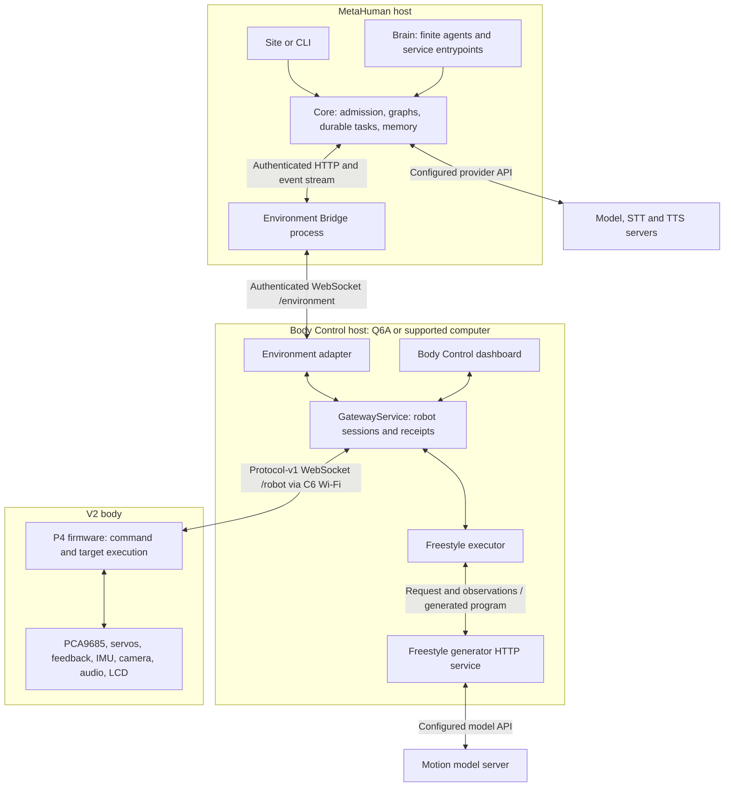

# Robot software architecture

This is the engineering map for **V2** across Ainekio and MetaHuman: processes,
interfaces, execution paths and state owners. V1 work is paused. Source paths were
traced on **2026-10-26**; this is not a claim that every checkout change is deployed.
The [design core](ROBOT_BIBLE.md) owns product intent; [V2 specifications](../../../Ainekio/docs/v2-12servo/SPECIFICATIONS.md)
own the physical assembly. Read this page before changing robot software.

## Processes and connections

**Body Control is a Python application.** Its [composition root](../../../Ainekio/Master/gateway/server/__main__.py)
creates GatewayService, the environment adapter, camera processing and the dashboard
HTTP thread. These boxes are responsibilities inside that application. Freestyle's
generator is a separate HTTP service; its executor is loaded by the dashboard into
the gateway application. The browser does not run the motion executor.

**MetaHuman is a TypeScript application.** Site/CLI call Core; Core owns domain
behavior. Brain supplies finite agent adapters and persistent service entrypoints.
Environment Bridge is a persistent process supervised through the Agent Catalog
and Agent Monitor. Model servers can run locally or remotely; assigning a model
does not move the task's durable state to that server.

| Connection | Endpoint / owner |
| --- | --- |
| Robot → Body Control | Robot initiates authenticated `/robot`, default port **8790**; gateway assigns session epochs and command sequences |
| Operator → Body Control | Dashboard HTTP, default **8791**, independent of MetaHuman's web UI |
| Bridge → Body Control | Authenticated `/environment` on **8790**; gateway accepts loopback peers. Remote SSH/Cloudflare forwarding terminates there |
| Bridge ↔ MetaHuman Core | Authenticated `/api/environment-bridge/*`: observation and result POSTs; `/stream` carries outbound work |
| Freestyle executor → generator | Configured HTTP endpoint, default `127.0.0.1:8794`; generator calls its configured model backend |

These are bidirectional information paths, not a mandatory execution sequence.
Speech, sensing, motion and inference can overlap. For an existing installation,
use the [startup guide](../../../Ainekio/docs/STARTUP.md); Ainekio's root simulator
launcher is not the physical V2 startup path.

## Follow an operation

### A request to move

1. Human input or an admitted autonomous intention reaches
   [`environment-mode.json`](../../etc/cognitive-graphs/environment-mode.json).
   Intent selects relevant context; Task Decision selects a program. The graph
   can use current execution, conversation, persona, memory and robot observations.
2. [`robot-active-task-mode.json`](../../etc/cognitive-graphs/robot-active-task-mode.json)
   advances that program inside the existing durable execution. Its
   [Active Task node](../../packages/core/src/nodes/environment/active-task.node.ts)
   uses Core's [environment contract/store](../../packages/core/src/environment-interface/)
   to admit actions and retain their identities.
3. [Environment Bridge](../../brain/agents/environment-bridge/core.ts) consumes
   Core's stream and sends the action to the gateway's
   [environment adapter](../../../Ainekio/Master/gateway/environment_adapter/server.py).
   The adapter translates the semantic request and correlates its result.
4. For `requestMotion.description`,
   [`GatewayService.request_motion`](../../../Ainekio/Master/gateway/server/service.py)
   calls the [Freestyle executor](../../../Ainekio/experiments/freestyle/bridge.py).
   Its [generator](../../../Ainekio/experiments/freestyle/generator.py) produces a
   motion program from the request and observations. The executor compiles and
   submits targets through the same gateway connection.
5. P4's [controller](../../../Ainekio/Slave/firmware/esp32p4-wifi6/main/controller.c)
   receives the wire command. Its [body executor](../../../Ainekio/Slave/firmware/esp32p4-wifi6/main/body.c)
   owns motion progress, calibrated output and measured target tracking; the
   [PCA9685 driver](../../../Ainekio/Slave/firmware/esp32p4-wifi6/components/ainekio_pca9685/pca9685.c)
   writes servo signals. LLM token generation does not clock servo frames.
6. Firmware receipts and telemetry return through GatewayService, adapter and
   Bridge to the same Core action/execution. Active Task consumes them; the
   [Goal Review graph](../../etc/cognitive-graphs/robot-goal-review-mode.json)
   assesses an eligible unfinished objective. Submission, execution completion
   and achievement of a physical goal are different results.

**Motion ownership:** Freestyle owns description-based motion, startup/wake and
first-stall correction requests. Inactivity rest/release is body-local, as
defined in [the motion contract](BODY_CAPABILITIES.md#motion-and-posture). The manual Motion Library selector affects
explicit manual controls; it does not redirect MetaHuman requests. Native motion
and low-level manual controls remain available through the same P4 owners.
MetaHuman has no active joint-generation workflow. An unavailable generator is
reported; a library movement is not silently substituted. See the
[Freestyle contract](../../../Ainekio/experiments/freestyle/README.md) for its model,
compiler, training and deployment dependencies.

### Contracts at the handoffs

| Boundary | Responsibility and reason | Behavior a change must preserve |
| --- | --- | --- |
| Graph → Core execution | Graphs compose model-selected behavior; Core owns admission and durable progress, so a second agent cannot independently claim the same objective | Preserve execution/effect/work identities, selected ordering and independent concurrent work; a graph return is not automatically goal completion |
| Core → Bridge → adapter | Core owns the requested action; Bridge transports it; the adapter translates it for the selected body | Preserve action identity, body ownership, admission, cancellation and results across reconnect; transport code does not reinterpret the goal |
| Gateway → Freestyle → P4 | Freestyle turns semantic motion into a program; gateway sends it; P4 owns physical execution and calibration | Generation failure is reported; manual library selection does not redirect semantic requests; generated targets are not measured positions |
| P4 → Core | Device and gateway evidence establishes progress and outcomes; Core correlates it to the originating work | Acceptance, termination, failure, unknown outcome and goal achievement remain distinguishable |
| Core → UI / model context | UI projects state and models receive attributed evidence | Preserve source, speaker, time and uncertainty; displaying success cannot create a receipt |

These boundaries keep body-specific execution out of cognition and task decisions
out of transports. The executable schemas remain in the [protocol](../../../Ainekio/Slave/software/protocol/README.md)
and [Core environment types](../../packages/core/src/environment-interface/types.ts);
do not copy their changing field inventories here. Model joint positions, physical
socket mappings and electrical units come from the [V2 specifications](../../../Ainekio/docs/v2-12servo/SPECIFICATIONS.md#joints-units-and-calibration).

Core's durable execution/effect identity is associated with Coordinator work and
the adapter action. The gateway then records the Freestyle job or robot session
and sequence that actually received it. A reconnect resumes delivery by those
identities; it is not a new movement request. Cancellation and manual takeover
must address the original work even if selection has changed. A successful Stop
command does not retroactively prove an earlier movement's outcome. The
[paired qualification](QUALIFICATION.md#cancellation-and-reconnect) exercises this
boundary with a simulated body.

### Hearing, speaking, seeing and body events

- **Hearing:** P4 microphone capture → gateway audio transport → Environment Bridge
  transcription through Core's STT owner → attributed observation → Environment
  Mode. A transcript and a body sensor event retain different source identities.
- **Speaking:** graph response → Core [robot speech delivery](../../packages/core/src/tts/robot-speech.ts)
  and configured TTS → Bridge → gateway speech transport → selected robot or host
  playback. Playback receipts return to the originating work. Browser audio uses
  the existing browser delivery selection.
- **Seeing:** P4 camera frames → gateway [camera plugin](../../../Ainekio/Master/gateway/plugins.py)
  and configured [perception owner](../../../Ainekio/Master/gateway/perception.py) →
  adapter/Bridge → selected graph image or observation. Acquisition, recognition,
  metric estimates and retained image identity are separate contracts.
- **Body events:** P4 IMU/feedback/device events → gateway event owner → Bridge →
  configured event workflow. The workflow selects the response. Telemetry also
  updates subscribed active tasks without becoming a new user conversation.

## Where a change belongs

Paths below are implementation owners, not proposed replacement services.

| Responsibility | Existing owner |
| --- | --- |
| P4 initialization and peripheral composition | Ainekio [`main/app_main.c`](../../../Ainekio/Slave/firmware/esp32p4-wifi6/main/app_main.c), `board.c`, `controller.c`; `components/ainekio_p4_media/` (including `imu.c`), `main/servo_feedback.c`, `main/display.c` |
| V2 kinematics, postures and native motion mathematics | Ainekio [`Slave/software/models/v2-12servo/`](../../../Ainekio/Slave/software/models/v2-12servo/); P4 `body.c` owns device execution |
| Wire fields, joint order and compatibility | Ainekio [`Slave/software/protocol/`](../../../Ainekio/Slave/software/protocol/), including `joints_v2.py`; MetaHuman [`environment-interface/types.ts`](../../packages/core/src/environment-interface/types.ts) owns its semantic side |
| Connections, authentication, command sequences and body receipts | Ainekio [`Master/gateway/server/`](../../../Ainekio/Master/gateway/server/); adapter `translation.py` and `action_receipts.py` own semantic translation/correlation |
| Learned movement generation and execution | Ainekio [`experiments/freestyle/`](../../../Ainekio/experiments/freestyle/), loaded by `dashboard/server.py`; this is an active runtime dependency despite the directory name |
| Host selection, reconnect and tunnel lifecycle | MetaHuman [connection lifecycle](../../brain/agents/environment-bridge/), [`forwarder.ts`](../../brain/agents/environment-bridge/forwarder.ts) and Bridge `core.ts` |
| Work admission and finite execution | Core [`queue/queue-system.ts`](../../packages/core/src/queue/queue-system.ts), `execution-engine.ts`; other processes submit through `work-submission.ts` |
| Graph execution, suspension, results and recovery | Core [`graph-executor.ts`](../../packages/core/src/graph-executor.ts) and [`durable-execution/`](../../packages/core/src/durable-execution/) |
| Cognitive composition and node behavior | [`etc/cognitive-graphs/`](../../etc/cognitive-graphs/README.md) connects registered [`Core nodes`](../../packages/core/src/nodes/); graph JSON is composition, not a second implementation |
| Model role resolution and transport | Core [`model-router.ts`](../../packages/core/src/model-router.ts), `model-roles.ts`, `llm-backend.ts`, [`providers/bridge.ts`](../../packages/core/src/providers/bridge.ts) |
| Agent registration and process lifecycle | Core [`Agent Catalog`](../../packages/core/src/agent-catalog-definitions.ts), `agent-process-runner.ts`; [`brain/agents/`](../../brain/agents/README.md) supplies adapters |

Site and CLI remain interfaces over Core. A UI fix does not belong in a second
brain implementation. A gateway repair does not create another body connection,
and a motion-model repair does not create a MetaHuman servo controller.

## State, memory and learning

| State | Producer and consumer | Release / retention responsibility |
| --- | --- | --- |
| Device calibration, peripherals and Wi-Fi | P4 configuration/NVS → physical executor and device setup | Device-owned configuration survives host reconnect; replacing a model or clearing a host queue does not erase it |
| Adapter action and delivery receipts | [ActionReceipts](../../../Ainekio/Master/gateway/environment_adapter/action_receipts.py) → Bridge/Core admission and evidence ingestion | Acknowledgement deletes the delivery copy. Action history remains until terminal, its observation is recorded, no delivery refers to it, and the existing age policy permits pruning. [Adapter recovery](../../../Ainekio/Master/gateway/environment_adapter/server.py) invokes that pruning; unresolved outcomes remain recoverable |
| Coordinator work and terminal results | [Queue manager](../../packages/core/src/queue/unified-queue-manager.ts) / [persister](../../packages/core/src/queue/queue-persister.ts) → executor and [durable receipt ingestion](../../packages/core/src/durable-execution/work-results.ts) | A terminal worker releases execution capacity. A durable result remains until its execution owner has committed the correlated receipt and acknowledges delivery; remaining terminal history follows the existing queue history policy |
| Goals, checkpoints, effects and evidence references | [Execution store](../../packages/core/src/durable-execution/store.ts), profile `executions.sqlite` → graph resume, result consumers and history readers | Pending delivery, unresolved effects and live writers prevent retirement. [Checkpointer](../../packages/core/src/durable-execution/checkpointer.ts) retention removes eligible terminal history and then unreferenced observations/blobs; [recovery](../../packages/core/src/durable-execution/recovery.ts) supplies unfinished-work exclusions |
| Conversation, persona and persistent experience | [Buffer admission](../../packages/core/src/buffer-admission.ts), [memory](../../packages/core/src/memory.ts) and profile owners → selected context and learning | Domain retention is independent of worker completion. Execution cleanup does not erase conversation or learned facts; attribution and deduplication belong to these owners |
| Training examples, model artifacts and CAD | Existing Core/Brain training owners, Freestyle dataset/deployment owners and Ainekio hardware owners → evaluation, serving, rollback or manufacturing | A completed training job does not make its dataset, active weights or rollback artifact an orphan. Verify references and intended retention at that owner before removal |

The table describes responsibility and current release paths, not permission to
purge data. An inactive record can still be required delivery evidence. A stored
goal can remain useful without occupying a worker. Missing release behavior must
be repaired at its producing owner and tested through normal consumption; adding
another cleanup process does not establish that the producer is correct. Exact
retention settings remain with their executable owners.

Autonomy, Desire, reflection and sleep initiate work through existing Coordinator
and graph owners. Active Operator assesses which operations to request; Desire
owns reviewed multi-step plans; Active Task executes body programs. Their
[behavior contracts](COMPANION_BEHAVIOR.md) and graph definitions specify the
differences. An agent, a graph, a model role and a persistent service are not
interchangeable names for the same thing.

Active Operator first uses the configured Orchestrator category to select context
through visible branches of its existing graph. Its autonomy model then selects
activity from the assembled evidence. The Environment graph retains its own
request routing and execution responsibilities, reusing attributed supplied
context only when its source owners can satisfy the selected scope. Persona,
buffer, memory and camera reads remain with those existing owners; there is no
second autonomy context store. See the [assessment context contract](COMPANION_BEHAVIOR.md#active-operator-execution-contract).

Full Auto must continuously select and carry out meaningful self-directed
activity through these existing owners, including reasoning, agents, tasks,
movement or Sleep. Empty decisions, idle assessment loops and event-only
suspension violate the [Full Auto contract](COMPANION_BEHAVIOR.md#full-auto-continuity--owner-contract).
The current Full Auto contract requires meaningful activity; its existing decision parser rejects empty selections. A selected operation still needs useful, varied companion behavior and actual outcome evidence before that broader capability is qualified.

The intended learning path is attributed experience and outcomes → persistence
and retrieval → reviewed examples → training/evaluation → explicit activation.
Writing memory or editing a dataset does not change running model weights.
[Models and learning](MODELS_AND_LEARNING.md) owns those details.

## Intended boundaries and remaining distribution work

P4 owns local physical execution; Body Control owns the selected body and learned
motion execution; MetaHuman owns cognition and durable objectives. Model-backed
behavior selection remains with the relevant models. Transport and UI layers
report observations and outcomes rather than choosing replacement behavior.

One Environment Bridge connects only to the explicitly selected Local, SSH, or
Cloudflare Body Control endpoint and follows its selected robot. Saved endpoints
do not start discovery or forwarding. Separate Local/Remote bridge agents are
retired. Remote forwarding belongs to the selected connection lifecycle; switching
to Local closes it. WireGuard is an independently managed operating-system network
interface, not a service started by MetaHuman. Already admitted work
keeps correlated receipts across reconnect; reconnect is not permission to repeat
a physical action. New unsolicited input requires a connected recipient.

Q6A and larger remote hosts may share the compute workload. General migration of
an active goal between MetaHuman installations, replicated durable state and
cross-installation control handoff remain design work in the
[distributed foundation](../../../Ainekio/docs/DISTRIBUTED_ROBOT_FOUNDATION.md).
Configured gateway switching does not implement that migration.

For changes, follow the affected path above and update its owner and consumers.
[Maintained Surface](../technical/MAINTAINED_SURFACE.md) owns detailed runtime
constraints; [Repair Design](../technical/REFACTOR_BLUEPRINT.md) owns the repair
method; [qualification](QUALIFICATION.md) owns observable acceptance. Keep this
page as the wiring map; repair histories and model/version inventories stay with
their existing evidence and executable owners.
